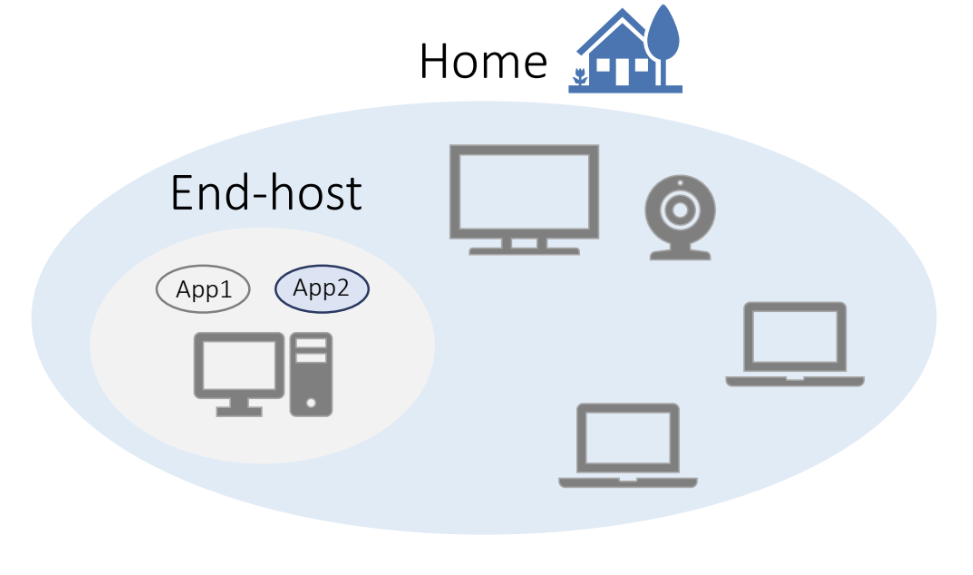
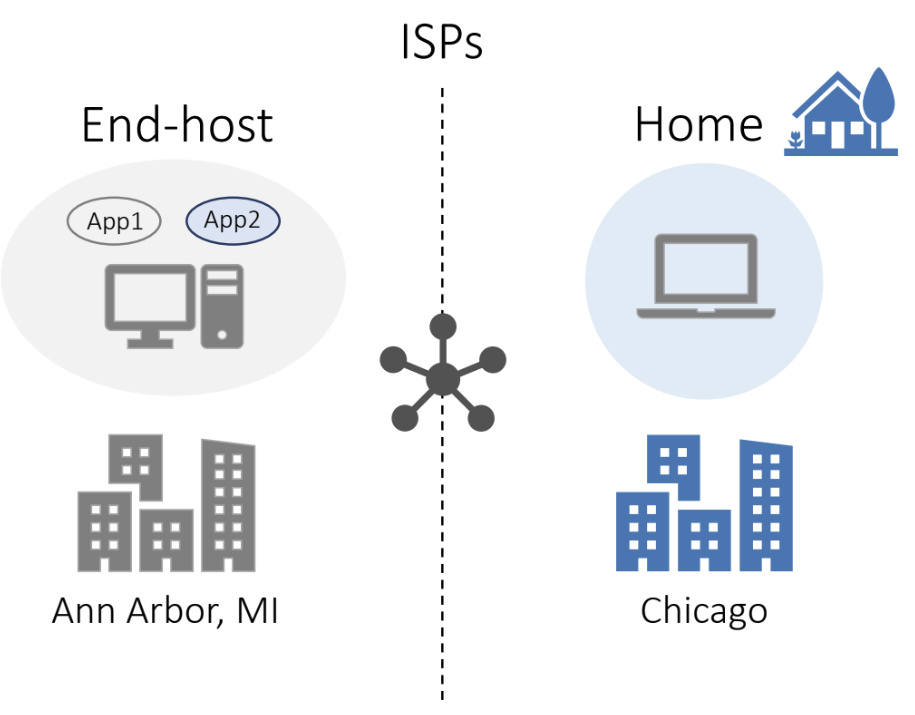
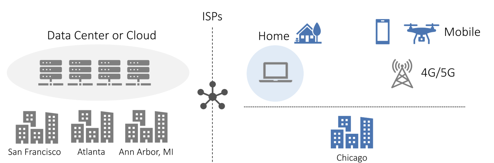
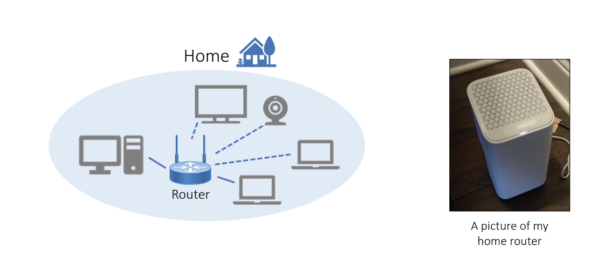
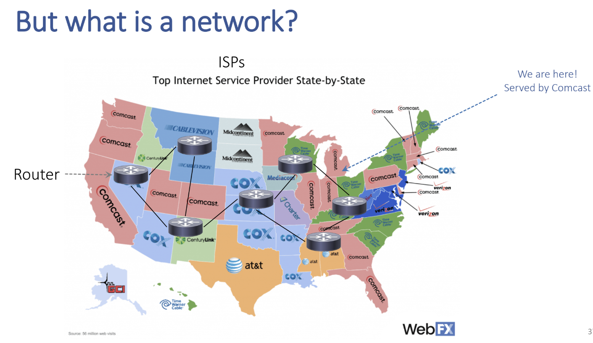
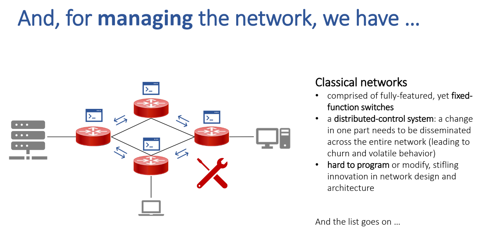
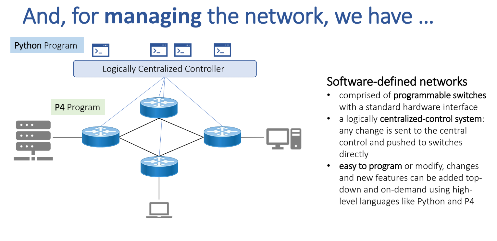

## course structure

assi 1: speed test of end-to-end throughput and delay of networks

assi 2: video streaming from CDNs

assi 3: reliable transport (transfer data over an unreliable network)

assi 4: router design (how internal elements of the network work)

bonus quizzes: 

- announced during lec

  ddl 10 p.m.

1 mid

1 final


## forms of networks

computer network: communicate data(text, voice, videos, etc) between two entities(physical devices, apps, etc)


local network:




wide area (remote network)




wide area (and cloud center)




End-hosts 比如: laptop, smartphones, and servers


Networks connecting end-hosts

- Within end-hosts
- Local area networks (like home)
- Wide area networks (cross cities)
- Datacenter networks (serving large workloads)
- 4G/5G networks (for mobile devices)
- Edge networks (moving compute closer to the user)


## communication between end-hosts by router

- **a computer network = <{lots of routers}, {lots of end-hosts}>**

end hosts communicate through router



### 物理形式: 网线 / 无线

两个路由器之间一般通过网线连接. 网线种类包括：

1. **铜缆 (以太网网线) **
   - 在局域网、数据中心或机房里, 路由器之间常常直接用双绞线 (Cat6/Cat7) 或 DAC 线连接. 
   - 适合短距离 (几米到百米). 
2. **光纤 (Fiber optic cable)**
   - 城域网、骨干网、跨国通信大量用光纤. 
   - 速率能到几十 Gbps、几百 Gbps. 
   - 跨国主要靠 **海底光缆**, 本质也是光纤, 只是铺在海底. 


也存在无线连接, 但是通常较慢：

3. **无线链路** (比如 wifi 就是一种) 

   - 卫星通信、微波链路 (微波塔之间). 

   - 适合没有光纤的偏远地区或临时链路. 

   - 缺点是带宽低、延迟高. 

总之就是：**超近距离可以 wifi, 近距离用网线, 长距离用光纤, 跨国用海底光缆, 特殊情况下用卫星/微波**. 

不过 wifi 只用在 “最后一步”：

- 终端 ↔ 接入点, 用 Wi-Fi；
- 接入点 ↔ 运营商网络, 还是光纤/铜缆. 


所以路由器分：

- **有线路由器 (以太网口) **

	每个接口 (port) 都有独立的网卡芯片, 信号只会发到那根网线连着的设备 (比如交换机、电脑). 不会「向所有方向」扩散. 

- **无线路由器 (Wi-Fi 功能) **

	天线确实是广播式发射, 覆盖一定范围 (全向天线 → 环形覆盖, 定向天线 → 特定方向). 

	但是这只是物理层的电磁波广播, **上层的包并不会无条件给所有人**, 还要结合 MAC 地址和加密. 


### interface: 两个任意路由器之间连接的实现

比如我家的路由器发出的信号, 在另一个国家的另一家人家如何收到：

End host (终端主机, 比如你的电脑、手机、服务器) 之间的数据传输可以走不同的路径, 是否一定经过路由器取决于它们所处的网络范围：

1. **在同一个局域网 (LAN) 内** (比如都接在同一个交换机 / Wi-Fi 路由器下, 并且子网号相同)

	- 它们通信时 **不需要经过路由器**. 

	- 这种情况通过 **交换机 (Switch)** 或者 Wi-Fi 的接入点来转发帧. 
	   
	   交换机通过 **MAC 地址表**学习到每个端口对应的主机, 然后点对点转发. 
	   
	   举例：宿舍里两台电脑连在同一个无线路由器的 LAN 口下, 直接走二层交换转发. 


2. **跨子网 / 跨局域网通信** : 两个 end hosts 不在同一个子网 (比如 A: `192.168.1.5/24`, B: `192.168.2.10/24`)

	- 它们之间的通信**必须通过路由器 (或者三层交换机)** 来转发. 

	- 路由器通过 **IP 地址和路由表**来决定往哪边转发, 跨网段时起到关键作用. 
	   
	   举例：你的笔记本在 `192.168.1.0/24`, 你要访问另一栋楼的服务器在 `192.168.2.0/24`, 中间一定要经过至少一个路由器. 


3. **跨广域网 (WAN) / Internet**

	- 不同 ISP 或不同国家的 end hosts, 数据一定会经过**多级路由器 (边界路由器、骨干路由器等)**. 

	- Internet 就是由路由器互联起来的, 路由器之间跑 BGP/OSPF/ISIS 等路由协议, 找到能到目标的路径. 


**总结：**

- **同子网**：不需要经过 router, 只需要交换机或无线接入点. 
- **不同子网**：必须经过至少一个 router. 
- **Internet 通信**：一定经过很多 router. 

举例：

- 如果 A = `192.168.1.5/24`, B = `192.168.1.6/24`, 
  - 子网掩码 `/24 = 255.255.255.0`, 说明这两个地址都属于 `192.168.1.0/24` 子网. 
  - 它们就能通过交换机直接通信, 不需要 router. 
- 如果 A = `192.168.1.5/24`, B = `192.168.2.6/24`, 
  - 那么一个是 `192.168.1.0/24`, 另一个是 `192.168.2.0/24`, 已经是 **不同子网**. 
  - 数据就必须发给默认网关 (router) , 由 router 转发到目标子网. 




#### 更具体: routing

两个路由器之间的交流路程 (经过几个中转) 并不是固定的, 而可能不同, 是根据 **路由表 (routing table)** 和 **路由协议 (routing protocols)** 决定的. 


不同的 routing 种类：

1. **静态路由 (static routing)**
   - 管理员手工配置：`目标网段 → 下一跳 IP`. 
   - 很死板, 适合小网络. 
2. **动态路由 (dynamic routing)**
   - 路由器之间会跑协议 (RIP, OSPF, BGP, IS-IS 等) , 自动学习和更新路由表. 
   - 它们会根据度量指标 (metric) , 比如跳数、带宽、延迟、策略, 来决定走哪条路径. 
   - BGP 甚至考虑运营商的商业策略 (便宜/贵、合作/竞争) 来选择路径. 
3. **转发过程**
   - 当路由器收到一个 IP 包时, 它查自己的路由表：
     - 如果能找到匹配的目标网段, 就交给对应的下一跳. 
     - 如果找不到, 就交给默认路由 (default gateway) , 再继续往外丢. 


不同的路由协议种类：

不同协议的机制不一样, 可以分三大类：

1. **距离向量协议 (Distance Vector, 例：RIP)**
   - 每个路由器定期把“我能到哪些网段 + 跳数”告诉邻居. 邻居再转发给它的邻居……
   
      就像打电话传话：“我能到 A, 要 2 跳”, “我能到 B, 要 3 跳”. 
   
      最终, 所有路由器都能拼凑出到各个目的网段的距离. 
   
   - 缺点：收敛慢, 容易环路. 
   
2. **链路状态协议 (Link State, 例：OSPF, IS-IS)**
   - 每个路由器发现自己直连的链路状态 (能到哪些网段、带宽、延迟) , 再把这些信息泛洪给全网. 
   
      **所有路由器最后都拿到一份完整的网络拓扑图**. 
   
      然后每个路由器自己跑 Dijkstra 算法, 算出最短路径. 
   
   - 优点：全网视图一致, 收敛快. 
   
3. **路径向量协议 (Path Vector, 例：BGP)**
   
   - 每个路由器 (AS 边界路由器) 告诉邻居：“我能到某个前缀, 而且路径是 A → B → C”. 
   
   - 邻居就能避免环路 (如果自己在路径里, 就丢弃). 
   
      这是 Internet 之所以能扩展到全球的关键. 
   
   - **这是现在用在 Internet 上的协议.** 


#### 总结: routers 之间构成的 graph

举个例子

- 你在家访问 **百度**：
  1. 你的电脑先交给家里 Wi-Fi 路由器 (1 个 router). 
  2. 家用路由器交给 ISP 的接入路由器. 
  3. ISP 的区域路由器 → 骨干路由器 → 出口路由器. 
  4. 经过跨运营商路由器, 最后进入百度的网络. 


所以说

- 路由器之间构成的网络并非是一张类似于 complete graph, 也不是完全中心化的星型图, 而是一个层次化的 graph. 每个层次都存在一些区域中心, 接收更低层次的信号并转发；

1. **接入层 (Access layer)**
   - 你的设备连到家庭/公司路由器. 
   - 这一层负责“接入”. 
2. **汇聚层 / 区域 ISP**
   - 小区/校园/公司路由器 → 区域 ISP 的核心路由器. 
   - 这一层负责把局部用户流量汇聚起来. 
3. **骨干层 (Backbone)**
   - 区域 ISP → 国家骨干网 → 跨国骨干网. 
   - 这一层是高速光纤/海底电缆, 负责跨区域、跨国的传输. 
4. **对等互联 (Peering)**
   - 不同运营商的骨干路由器之间通过 Internet Exchange (IX) 或 BGP 对等互联. 

所以：

- **本地网络内**：包直接到目标 (通过交换机或 AP). 
- **跨子网**：包交给默认网关 → 逐级 ISP → 骨干 → 目标 ISP → 目标 host. 


### data communication 所需要的要素

1. Naming: a way to uniquely identify hosts and applications within

2. Routing: a way for switches to learn routes between hosts
3. Failure handling: a way for the network to identify data loss and recover
4. Resource allocation: a way for the network to avoid congestion collapse
5. Security: a way for the network to avoid malicious behavior (e.g., DDoS)
6. …

还有很多. 


## classical networks v.s. software-defined networks



特点：

1. **Fixed-function switches**
   - 网络设备 (交换机/路由器) 功能是固定的, 由厂商预定义. 
   - 只能通过厂商提供的接口配置, 难以灵活修改. 
2. **Distributed-control system**
   - 每台路由器/交换机自己做控制决策 (运行路由协议, 如 OSPF、BGP). 
   - 如果网络中有一个变化 (例如链路断了) , 需要在整个网络传播更新信息, 所有设备各自重新计算. 
   - 容易造成收敛慢、不稳定 (volatile behavior). 
3. **Hard to program**
   - 如果想在网络里引入新功能 (比如新的转发策略) , 需要改硬件或升级固件, 非常难. 
   - 这限制了网络架构的创新. 

👉 图里：多个红色交换机互联, 分别独立运行. 维护时需要逐台配置, 就像一个个“黑盒子”. 




特点：

1. **Programmable switches**
   - 交换机是“傻硬件”, 只提供基本的转发功能. 
   - 功能逻辑可由外部程序 (比如 P4) 定义. 
2. **Centralized-control system**
   - 控制功能被抽离出来, 放到一个逻辑上集中的控制器 (Controller). 
   - 控制器知道整个网络的全局状态, 并下发规则给各个交换机. 
   - 网络的控制和数据转发分离 (control plane vs. data plane). 
3. **Easy to program / modify**
   - 通过高级语言, 运维人员可以灵活定义转发策略. 
   - 比如, 可以写一个 Python 程序, 让流量按某种策略动态分流, 而不需要改硬件. 

👉 图里：蓝色交换机下方有“逻辑集中控制器”, 上层的程序直接告诉它们该怎么转发. 


**传统网络**：分布式控制, 每个路由器/交换机自己做决定, 难以编程, 改动慢. 

**SDN 网络**：集中式控制, 交换机可编程, 控制器全局调度, 灵活可扩展. 

Note SDN:

- **逻辑上中心化 (logically centralized)**

  - 控制平面 (control plane) 的决策逻辑由一个 **控制器** 负责, 拥有全局视图. 
  - 就像有一个“大脑”, 可以看到整个网络拓扑, 然后下发转发规则给各个交换机. 

  **物理上可以分布式 (physically distributed)**

  - 实际部署时, 控制器往往不是单机, 而是一个分布式系统, 有多个实例, 保证高可用和容错. 


## IP 如何被分配

### IPv4 地址

IPv4 的地址长度是 **32 位**

因此可表示的地址总数是：
$$
2^{32} = 4,294,967,296
$$
也就是 **约 43 亿个地址**


然而——

- 其中一些被保留 (例如私有地址、环回地址、广播地址等) ，不能在公网使用. 
- 随着全球联网设备 (手机、电脑、服务器、物联网设备) 的爆炸性增长，公网可用 IPv4 地址早已分配完了. 

这就是为什么我们需要 **IPv6** (128 位地址) ，它可以提供：
$$
2^{128} \approx 3.4\times 10^{38}
$$
几乎可以给地球上每个沙粒都分配一个 IP 地址. 


### 谁分配 IP

全球的 IP 地址由 **IANA (Internet Assigned Numbers Authority)** 统一管理, 然后分层分配：

| 层级                | 机构                                 | 职责                                                |
| ------------------- | ------------------------------------ | --------------------------------------------------- |
| **顶层**            | **IANA**                             | 管理整个 IPv4 / IPv6 地址空间，并分配给各地区的 RIR |
| **地区层**          | **RIR (Regional Internet Registry)** | 按地理区域分配地址                                  |
| **国家层/运营商层** | **ISP (Internet Service Provider)**  | 把地址再分配给企业或个人用户                        |

其中 RIR, 全球根据地区有五大:全球五大 RIR (地区互联网注册机构)

| 区域                 | 机构名                                            | 负责范围                     |
| -------------------- | ------------------------------------------------- | ---------------------------- |
| 北美                 | **ARIN** (American Registry for Internet Numbers) | 美国、加拿大等               |
| 欧洲、中东、部分中亚 | **RIPE NCC**                                      | 欧洲、俄罗斯、中东等         |
| 亚太地区             | **APNIC**                                         | 中国、日本、韩国、澳大利亚等 |
| 拉丁美洲、加勒比地区 | **LACNIC**                                        | 南美洲及加勒比海国家         |
| 非洲                 | **AFRINIC**                                       | 非洲大陆                     |

所以 internet IP 确实是根据地区分配的. internet IP 也表明了你所在的地方.

例如，中国的公网 IP 地址资源大多是由 **APNIC** 分配，再下发给 **中国电信 / 联通 / 移动** 等 ISP. 


### ISP 怎么分配 IP

#### DHCP (Dynamic Host Configuration Protocol) 

我们日常用的路由器基本都是有一个 internet IP (ISP, RIR 的则可能有很多个), 在接入网线的时候被 ISP 动态分配. 每次变化的差异不会太大

动态分配方式: **DHCP (Dynamic Host Configuration Protocol) **

- 当你的路由器启动并“拨号”上网时，它会向 ISP 发出一个 **DHCP 请求**：
- ISP 的 DHCP 服务器响应
- 路由器拿到这个 IP 并配置到“WAN”接口上

- 你拔掉路由器, 过几小时重连, 也许 IP 就换了. 


#### CIDR (Classless Inter-Domain Routing) 记法

但是这是个人. 很多大公司因为需要固定的 IP, 向 ISP / RIR 申请一个公网地址段. ISP 同意后, 会进行静态分配, 把一整个子网都交给它. 然后公司内部再分配这个子网的所有 IP.

比如: 某个 ISP 把一整个子网 (例如 `203.0.113.0/28`) 路由给企业的边界路由器. 

这个子网是多大?

我们需要知道: 后面的 `/n` 表示: 这个地址段的前多少位是固定的. 也就是从第 n+1 到第 32 位的地址, 是这个子网所有的 IP. 比如这里的 `203.0.113.0/28` 即:

```
11001011.00000000.01110001.0000|0000
```

即这个子网的范围是: 

```
11001011.00000000.01110001.0000|0000 --- 11001011.00000000.01110001.0000|1111
```

其实只有 16 个 IP 地址. 


这就是 CIDR 记录方法. ISP 不会“一刀切”给所有人 `/24`，而是：

| 企业类型            | 分配方式                     | 是否需要独立公网 IP |
| ------------------- | ---------------------------- | ------------------- |
| 普通小公司          | 共享 NAT，通过 ISP 出口上网  | ❌ 不需要            |
| 有自己服务器的企业  | 动态公网 IP 或一个小 CIDR 段 | ✅ 需要              |
| 数据中心 / 云服务商 | 大段静态地址 (/24, /22 等)   | ✅ 需要很多          |

这样才能节省地址空间. 


ISP 有一个地址池 (IP Pool): 哪些 ip 范围已经被分配掉了, 哪些还可以供给 DHCP

| 字段             | 示例                   | 说明             |
| ---------------- | ---------------------- | ---------------- |
| 地址段 (CIDR)    | 47.88.32.0/20          | 这块地址池的范围 |
| 分配状态         | 已分配 / 空闲 / 保留   | 当前状态         |
| 分配对象         | 某企业 / 某省 / 某基站 | 给了谁           |
| 分配方式         | 静态 / 动态            | 固定或临时       |
| 租约时间 (lease) | 24h / 永久             | 动态地址有效期   |
| 使用记录         | 最近使用时间、客户账号 | 用于追踪与审计   |

可以把 ISP 想象成一个“房地产开发商”：

- 整个地块是它向 IANA/RIR 申请来的地址段；
- 它用网格方式划分地块 (/16 → /20 → /24...)；
- 每次出租或售出 (分配 IP) ，都要登记在册；
- 有的租约短期 (DHCP 动态) ，有的长期 (静态专用) . 


这样才能保证不会两个客户拿到相同的地址，也不会浪费空闲资源


分配结构例子:
```
APNIC 分配:  47.88.0.0/14
  ├─ 华东区: 47.88.0.0/16
  │   ├─ 上海: 47.88.1.0/20
  │   ├─ 杭州: 47.88.16.0/20
  │   └─ 苏州: ...
  ├─ 华南区: 47.89.0.0/16
  └─ 华北区: ...
```

