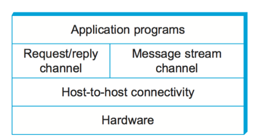
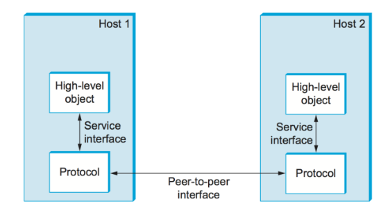
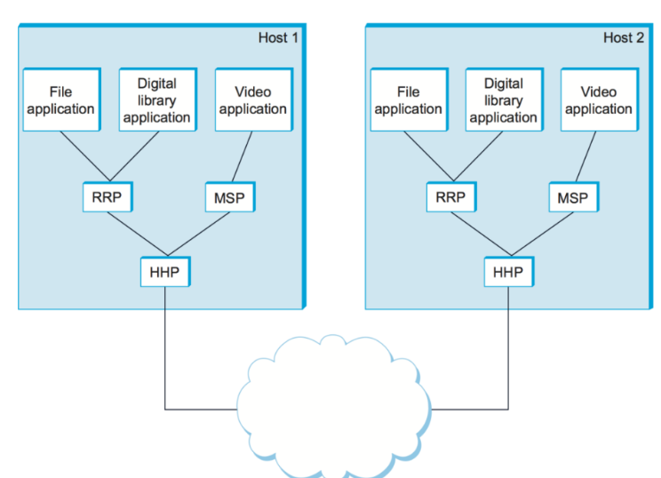
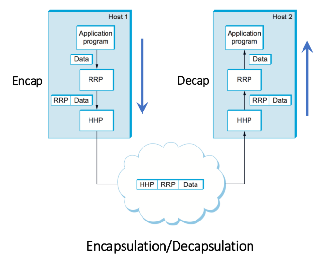
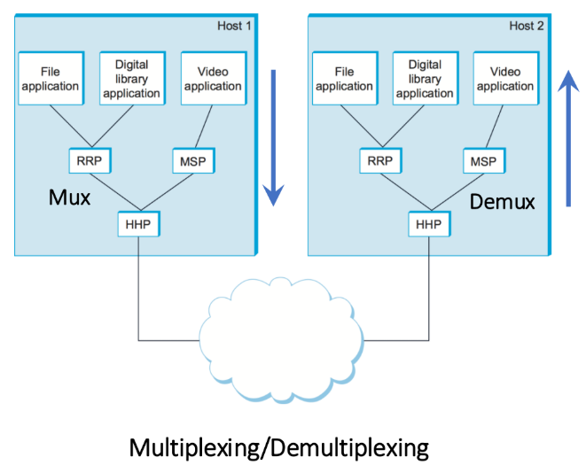
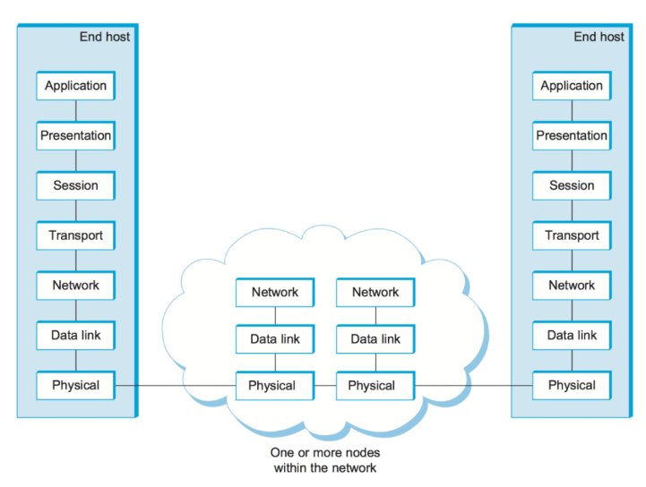
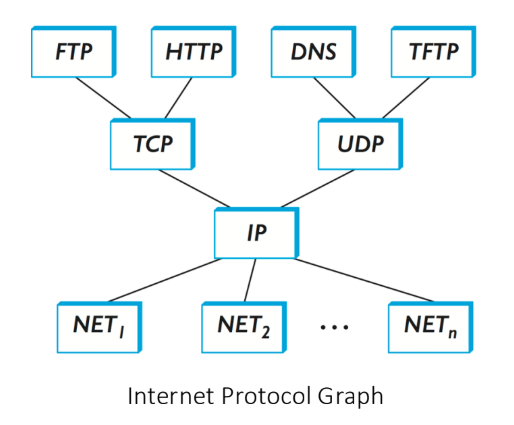
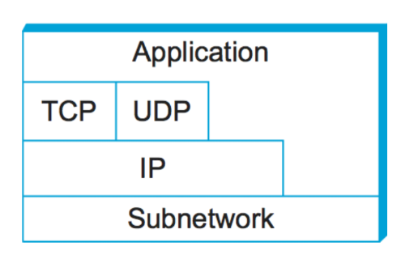

## computer network 的功能

### 通用性

1. **Built from general-purpose hardware**
   
   计算机网络是用通用硬件 (routers, switches, servers 等) 搭建的
2. **Not optimized for a particular application**
   
   不像传统的“单一用途网络”, 比如:
   - 电话网络: 只为语音通话优化
   - 电视传输网络: 只为广播电视优化
   
   计算机网络并不是专为某一类应用优化的, 而是能通过统一的架构来支持各种应用
3. **Has largely taken over functions previously performed by single-use networks**
   
   过去我们需要不同的网络来满足不同用途 (电话网, 电视网, 电报网).
   
   现在这些功能基本都被计算机网络取代了 (例如 VoIP 代替电话, 流媒体代替电视广播).

### 支持的应用类型

1. **Non-streaming apps (非流式应用) **

   - 特点: 主要处理文本, 图片, 图形; 不要求连续数据流.

   - 例子: 网页浏览 (browsing), 即时通讯 (messaging), 电子邮件 (emails). 

   - 需求: 关注数据完整性，延迟要求相对不高. 

2. **Streaming apps (流式应用) **

   - 特点: 连续传输音频/视频数据. 

   - 例子: Spotify, Netflix, YouTube, Apple iTunes. 

   - 需求: 需要一定的带宽保证流畅播放，但对偶尔的小丢包容忍度较高. 

3. **Interactive apps (交互式应用)** 

   - 特点: 强调实时交互，比如视频会议, 在线游戏. 

   - 例子: Zoom, Google Hangouts, Skype, Stadia. 

   - 延迟要求: 
     - 300ms (毫秒) 是合理的上限，再高会让用户感到明显卡顿. 
     - 100ms 被认为是非常好的体验. 

非流式应用需要可靠性，流式应用需要带宽和连续性，而交互式应用则对延迟特别敏感. 

### 现代网络的参与者 

**过去**: 主要是网络设计者 (做路由器和协议). 

**现在**: 增加了

1. **应用开发者** (做云端 app, 手机 app, 数据中心服务) 	
   - 现代互联网大多数流量来自应用层** (YouTube, Zoom, Spotify 等). 
   - 应用开发者需要构建 **云端 app** (手机上的应用) 和 **服务** (运行在数据中心的服务). 
   - 他们推动了网络对 **性能 (低延迟, 高带宽) ** 和 **功能 (安全, QoS) ** 的新要求. 
2. **网络运营商** (管理大型数据中心和 ISP). 
   - 今天的网络规模巨大 (全球 ISP, 大型云数据中心). 
   - 要保持网络稳定, 可扩展, 可管理，需要运营商来负责运行和维护基础设施. 
   - 运营商对网络自动化, 监控, 调优 有强烈需求，也影响网络的演进方向. 

## 现代网络的需求

### Scalable Connectivity: direct links -> switched network -> internet

现代 computer network 支持大量主机. 

由这些结构的演变和扩展实现: 

- 最开始是 point to point / multiple access 的网络
- 之后被改进为 switched network
- 而多个 swithced networks 通过路由器进行 Interconnection, 形成互联网

> switched network: 
>
> - 使用交换机 (switches) 连接多个主机
> - 不会像多路接入那样所有人都共享一条链路, 而是通过交换机进行转发, 只把数据发给目标设备.
>   - 避免冲突, 效率更高
>   - 支持更多的主机同时通信
> - eg: 以太网 (Ethernet) 一般都是交换机连接每台电脑
>
> internet:
>
> - 把多个交换网络 (每个云状部分) 再通过路由器 (routers) 连接起来, 形成一个更大的网络集合 → 互联网 (Internet).
> - 路由器的任务是: 
>   - 选择路径, 把分组从一个网络送到另一个网络.
>   - 让不同类型的网络 (以太网, WiFi, 光纤) 都能互联.
> - eg: 家庭 WiFi 路由器其实就是把你家里的小网络接入到 ISP 的大网络, 再连接到全球互联网.
>

### Cost-effective Resource sharing

以 Circuit-Switched Network (电路交换网络) 被改进为 Packet-Switched Network (分组交换网络) 作为例子.

- Circuit-Switched Network: 建立专用通路, 一次只能一对主机使用, 每次发送 stream of bits.

- Packet-Switched Network: 不专门 establish paths, 而是动态学习 routes

  存储并转发 packets (**一个 packet 是一个 fine-grained unit of transmission**), 支持任意对主机同时通信, 且能复用 (multiplex) 链路资源.

  实现方法: 

  - 同一个 switched 网络里每个主机的数据都被切分为 packets. 
  - packets 统一送到 switch
  - switch 把不同来源的 packets 都**复用 (multiplex) 到同一条 link 上, 按顺序转发**, 最终达到目标主机. 
  
  对于链路的共享使得 Packet-Switched Network 比起 Circuit-Switched Network 更加高效.

### separation of concern

关注点分离 (Separation of Concern): 指现代网络设计提供一些通用服务, 让用户在应用时只需要调用这些 abstraction, 而不用处理底层细节.

比如, 网络抽象出了这两类 Common Communication Primitives (通信原语):

**Request–Reply Messages (请求–应答消息)**

- 应用: 文件传输, 网页浏览
- 要求:
  - 每条消息必须**完整送达, 不丢失** (every message is delivered) 且只送一次, **不重复** (received only once)

**Streaming Messages (流式消息)**

- 应用: 视频点播, 视频会议
- 要求:
  - 支持单向或双向通信 (one-/two-way comm)
  - **不保证完全可靠** (允许丢包), 但必须保持**顺序正确** (packets are received in-order)

并且, separation of concern 还保证了 reliable message delivery. 即: 网络必须保证消息可靠送达, 即使发生以下问题:

- **Bit errors over physical links**: 比特错误 (如电力干扰)
- **Packet loss**: 分组丢失 (如交换机拥塞)
- **Node or link failures**: 节点或链路失效 (如配置错误或断电)

通过网络层及以上的协议 (如 TCP) 提供 **可靠传输服务**, 让应用不用处理这些细节.

### Manageability

网络需要能够被监控, 调试, 改变.

- 强调自动化和自适应设计.
- 传统上追求稳定, 但云计算推动了更快的功能更新.

## Layering and Protocols

我们提到了 separation of concern (即: 接口抽象化), 但是如何实现?

其实现工具: layering 和 protocols.

### 分层 (Layering)

- 把建网问题拆解为更易管理的组件. 
- 模块化设计: 新服务只需改单层，能复用其他层. 
- **同一层可能有多种抽象** (如: request-response 服务 vs. 流媒体服务) . 

### 协议 (Network Protocols)

协议是组成某一层的 **abstract objects**.

它的作用是**提供通信服务 (communication service)**, 让上层对象能够交换消息.

protocols 会提供两个接口: 
- **直接服务接口 (Service Interface)**: 提供给本机内部, 给上层(应用层) 对象来调用.
- **点对点接口 (Peer Interface)**: 和远端同层对象交互. 

协议图 (应用层有 File/Video/Library；进程间通信层有 RRP, MSP；主机间通信层有 HHP) . 

#### example: 更加具体和复杂的 layer graph

一个例子 of network architecture: 

上层是 application layer, 中层 **(进程间通信层)** 是:

- Request/reply protocol (RRP, 类似 HTTP)
- Message stream protocol (MSP)

再往下是比它们更加底层的 protocol **(主机间通信层, 相当于 TCP/IP 体系里的Transport 层)**:

- Host-to-host comm. protocol (HHP, 类似 TCP/UDP)

Notice: 虽然只有 Link 层的协议 (Wifi, 以太网) 会直接调用物理层和远程沟通数据, 但是每一层的协议都存在 Peer Interface. **中间层 (比如这里的 RRP, MSP, HHP) 的协议可以通过调用更底层的协议来达成这个 interface.**

eg: 应用层协议调用 TCP -> TCP 调用 IP -> IP 调用 WiFi 协议 -> 通过基站最终传输数据.

(不过, 这个一级一级未必是必需的. 有些应用可以跳层, 直接绕过传输层, 调用 IP 层. 之后再说.)

#### Encapsulation/Decapsulation, Multiplexing/Demultiplexing 

- **Encapsulation/Decapsulation (封装/解封装)**: **单条数据在层次间如何逐层打包/解包的过程.**

  数据逐层封装来传输出去; 接收者再逐层解封装.

  Encapsulation (封装) 发生在发送端:

  - 应用程序产生的数据交给 RRP.
  - RRP 在数据外面加上 RRP 的 header.
  - 然后交给 HHP, HHP 再加上 HHP 的 header.
  - 最后发到网络上, 数据包看起来是 `[HHP][RRP][Data]`.

  Decapsulation (解封装) 在接收端:

  - HHP 收到包, 读掉自己的首部, 把剩下的交给 RRP.
  - RRP 读掉自己的首部, 把真正的数据交给应用程序.

  

- **Multiplexing/Demultiplexing (复用/解复用)**: **多条数据流如何共享同一层的服务, 并在接收端被正确区分**.

  - Multiplexing  (复用) 发生在发送端:
    - 多个应用 (File app, Digital library app, Video app) 同时使用网络.
    - 它们的数据分别走 RRP 或 MSP, 但最后都通过同一个 HHP 传到网络.
    - HHP 必须支持同时承载多个上层协议的数据.
  - Demultiplexing (解复用) 发生在接收端
    - HHP 收到数据包后, 根据包头信息 (比如协议号, 端口号) 把数据交给对应的上层协议 (RRP 或 MSP).
    - 上层协议再交给对应的应用.

  

### ex of Network Architectures

#### 7-layer OSI Model (已不再使用)

这个过去使用的 model 把 network functionality 分为了 7 个 layers.

#### TCP/IP 四层架构 (最常用)

四层:

- Application (应用层): FTP, HTTP, DNS 等. 
  - **Service interface**: 提供给应用开发者的 API, 例如 HTTP 的 `GET`/`POST` 请求接口, DNS 的查询接口.
  - **Peer-to-peer interface**: 两台主机上的应用层对象 (例如 Web 浏览器和 Web 服务器) 逻辑上直接交换 HTTP 请求/响应, 或者 DNS 查询/应答.
  - 实现方式: 调用 Transport 层 (TCP/UDP) 的 service interface 来完成消息交付.
- Transport (传输层): TCP (**Reliable byte stream service**) , UDP (**Unreliable datagram delivery**).
  - **Service interface**:
    - TCP 提供可靠的字节流接口 (socket API, send/recv).
    - UDP 提供不可靠的数据报接口 (socket API, sendto/recvfrom).
  - **Peer-to-peer interface**:
    - 两台主机上的 TCP 对象逻辑上在交换 **segment**.
    - 两台主机上的 UDP 对象逻辑上在交换 **datagram**.
  - 实现方式: 通过调用 **Network 层 (IP) 的 service interface** 来交付 segment/datagram.
- Network (网络层): IP 
  - **Service interface**: 提供数据报传输, 上层 (TCP/UDP) 可以调用 `send IP packet`.
  - **Peer-to-peer interface**: 两台主机的 IP 层逻辑上在交换 **IP datagram**.
  - 实现方式: IP 自己也不能直接送比特, 它通过调用 **Link 层 (Ethernet/WiFi) 的 service interface** 来把 IP datagram 放在帧里传输.
- Link (链路层): Ethernet 以太网 / wireless 无线网.
  - **Service interface**: 提供点到点或多路接入的帧传输接口. 上层 (IP) 可以请求 “把这个 IP datagram 封装成帧并发出去”.
  - **Peer-to-peer interface**: 两个相邻节点的链路层在交换 **frames**.
  - 实现方式: 链路层最终通过物理层 (物理信号, 比特流) 来真正传输数据.

整个过程类比:

- Application: 写信 (HTTP request).
- Transport: 装进信封, 保证信件完整 (TCP).
- Network: 决定走哪条路线 (IP).
- Link: 具体放到哪辆卡车/飞机 (Ethernet/WiFi).

注意: 

- 不严格分层 (比如应用层可直接调用 IP 层).
- 协议如“沙漏”形状, **IP 是核心共享点**, 统一异构网络 (heterogenous networks) 的分组传输. 

https://www.wireshark.org/