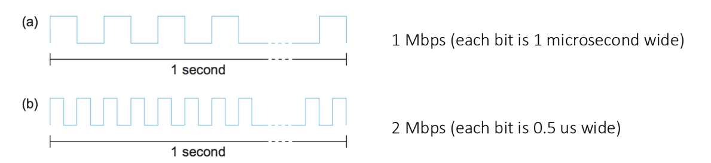
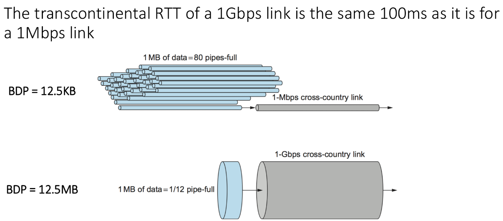
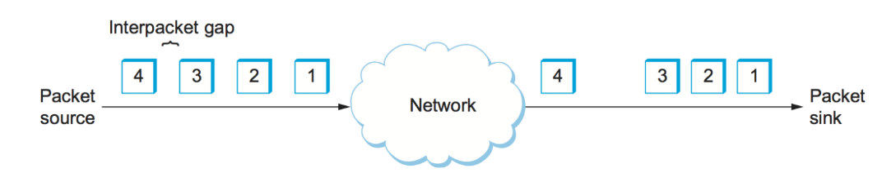
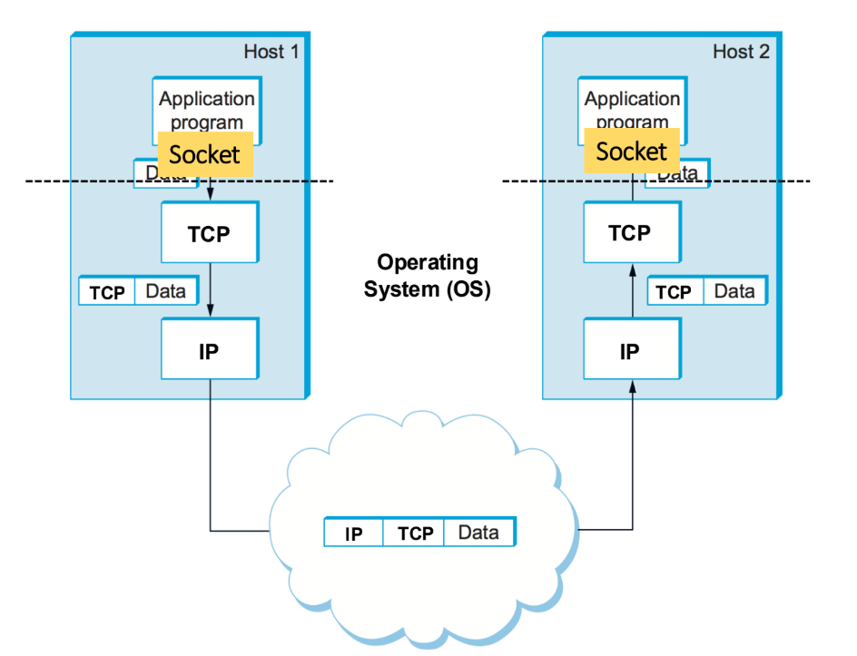
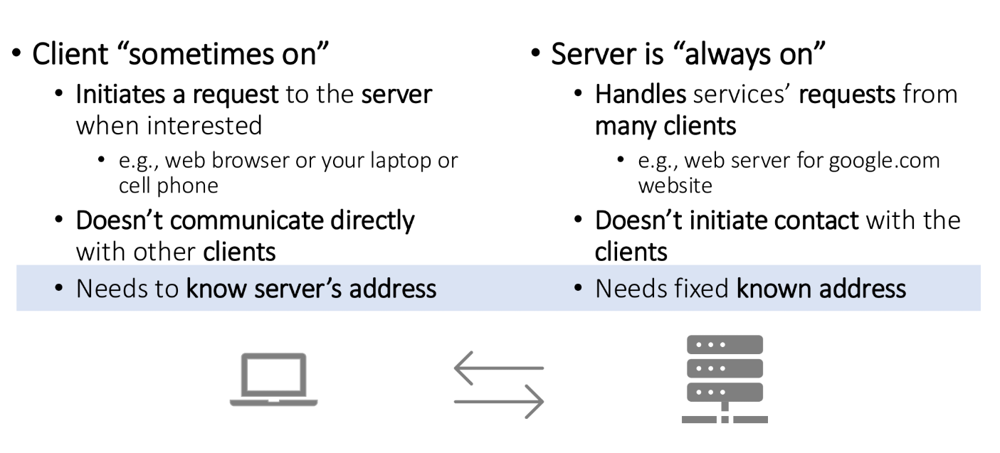
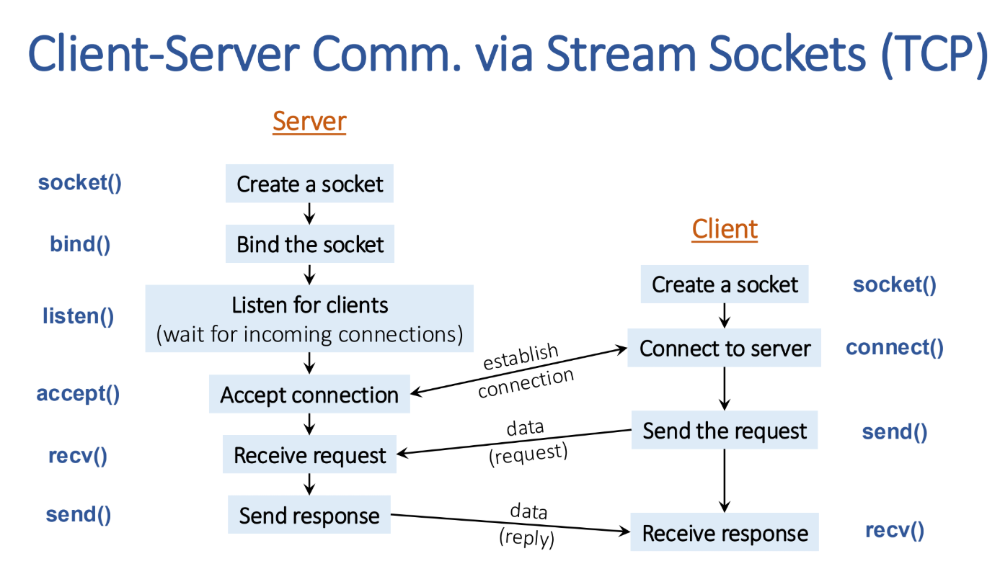
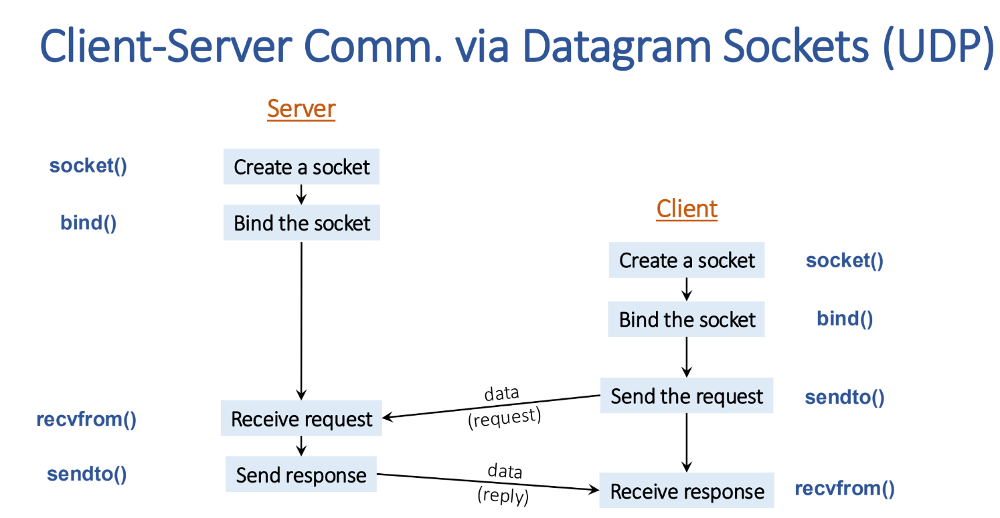

## Measuring Network Performance

测量 network 的 performance 的两个 fundamental metrics:

- **bandwidth (带宽)**: link 的最大传输能力 (数据量/时间), 单位为 bit/s, Mbps, Gbps 等

  而更加精确的测量: 是 **throughput**, 表示测量时间内实际上的传输数据量.

  throughput 不仅受到 bandwidth 影响, 同时受到: 网络堵塞, 协议开销, 丢包等影响.

  并且, 对于 TCP 等窗口协议 (窗口就是受到 ACK 前, 发送端最多发送窗口大小的数据), 如果窗口设置得太小, 那么 throughput 还受到 latency 和窗口大小影响.

- **latency (延迟)**: 任意数据 (无关数据量) 从一段传输到另一端需要的时间


### bandwidth

bandwidth: link 理论传输速率最大值 (即: **单位时间内一次能发多少 bits**), 由硬件规格决定

- 网络接口, 光纤/以太网协议本身就规定了带宽 (如 100 Mbps, 1 Gbps, 10 Gbps)
- ISP 套餐给出的数字其实就是带宽上限

throughput: 实际传输速率, 可以通过测速工具测量
$$
\text{Throughput} = \frac{\text{实际成功传送的数据量 (bits)}}{\text{传输时间 (seconds)}}
$$



### latency

latency 指的是: 数据传输的延迟.

常见标准: **Round trip time (RTT)**, 指一个 packet 从一段到另一端再返回, 一个周期的时间.

latency 和 bandwidth 有一点关系, 但不多 (真的只有一点点)

- 这一部分叫做 transmit delay, 基本可以忽略不计. 

  因为: latency 是以每个 packet 为单位计算的而不是以每个 bit 为单位计算的. 

  除了 propagation delay 和 queuing delay 外, 整个 packet 一开始被推出来也需要一点时间 (第一个 bit 几乎没有 transmit delay, 这个 packet 的 transmit delay 指的是最后一个 bit 被推出来的时间)

  即 packet size (比如1KB) / bandwidth (比如 100MB).

- 但是, 这个影响是一次性的而不是持续的. 所有数据受到同一个 latency 影响, 不会叠加

  (所以高带宽和低延迟基本没关系)

  


**计算 latency (RTT) 的方法:**
$$
\begin{aligned}
& \text { Latency }=\text { Propagation }+ \text { Transmit }+ \text { Queue } \\
& \text { Propagation = Distance/SpeedOfLight } \\
& \text { Transmit = Packet Size/Bandwidth }
\end{aligned}
$$
eg:  a message from west coast to east coast might take 24ms

其中各个部分:

1. **Propagation delay (传播时延)**, 主要
   $$
   \text{Propagation} = \frac{\text{Distance}}{\text{Speed of Light in Medium}}
   $$

   - 取决于信号在物理介质中的传播速度 (通常是光速的 2/3 左右). 
   - eg: 光纤中 200 km → 约 1 ms 的传播时延.

2. **Transmit delay (传输时延)**
   $$
   \text{Transmit} = \frac{\text{Packet Size (bits)}}{\text{Bandwidth (bps)}}
   $$

   - 已经描述过
   - 举例: 在 10 Mbps 链路上传输 1,000 bits → 需要 100 μs.

3. **Queueing delay (排队时延)**

   - 数据包在路由器/交换机队列中等待转发的时间.
   - **不确定性**很大, 取决于网络拥塞情况, 范围可能是 μs 到数百 ms.


### bandwidth 和 latency 对于 nerwork performance 影响的相对重要性

bandwidth 和 latency 共同决定了 network performance. (传输速率和传输延迟都是 performance 的衡量标准.)

但是, bandwidth 和 latency 对于 performance 的相对重要性取决于应用类型:

**小消息 (例如 1-byte)**:

- 属于 **latency bound** (latency 主导)
- 因为消息很小, 传输时间几乎可以忽略.
- 举例：
  - 在 **1 Mbps** 链路下, 传输 1B 需要 8 μs.
  - 在 **100 Mbps** 链路下, 传输 1B 只需 0.08 μs.
  - 但是 propagation delay 通常在 1 ms 到 100 ms, 远大于传输时间, 所以 delay 占主.

**大文件传输 (例如 1 MB):**

- 属于 **bandwidth bound** (带宽主导).
- 举例：
  - 在 **1 Mbps** 链路下, 传输 1 MB 需要大约 8 秒.
  - 在 **100 Mbps** 链路下, 只需要 0.08 秒.
- 此时 delay 几乎可以忽略, 带宽成为瓶颈.

所以: 大文件的传输效率主要受到 bandwidth 限制. 而小文件传输效率受到 delay 影响更大.


### why latency matters

低带宽 -> 低 throughput 或者高延迟都会使得 send / recv 数据的时间变长.

假设: 

- 服务器上一段程序因为 recv all 而 block, 等到所有数据都收到才进行下一步操作. 那么如果因为高延迟 / 低 throughput 导致晚收到数据 100 ms;
- 程序每秒可以执行 100 billion 个操作

那么这个机器每次 recv, 就会浪费 10 billion 次运算不用.


## 提高 network performance

### BDP (Bandwidth–Delay Product) -> 调整窗口大小, 提高 throughput

带宽是物理设施决定的, 无法提高. 除非更换物理设施 (例如从铜缆到光纤), 升级路由器等; 或者无线场景下 → 使用 更宽频谱 / 更先进的调制方式 (例如 WiFi 6 → WiFi 7).

不过, throughput (总是 ≤ bandwidth) 却是可以提高的.

首先看这个测量计量:

**BDP (Bandwidth–Delay Product)** 表示一条链路在“稳态”下能同时容纳多少数据.
$$
\text{BDP} = \text{Bandwidth} \times \text{RTT}
$$

- **单位**: bits (或 bytes)
- 含义: 在一个往返时间 (RTT) 里，链路上“正在飞行”的数据量

类比水流:

- **Bandwidth** = 水管的粗细 (流速)
- **Delay (RTT)** = 水管的长度 (水从头到尾要多久)
- **BDP** = 水管里“同时在管子里的水量”


测量 BDP 的用处:

- 对于 TCP 等窗口协议, 发送端维护一个 **发送窗口 (send window)**, 窗口大小 = `min(rwnd, cwnd)`. **rwnd (接收窗口)**: 接收方通告的缓冲区大小

  - **cwnd (拥塞窗口)**: 发送方根据网络拥塞情况动态调整

- 这个窗口是收到 ACK 前发送的数据的最大量. 

  - 也就是说: 数据不是全部发送的, 而是每次去 -> 收到 ACK -> 返回的一个 round 都发送一个 ACK)

  - 因而 throughput 在这种情况下的真实计算是:
    $$
    \text{Throughput} \leq \min\Big(\text{Bandwidth}, \frac{\text{Window Size}}{\text{RTT}}\Big)
    $$
    **受限于延迟 (RTT) 和 window size** (当然, 带宽真的很低的话还是受限于带宽)

- 所以为了充分利用带宽, 需要调整窗口协议 **TCP 窗口大小**

  - 为了“填满管道”, 发送端的 **拥塞窗口 (cwnd)** 至少要等于 BDP.

  - 否则链路带宽就浪费了 (管子里没有足够的数据在飞).


eg: 假设 windows size 是 1MB, RTT 是 100 ms, 带宽是 1Gbps

- 那么 throughput 是 1MB/100ms =  80 Mbps << 带宽.

提高 windows size 到 BDP = 100 ms * 1Gbps = 12.5 MB, 

- 则 throughput 就被提高到了带宽的水平 (1Gbps)


### 减少 jitter (packets 间的 latency variation)



**Jitter** = packet 到 packet 之间 latency 的波动.

- 如果所有包的延迟都一样 → jitter = 0
- 如果有的包快，有的包慢 → jitter > 0

原因: Network 中拥塞, 路由不同, 以及 queuing 等因素.

影响:

- 对于**Streaming (视频/音频)**：jitter 会导致播放不连续 (卡顿、声音断裂).

因而, 对于流式数据, jitter 也是 network performance 的另一个指标 (除了延迟, 带宽外).


**解决办法 (缓冲)**：

- 如果知道 latency 的上下界, 可以延迟播放, 让接收端有 buffer, 平滑 jitter.
- 例如: 视频播放器通常预加载几秒, 避免因 jitter 导致卡顿.

但是, 对于 zoom 这类实时传输的交互性应用, 则不行. 因为会严重影响对话. 这种情况只能依靠**低延迟传输 + 抗丢包算法**, 而不能靠大缓冲.


### 降低 latency

降低 latency 是 network performance 优化里最难的部分.

我们可以把 latency 分成几部分, 分别再看对应的改善方法:


Propagation delay:

- 由**地理距离**和**介质中的信号速度**决定 (光纤 ≈ 光速的 2/3)
- **几乎无法优化**, 唯一办法是缩短路径.
  - 部署 **CDN / Edge Computing (边缘计算)** → 把服务器放到离用户更近的地方
  - 使用更直的链路 (减少路由绕路)
  - 采用卫星星座 (Starlink) 等低轨道方案, 缩短物理路径.

Transmit delay: 

- 要么提高带宽 (物理), 要么减少 packet 大小 (使用更轻量协议)

Queueing delay (排队时延): 

- 由网络拥塞造成, 是最不稳定的部分. 算法可以提升

  - 避免链路过载 → 增加链路容量

  - 使用 **QoS (Quality of Service)**, 优先转发低延迟流量 (VoIP, 游戏).

  - 使用 **主动队列管理 (AQM)** 算法, 比如 RED/CoDel, 减少 bufferbloat.

  - 在客户端或路由器开启智能排队, 保证关键流量低延迟.


彩蛋: https://www.speedtest.net/ 进行 network performance 检测.


## socket: 用户进程使用 network 进行交流的标准 interface

### 网络数据传输的 division of labor

我们在 lec 2 中讲述了: 网络数据传输的各层 protocols.

而它们分别都用什么方法把数据传递给下一级?

实际上, 在 application layer 之下, 所有的这些过程都由 socket (os 里的 network 虚拟化, 详见 Operating Systems 笔记) 进行封装. application 只需要调用 socket 就可以.

其下的层级, 全部都在 Operating System 里 (写它们不是 application 的责任, 而是操作系统应该实现的.)



因而层级自上而下为:

- Application
  - Read data from and write data to the socket API (socket 本体写在 OS 里)
  -  如果是读取数据 -> 那么翻译它, 并用于程序 (比如 render a webpage)
- Operating System
  - 把数据传输给 destination socket (file descripter), 基于 destination port number
- Network
  - 把数据切分成 data packets 传输给 destination host, 基于 destination host id (i.e., IP address)


### client-server communication



network programming 最常用的架构: server-client.

**Client (客户端):**

- 只在用户需要时才向服务器发起请求. 例如我们自己的浏览器.

- 客户端之间不直接通信, 而是通过服务器间接通信.
- **Needs to know server’s address**: 必须知道服务器的 IP 地址或域名 (比如 `google.com`) 才能发起请求.

**Server (服务器):**

- 必须 24/7 保持在线, 随时响应客户端请求.

- 同时为成千上万个客户端提供服务 (比如 Google 的 Web 服务器).

- 不会主动去找客户端, 而是等待客户端来请求.

- **Needs fixed known address**: 服务器必须有一个固定且公开的地址 (IP/域名), 客户端才能找到它. 

  (recall: 一些服务器会更换域名, 但总会保留之前的域名一段时间, 允许客户端查看, 告知它们之后会更换. 记得小时候看不正规的色情网站都要经常看一眼, 以防被审了换域名, 错过通知时间就找不到那个网站了. 小时候经常发生这件事情, 不过总是能找到同学最近浏览过, 问他要新域名)


https://www.iana.org/assignments/service-names-port-numbers/service-names-port-numbers.xhtml: 这个网页是 **IANA (Internet Assigned Numbers Authority)** 维护的 **Service Names and Port Numbers** 注册表. 

- 它是 **全网的标准端口号数据库**。
- IANA 负责为互联网中的各种服务分配和管理 **well-known ports (知名端口)** 和 **registered ports (注册端口)**。
- 这个页面列出了每个端口号对应的协议和服务. 


在 TCP/UDP 传输中, **端口号**用来区分不同应用. 为了避免冲突, 某些端口号被“标准化”分配给特定服务.例如：

- **HTTP** → TCP port 80
- **HTTPS** → TCP port 443
- **DNS** → UDP/TCP port 53
- **SSH** → TCP port 22

这样全世界的应用都遵循相同的端口习惯, 保证互通.


IANA 将端口分为三类：

- **Well-known ports (0–1023)**
  - 固定给系统服务和常见协议
  - eg: 80 (HTTP), 25 (SMTP), 443 (HTTPS)
- **Registered ports (1024–49151)**
  - 用于用户进程或第三方应用, 可以向 IANA 注册
  - eg: 3306 (MySQL), 5432 (PostgreSQL)
- **Dynamic / Private ports (49152–65535)**
  - 不注册, 供临时连接使用


### socket programming 回顾

socket 编程的 notes 在 Operating Systems 的笔记里.

这里浅浅 recap 一下. 

#### 5-tuple: 唯一地确定一条 socket 连接

一条 socket 连接可以用以下**五个元素**唯一确定:

1. **源 IP 地址 (Source IP)**
2. **目的 IP 地址 (Destination IP)**
3. **源端口号 (Source Port)**
4. **目的端口号 (Destination Port)**
5. **传输层协议 (Transport Protocol)** → TCP 或 UDP


#### TCP 和 UDP 的 socket 连接与传输范式

TCP sockets:



UDP sockets:




#### python interface

服务器端 (Server)

1. **创建 socket**

   ```python
   server_socket = socket.socket()
   ```

   - 创建一个 TCP socket

2. **绑定地址和端口**

   ```python
   server_socket.bind(("0.0.0.0", 8080))
   ```

   - 绑定到本机所有 IP 地址 (0.0.0.0) 的 8080 端口
   - 也可以用 `"127.0.0.1"` 表示只接受本地连接

3. **监听连接**

   ```python
   server_socket.listen(10)
   ```

   - 开始监听客户端请求，最多允许 10 个等待连接的排队

4. **接受连接**

   ```python
   new_sock, address = server_socket.accept()
   ```

   - 阻塞等待客户端连接。
   - 返回一个新的 socket (`new_sock`) 用于和该客户端通信

客户端 (Client)

1. **创建 socket**

   ```python
   client_socket = socket.socket()
   ```

2. **连接服务器**

   ```python
   client_socket.connect(("127.0.0.1", 80))
   ```

   - 主动连接服务器 IP 和端口。

3. **发送数据**

   ```python
   client_socket.send(b"hello!")
   ```

4. **接收数据**

   ```python
   data = client_socket.recv(100)
   ```

   - 一次接收最多 100 字节。

注意点

- **send/recv 是阻塞的**
  - 调用会一直等到数据被成功发送/接收, 才返回.
- **Server 必须先启动**, Client 才能连接.
- **Server 用 `accept()` 返回的新 socket** 来和某个客户端通信，而不是 `server_socket` 本身。

总结:

**Server**: `socket → bind → listen → accept → send/recv`

**Client**: `socket → connect → send/recv`


#### C interface

服务器端

1. **解析地址和端口** (自己填写 hints 信息)

   ```c
   getaddrinfo(NULL, MY_PORT, &hints, &result);
   ```

   作为服务器, IP 不用填写. NULL 表示监听本机所有 IP (v4,  v6, 多网卡, 多 ip 等). 这可能会导致 result 有多个结果, 不过如果只是 IPv4 和 v6 的问题, 那么我们可以在 `hints.ai_family` 中定好

   Port 可以自己填或者填 0 让 OS 自己决定怎么分配 (但是如果这样的话, 非 well-known ports 就一定要打印出来, 这样自己才知道, 才能告诉 client)

   填写 hints 主要就是:

   - `hints.ai_family`: 地址族 (IPv4/IPv6).

   - `hints.ai_socktype`: TCP (SOCK_STREAM) 或 UDP (SOCK_DGRAM).
   - 返回可绑定的地址信息链表, 存进 result 里面.

2. **创建 socket**

   ```c
   sockfd = socket(result->ai_family, result->ai_socktype, result->ai_protocol);
   ```

   如果 result 有多个结果并且你都想监听, 那么可以遍历, 全部都尝试获取 sockfd, 等i西安全部都绑定并 listen 并接受链接.

3. **绑定 IP 和端口**

   ```c
   bind(sockfd, result->ai_addr, result->ai_addrlen);
   ```

4. **监听连接 (TCP 专用)**

   ```c
   listen(sockfd, QUEUE_LENGTH);
   ```

   - 开始监听, 队列中最多容纳 `QUEUE_LENGTH` 个等待连接的客户端.

5. **接受连接**

   ```c
   new_fd = accept(sockfd, (struct sockaddr *)&their_addr, &addr_size);
   ```

   - 返回一个新的 socket `new_fd`, 用于和该客户端通信.
   - 原始的 `sockfd` 继续监听其他连接.

客户端:

1. **解析目标地址和端口**

   ```c
   getaddrinfo(SERVER_HOST, SERVER_PORT, &hints, &result);
   ```

   注意, 客户端必须完整填写 server 的 ip 和 port. 

   **(ip 可以填写域名, port 可以填写 “http” 等 (well-known), 让 os 自己根据 DNS 缓存或者 /etc/hosts 文件进行解析. (找不到的话, OS 也会向 ISP 提供的 DNS 服务器查询, 不用我们担心)**

   - `hints.ai_family = AF_INET` (IPv4)
   - `hints.ai_socktype = SOCK_STREAM` (TCP)
   - `hints.ai_flags = AI_PASSIVE` (用于 server 绑定)

2. **创建 socket**

   ```c
   sockfd = socket(result->ai_family, result->ai_socktype, result->ai_protocol);
   ```

3. **连接服务器**

   ```c
   connect(sockfd, result->ai_addr, result->ai_addrlen);
   ```

   - 向服务器发起 TCP 三次握手.

4. **发送数据**

   ```c
   bytes_sent = send(sockfd, msg, len, 0);
   ```

5. **接收数据**

   ```c
   recv(sockfd, buf, len, flags);
   ```


总结

| 步骤        | Server                       | Client                         |
| ----------- | ---------------------------- | ------------------------------ |
| 地址解析    | `getaddrinfo(NULL, port, …)` | `getaddrinfo(server, port, …)` |
| 创建 socket | `socket()`                   | `socket()`                     |
| 绑定地址    | `bind()`                     | —                              |
| 监听连接    | `listen()`                   | —                              |
| 接受连接    | `accept()` (得到新 socket)   | —                              |
| 发起连接    | —                            | `connect()`                    |
| 数据传输    | `send()/recv()`              | `send()/recv()`                |

**Server**: `socket → bind → listen → accept → send/recv`

**Client**: `socket → connect → send/recv`


#### 小问题: Byte Order

网络序总是 big endian 的

host 序根据主机不同. 有些是 big, 有些是 small endian.

只要在传递, 接收数据的时候用 `htons`, `htonl`,`ntohs`, `ntohl` 就好了.

`l`, `s` 是 Long / short. `h` 是 host, `n` 是 network. 


#### 为什么需要 `len` 这个参数, 以及 `send`, `recv` 实际的数据量

关于 `len`:

- 内核并不知道你的 `buf` 有多大, 它只能依赖你传的 `len`.
- 如果 `buf` 实际比 `len` 小, 就会发生 **缓冲区溢出 (buffer overflow)**
- 后果可能是程序崩溃 (segmentation fault)
- 所以**必须保证 `buf` 的大小 $\geq$ len.**


`send`, `recv` 实际的数据量:


首先是 `recv`.

`recv` 中, `len` 是一个坑. 它是一个 upper bound 而不是一个准确的数字. 也就是说, 它只能保证程序安全

- 至多收 `len` 这么多, 立刻返回, 再有数据也不收了. 

- 但是, 并不会等到收到那么多数据才返回 (除非 `flags` 写 `MSG_WAITALL`, 让它 block)

  它只要收到数据立马返回, 你永远不知道收到多少.

**所以, 一定要确定收到的数据量, 在确定的前提下填入 `len`, 然后 `flags` 写 `MSG_WAITALL`**

(e.g. 对于 HttpMessage, 对方一般会告诉你 body 多长, 你可以解析一下, 然后固定 recv 这个长度.)


然后是 `send`

`send` 中, `len` 也并不保证这么长的数据全部被发送掉.

- 因为 `send` 会把数据拷贝到内核的发送缓冲区. 如果 buffer 满了, 那么就不行.

不过幸好, 它返回值是成功发送的数据量. 我们可以利用这个返回值, 配合上 `len` 写一个标准的 `send_all` 函数, 来全部发送.

```c++
int send_all(int sockfd, const void *buf, size_t len) {
    const char *p = (const char *)buf;
    size_t remaining = len;

    // 可选：阻止 SIGPIPE 导致进程被终止（或在程序初始化时 signal(SIGPIPE, SIG_IGN)）
    // 或在 send() 中使用 MSG_NOSIGNAL（Linux 支持）
    while (remaining > 0) {
        ssize_t n = send(sockfd, p, remaining, MSG_NOSIGNAL);
        if (n > 0) {
            p += n;
            remaining -= n;
            continue;
        }
        if (n == 0) {
            // 理论上 send 不会返回 0，视为错误
            errno = EPIPE;
            return -1;
        }
        // n < 0
        if (errno == EINTR) {
            // 被信号打断，重试
            continue;
        }
        if (errno == EAGAIN || errno == EWOULDBLOCK) {
            // 非阻塞 socket 且无法立即写入
            // 这里我们选择返回 -1 并保留 errno，调用者可用 select/poll 等待可写后重试
            return -1;
        }
        // 其他不可恢复错误
        return -1;
    }
    return 0;
}
```


#### 关于 Blocking

server 和 client 分别在什么时候 blocking?

对于 client 而言, connect, send, recv 全部都会 block.

对于 server 而言: 不仅如此, 还有 accept 也会 block

- **`connect()`**
  - 阻塞直到 TCP 三次握手成功, 或者出错 (超时/拒绝)
- **`send()`**
  - 阻塞直到数据被拷贝进内核的发送缓冲区
  - 如果缓冲区满了, 会卡住直到有空间
- **`recv()`**
  - 阻塞直到有数据到达内核缓冲区.
  - 如果对方暂时没发数据, 就会卡住
- **`accept()`**
  - 阻塞直到有新的客户端连接
  - 如果当前没有客户端请求连接, 它会一直卡

block 的时间是 kernel 决定的. (Linux 默认 TCP 连接超时 ~ 75s 左右); 除了 `accept` 和 `recv` 可能会永久等.

防止卡死的方法:

1. 设置超时

   用 **`setsockopt()`** 设置 SO_RCVTIMEO / SO_SNDTIMEO

   ```c++
   struct timeval tv;
   tv.tv_sec = 5;   // 5 秒超时
   tv.tv_usec = 0;
   setsockopt(sockfd, SOL_SOCKET, SO_RCVTIMEO, &tv, sizeof(tv));
   setsockopt(sockfd, SOL_SOCKET, SO_SNDTIMEO, &tv, sizeof(tv));
   ```

   - 让 `recv()` / `send()` 最多等 5 秒，超时返回 -1 (errno=EAGAIN / EWOULDBLOCK)

2. non-blocking I/O: 多路复用

   - 用 `select()` 或 `poll()` 等待多个 socket 上的事件
   - 你可以设置一个 **等待超时** (比如 1 秒)
   - 如果超时后还没事件, 去干别的事情, 不会一直卡死

   ```c++
   fd_set readfds;
   struct timeval tv;
   
   while (1) {
       FD_ZERO(&readfds);
       FD_SET(sockfd1, &readfds);
       FD_SET(sockfd2, &readfds);
       int maxfd = max(sockfd1, sockfd2) + 1;
   
       // 等待事件，最多 5 秒
       tv.tv_sec = 5;
       tv.tv_usec = 0;
       int ready = select(maxfd, &readfds, NULL, NULL, &tv);
   
       if (ready == -1) {
           perror("select");
           break;
       } else if (ready == 0) {
           // 超时 → 可以做别的事
           printf("No events, do something else...\n");
           do_background_work();
       } else {
           if (FD_ISSET(sockfd1, &readfds)) {
               handle_socket(sockfd1);
           }
           if (FD_ISSET(sockfd2, &readfds)) {
               handle_socket(sockfd2);
           }
       }
   }
   ```

3. 多线程

   - 每个连接一个线程/进程
   - 即使某个线程在 `recv()` 阻塞, 也不会影响其他连接
   - 缺点: 线程/进程过多会增加开销

4.  针对 `send`: 可以 write short messages into a buffer and send once.

   

#### server 如何高效处理多个 requests / 很多 clients

如果 **序列化 (serializing)** 请求：

- 服务器每次只能处理一个客户端的请求
- 其他客户端必须等待
- 效率低

解决思路：并发处理

1. **时间分片 (time sharing)**

   - 服务器在不同请求之间切换

   - 例如：做一点工作 → 等待磁盘 I/O → 暂停该请求 → 去处理另一个请求

   - 实现方式：
     - **非阻塞 I/O (Nonblocking I/O)**: 避免一个请求阻塞整个服务器.
     - **异步 I/O (Asynchronous I/O)**: 事件驱动模型

2. **多进程**

   - 为每个请求创建一个新的 process.

   - 让 OS 进行调度.

   - 缺点: 创建进程开销较大.

3. 混合方式
   - 比如线程池 + 非阻塞 I/O.