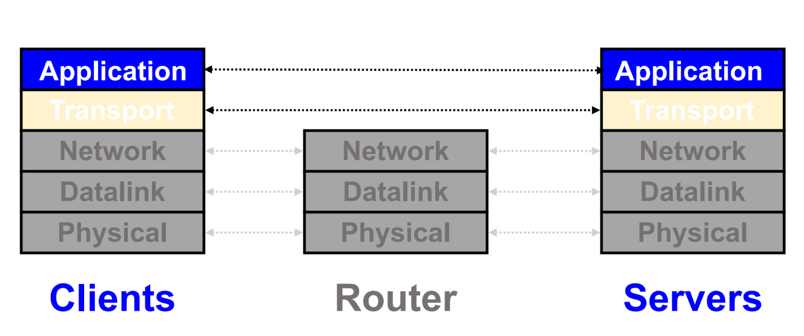
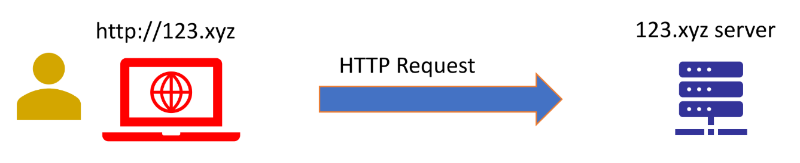
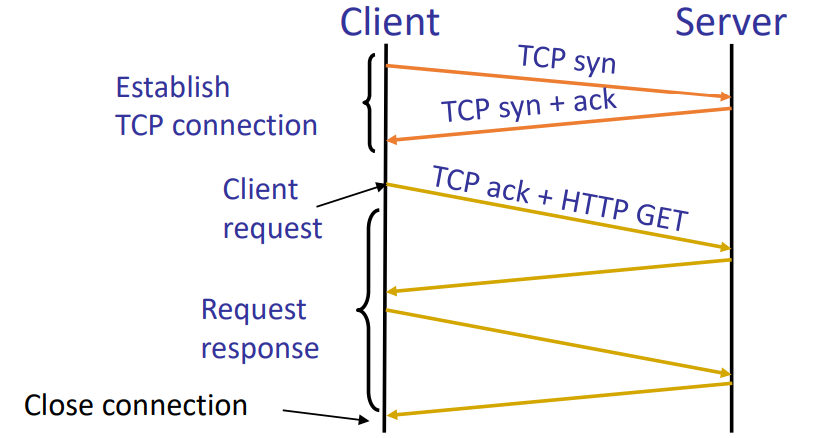
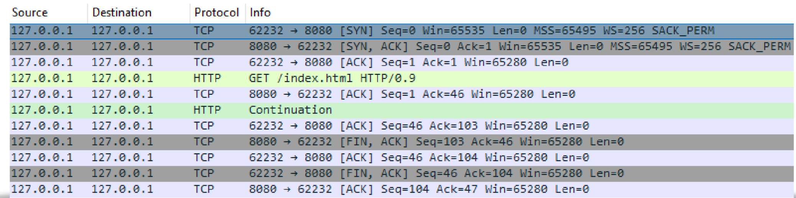
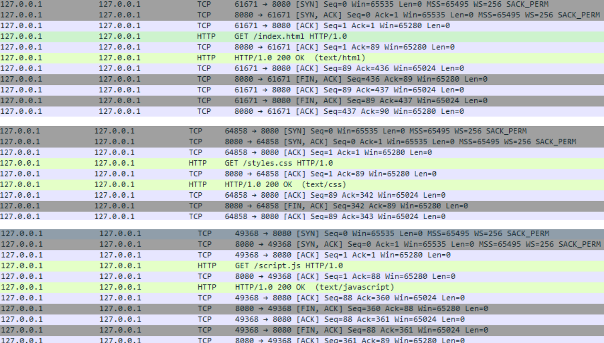
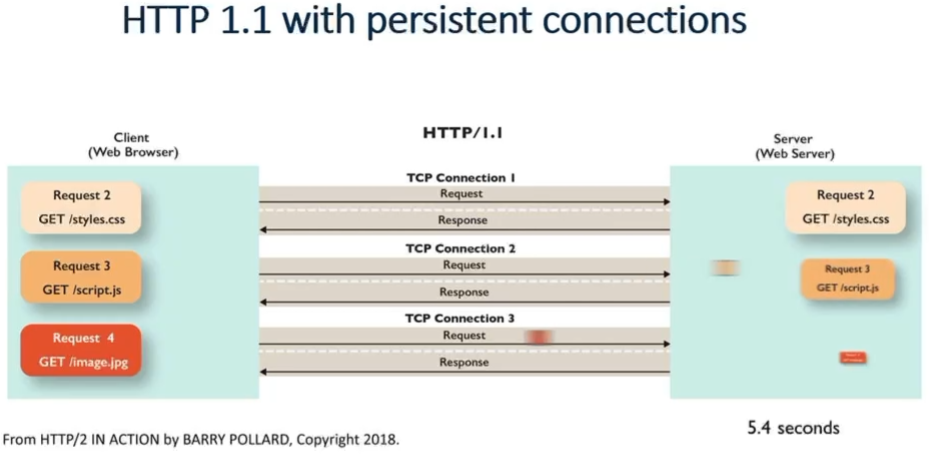
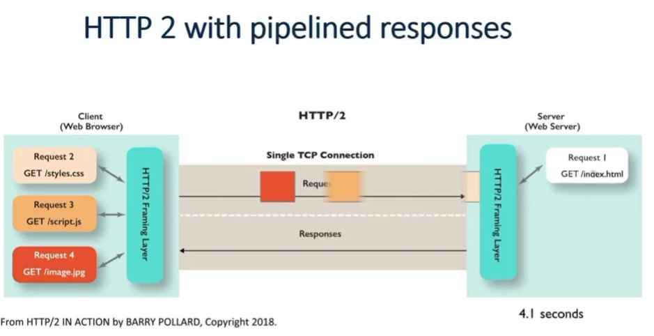
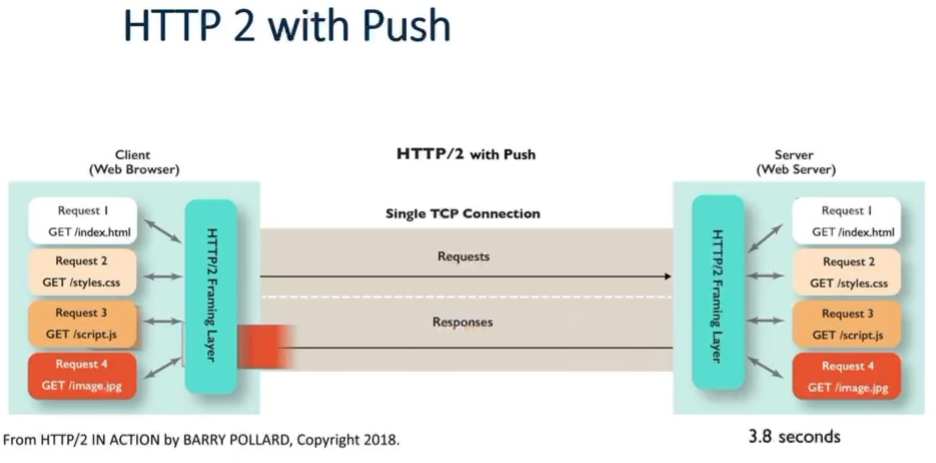
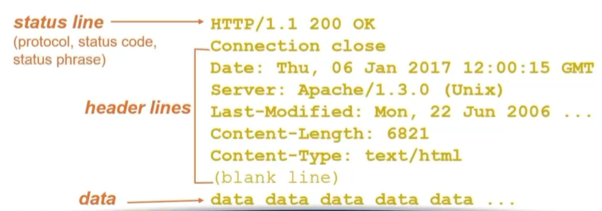

## Web components

1. Content (内容)

   - **URL (Uniform Resource Locator)**: 用来命名和定位资源, 例如 `https://www.example.com/index.html`.

     它可以拆解为:

     - **Scheme**: `https` → 使用的协议 (HTTP, HTTPS, FTP 等)
     - **Domain name (Host)**: `www.example.com` → 这是域名部分
     - **Port**: `8080` (可选, 默认 HTTP 是 80, HTTPS 是 443)
     - **Path**: `/path/to/file.html` → 指定资源的路径
     - **Query**: `?name=ryn` → 携带参数
     - **Fragment**: `#section1` → 页面内锚点

   - **HTML (HyperText Markup Language)**: 用来描述内容的结构和格式, 告诉浏览器**如何渲染页面.**

2. Protocol for exchanging information

   - **HTTP (HyperText Transfer Protocol)**: Web 中用于交换信息的主要协议, 定义了 client 和 server 之间的请求与响应格式.

3. Infrastructure (基础设施)

   - **Clients**: 用户这边的浏览器, 手机 App, 或者任何发起 Web 请求的设备.

   - **Servers**: 提供内容和服务的后台系统 (多个且每个都是分布式的服务器, 并非只有一个服务器响应)
     - **Datacenters**: 存放大规模服务器的机房, 是 Web 服务的核心运行环境.
     - **CDN (Content Delivery Network)**: 一个分布式网络系统, 把静态资源缓存到这个网站在不同地区的储存节点, 对于不同地区的用户的访问分布到离他最近的节点, 从而提高访问速度.
     - **DNS (Domain Name System, 域名系统)**: 也是一个分布式网络系, 负责把域名解析成 IP 地址. 当用户请求 `www.example.com` 时, DNS 会返回用户输入的网站使用的**离用户最近的 CDN 节点**.


### URL: Uniform Record Locator

访问一个网页就是访问一个 url.

- **URL** 是资源的唯一定位符, 告诉浏览器去哪取东西.
- 网页其实就是服务器上的一个资源 (HTML 文件或者是动态生成的内容).
- 所以当你访问一个网页时, 实际上就是在访问它对应的 URL

一个 URL 格式如下:

```c++
protocol://host-name[:port]/directory-path/resource
```

比如 https://policies.google.com/terms?hl=en&fg=1

其中各个组成部分解释:

1. **protocol**
   - 表示使用的协议: `http`, `https`, `ftp`, `smtp`, `rtsp`, etc.
   - 决定了浏览器/客户端和服务器之间的通信方式.
2. **host-name**
   - 可以是 **DNS name** (域名, 比如 `www.example.com`)
   - 也可以是直接的 **IP address** (比如 `192.0.2.1`)
3. **port** (可选)
   - 如果不写, 默认使用协议的标准端口.
   - 比如 `http` 默认端口是 80, `https` 默认端口是 443.
   - 例子: `https://example.com:8443/` 表示使用 8443 端口.
4. **directory path**
   - 就像文件系统里的目录路径, 分层结构.
   - 例子: `/users/ryn/profile/`
5. **resource**
   - 具体请求的资源, 比如一个文件 (`index.html`, `video.mp4`), 或一个动态接口 (`search?q=eecs489`). 
   - 动态接口可以触发后端程序逻辑. 比如这里的`search?q=eecs489` 不是一个固定文件, 而是 Google 的搜索程序在 server 上执行, 根据 `q=eecs489` 这个参数动态生成结果.


### 访问 `https://www.example.com` (未 cache) 时经历的过程: 访问多层 DNS 服务器, 最后访问对应 ip

刚才说到, 当我们访问一个网页的时候, 并不是只有这个网站的服务器在响应, 而是存在多个不同的服务器. 这是因为我们输入的 url 并不是一个 ip. 我们需要解析这个 url (只需要解析 host-name, 后面的 host 会处理). 

这个解析的过程由 isp 和 DNS servers 来完成.

比如我们输入

```
https://www.example.com
```

然后我们浏览器会进行 DNS 解释: 

- 浏览器先查自己的 **DNS 缓存** (有没有上次解析过的 IP).

- 如果没有 → 查操作系统缓存.

- 如果没有 → 发请求给 ISP 的 **recursive resolver** (递归解析器).

- 递归解析器如果缓存里也没有, 会去问:

  1. 首先问 **Root DNS server** → 它告诉你 `.com` 的 TLD 服务器在哪里.

     等待 Root DNS server 给我们这个 `.com` 的 TLD 服务器在哪里

  2. 然后问 (Root DNS server 返回的) **TLD DNS server (.com)** → 它告诉你 `example.com` 的权威服务器在哪里.

  3. **Authoritative DNS server** → 返回最终的 IP 地址 (比如 `93.184.216.34`).

- 最终 IP 返回到你的电脑, 浏览器知道了要联系的目标地址.


所以其实我们 (在先前没有 ip 缓存的情况下) 访问了多个 servers:

- **递归解析器 (Recursive resolvers)**:

  - ISP 提供 (电信, 联通, Comcast, AT&T 等).
  - 公共解析器:
    - Google DNS (8.8.8.8, 8.8.4.4)
    - Cloudflare DNS (1.1.1.1, 1.0.0.1)
    - OpenDNS (208.67.222.222)

- **Root DNS servers**:

  - 由 ICANN (Internet Corporation for Assigned Names and Numbers) 监督,
  - 由 Verisign, 美国军方, NASA, 日本 NIC 等多个组织共同运维.

- **TLD DNS servers**:

  - 比如 `.com` 由 Verisign 管理, `.org` 由 Public Interest Registry, `.cn` 由中国互联网络信息中心 (CNNIC).

- **权威 DNS servers (Authoritative DNS)**:

  - 每个网站管理员自己选择托管, 常见的托管公司:
    - Cloudflare DNS
    - AWS Route 53
    - Google Cloud DNS
    - 阿里云 DNS
    - 腾讯云 DNS
    - GoDaddy 等域名注册商

  

DNS 几乎参与了所有互联网访问, 但**用户缓存 + 分布式部署**让它能支撑全球流量. 


而访问各个服务器的过程, 和一般的 network 信息交流没差别



最终, 我们在 DNS 解析完毕后, 会访问输入的这个网站真实对应的 ip.




## HTTP (Hyper Text Transfer Protocol) 

### basics 

刚才说到, HTTP 是 web 中用于交换信息的主要协议, 定义了 client 和 server 之间的请求与响应格式.

1. 协议模式:

   它是一个 Synchronous request/reply protocol, 并且基于 TCP 协议.

   - **Request/Response 模式**: Client 发起请求 → Server 回复响应.
   - **默认端口**:
     - HTTP 基于 TCP 协议, 默认端口是 80.
     - HTTPS 基于 TCP + TLS, 默认端口是 443.

2. stateless (**无状态协议**): 每次请求都是独立的, server 不记得之前的交互.
   - 要维持状态 (比如登录), 需要额外机制: Cookie, Session, Token. Cookie 采用 client-side state maintenance.

3. 它的 **format**: 在 HTTP/1.1 及之前, Request/Response 都是 **ASCII 文本格式**. 比如:

   ```
   GET /index.html HTTP/1.1
   Host: www.example.com
   ```

   从 **HTTP/2** 开始, 改成**二进制编码**, 更高效.

   | 特性     | HTTP/0.9     | HTTP/1.0       | HTTP/1.1       | HTTP/2         | HTTP/3           |
   | -------- | ------------ | -------------- | -------------- | -------------- | ---------------- |
   | 请求格式 | 只有 GET     | 方法 + headers | 方法 + headers | 二进制帧       | 二进制帧         |
   | 响应格式 | 纯 HTML      | headers + body | headers + body | headers + body | headers + body   |
   | 连接方式 | 每次新建 TCP | 每次新建 TCP   | Persistent TCP | Multiplex TCP  | Multiplex QUIC   |
   | 性能     | 极低         | 低             | 中             | 高             | 最高             |
   | 典型用途 | 早期 HTML    | 静态网站       | 大多数现代网站 | 大型网站/CDN   | 移动, 视频流媒体 |

   

### client-server 交互过程 (HTTP 0.9/1.0)



假设 server 和 client 的 TCP socket 都已经建立好, 并且 server 已经在 `listen()` 了还没 `accept` 这个 client, 而 client 开始尝试 `connect()`. 

这个时候会进行 TCP handshake (三次握手):

- **Client 调用 `connect()`** → 内核发出 **SYN** 报文.
- **Server 调用 `accept()`** → 内核监听端口, 收到 SYN 后回复 **SYN+ACK**.
- **Client 内核** 收到后再发 **ACK**.
- 当三次握手完成:
  - `connect()` 返回 → Client 知道连接建立成功.
  - `accept()` 返回 → Server 得到一个新的 socket 用于通信.

三次握手正好对应 client `connect()` 和 server `accept()` 阶段.


然后, client 和 server 就可以开始 send 和 recv HTTP messages.

- 在 HTTP/0.9, 1.0 里:

  - 一次三次握手建立连接 → 一次 HTTP 请求/响应 → 关闭连接 (FIN).

  - `Content-Length` header, 服务器只能在响应中**一直发数据 (TCP segments), 直到主动关闭连接 (FIN), 不会再接受新的 request.** 每当 Server 发送一个 TCP segment (比如 HTML 的一部分), Client 都会回一个 **ACK**, 告诉 Server 收到了, 可以继续发下一个. 这是 **TCP 层的正常数据确认过程**, 不是新的 HTTP 请求.

    

  - 最后, 当 server 把内容发完, 它会发送 **FIN**; Client 回复 **ACK** → 进入四次挥手过程. 这是连接真正关闭的标志.

- 而在 HTTP/1.1:

  - **Persistent connection (默认 keep-alive)**

  - 一次三次握手建立连接后, 这个连接不会马上 `close()`.

  - Client 可以在这个 TCP 连接上 **多次 send() HTTP 请求**, Server 多次 recv()/send() 响应.

  - 直到一方发送 `Connection: close` 或主动调用 `close()`, 连接才断开.


### HTTP 1.1 (why persistent connections)

考虑这一个 html 文件:

```html
<!DOCTYPE html>
<html>
<head>
	<link rel="stylesheet" href="styles.css">
</head>
<body>
    
<h2>A Picture</h2>

                                                      
<script type="text/javascript" src="script.js"></script>
</body>
</body>
</html>
```

这个 `index.html` 引用了:

- 一个 **CSS 文件** (`styles.css`)
- 一张 **图片** (`pic_1.jpg`)
- 一个 **JS 文件** (`script.js`)

所以浏览器要完整渲染这个页面, 需要请求 **4 个资源 (URL)**.



- 第一次 TCP 连接
  - Client → `GET /index.html HTTP/1.0`
  - Server → `200 OK (text/html)` + 返回 HTML 内容
  - 关闭连接
- 第二次 TCP 连接
  - Client → `GET /styles.css HTTP/1.0`
  - Server → `200 OK (text/css)` + 返回 CSS 内容
  - 关闭连接
- 第三次 TCP 连接
  - Client → `GET /script.js HTTP/1.0`
  - Server → `200 OK (text/javascript)` + 返回 JS 内容
  - 关闭连接
- …(第四次 for img)


而大多数 web pages 都有多个 objects, 比如 html 文件, css 文件, js 文件和一堆图片.

HTTP 0.9/1.0 每个 object 都需要一次 TCP connection.

每次 TCP connection 需要的时间:

-  三次握手: 从 Client 发到 Server, 再从 Server 返回到 Client, **等于 1 RTT**
- HTTP request 以及 first few bytes: **又是一个 RTT**
- Transmission time: 传输整个 object, 等于 object size / bandwidth


所以, 每次传一个 object, 在 HTTP 1.0 中, 都需要 2RTT + object 的 transmission 时间.

如果传一次关一次, 多一个 object 就会多一对 RTT 时间.

这就大大增加了 latency.


所以我们需要:

**HTTP/1.1 (1997)**

- **Persistent connections** (长连接): 一个 TCP 连接可以传多个请求/响应, 避免每次都三次握手.
- 依旧是基于 **文本协议 (ASCII)**.


## HTTP 的 performance 优化

### performance goal

要达到好的 performance, 各方有各自的需求:

- 对于 user 而言, 需要
  - fast downloads
  - high availability

- 对于 content provider 而言:
  - cost-effective infrastructure
- 对于 network (次要) 而言:
  - 避免 overload.

user 和 network 的需求都可以通过用户端的 caching 和 replication 来解决.

而 content provider 的需求: 可以运用 webhosting, CDNs, datacenters 来帮助自己存储内容.


### pipelining 以及 concurrent: HTTP/1.1 的更多优化

1. Pipelined requests & responses (流水线):

   - 在一个连接里, Client 可以同时发多个请求 (不用等前一个响应回来再发).
   - Server 会按顺序 (FIFO) 依次返回响应.

   - **问题 (HOL Blocking)**:

     - 如果前一个响应很大, 后面的小响应必须等它传完才能发 → **队头阻塞**.

     - 举例: 请求了一个 10MB 的视频片段 (响应 1), 以及一个 1KB 的 CSS 文件 (响应 2).

       结果 CSS 必须等视频传完, 页面卡住.

   - 应对方法: priority 和 preemption

   - **现实**: 虽然 HTTP/1.1 标准支持 pipelining, 但 **主流浏览器基本禁用了** (大约 2015 就都不支持), 因为 HOL 问题太严重.

2. Concurrent requests and responses (并发):

   - **同时开多个 TCP 连接** 来并发请求多个资源. 这样就不需要等一个响应结束才能发下一个请求. 
   - 响应顺序不一定严格匹配请求顺序 (谁先完成就先返回).
   - performance 上的优缺点:
     - **Client ✔**: 浏览器用户体验更好, 页面加载更快.
     - **Content provider ✔**: 网站能更快给用户提供内容.
     - **Network ❌**: 同一个 Client 会同时开很多 TCP 连接 (Chrome 默认 6 个左右). 这会 **增加网络拥塞**:
       - 抢占更多带宽.
       - 在中间路由器看来, 一个用户就像同时发起多个独立流, 导致网络不公平.


最终解决方案: **HTTP/2 的多路复用 (multiplexing)**, 在单连接里实现真正的并发, 不需要开多个连接.


### HTTP/2 (2015) 和 HTTP/3 (2022, RFC 9114)

HTTP/2:

- **Multiplexing (多路复用)**: 在一个 TCP 连接里并行传多个请求和响应, 互不阻塞.
- **Binary protocol**: 不再是 ASCII 文本, 而是二进制帧 → 更高效.
- **Header 压缩 (HPACK)**: 避免重复传递 headers.
- **Server push**: 服务器可以主动推送资源 (比如你请求 HTML 时, server 自动推 CSS/JS).
- 但问题: 仍然跑在 **TCP** 上, 所以如果底层 TCP 丢包, **所有流都被卡住 (HOL blocking at transport layer)**.

HTTP/3:

- 基于 **QUIC (UDP 协议上的用户态传输层, 内置 TLS)**.
- **避免 TCP 的队头阻塞问题**: QUIC 的流是独立的, 某个流丢包不会卡住其他流.
- **更快握手**: QUIC 支持 0-RTT 建立连接 (减少延迟).
- **内置加密**: QUIC 本身就集成了 TLS 1.3.


对比例: HTTP/1.1, HTTP/2 pipelined, HTTP/2 PUSH








### 获取 n 个小 objects / 大 objects, 各个策略的时间

Getting n small objects: 这里的瓶颈是 **latency (RTT)**, 因为每个对象很小, 传输时间几乎可以忽略.

- **One-at-a-time (~2n RTT)**
  - 每个对象都要重新建连接 (TCP handshake + 请求/响应).
  - 所以总时间 ≈ `2n RTT`.
  - → 对应 HTTP/0.9, HTTP/1.0 非持久连接.
- **m concurrent (~2 [n/m] RTT)**
  - 同时开 m 个 TCP 连接, 把 n 个对象分摊到 m 个连接里下载.
  - 总时间 ≈ `2 * (n/m) RTT`.
- **Persistent (~ (n+1) RTT)**
  - 1 RTT 建立连接, 后续每个对象只需要 1 RTT 请求/响应.
  - 所以总时间 ≈ `(n+1) RTT`.
  - → HTTP/1.1 的持久连接 (串行请求).
- **Pipelined (~2 RTT)**
  - 一次建连接 (1 RTT), 请求和响应流水线重叠.
  - 所以总时间 ≈ `2 RTT`.
  - → HTTP/1.1 的理论优化 (但有 HOL 阻塞).
- **Pipelined + Persistent (~2 RTT first time, then ~1 RTT later)**
  - 第一次访问一个站点, 需要 2 RTT (建立连接 + 请求/响应).
  - 以后访问同站点, 连接已建立, 只需 ~1 RTT.


Getting n large objects (each size F):  这里的瓶颈是 **throughput (带宽 Bc)**, 因为对象很大, 传输时间远大于 RTT.

- **One-at-a-time (~ nF / Bc)**
  - 顺序下载 n 个对象.
  - 时间 ≈ `nF / Bc`.
- **m concurrent (~ nF / (m Bc))**
  - 同时开 m 个 TCP 连接, 理想情况下带宽能平分.
  - 时间 ≈ `nF / (m Bc)`.
  - (前提是 mBc ≤ BL, 总带宽允许, which is hard).
- **Pipelined/Persistent (~ nF / Bc)**
  - 因为瓶颈是带宽, pipeline 或 persistent 并不能提升速度.
  - 时间还是 ≈ `nF / Bc`.
  - 唯一能改善的就是提高链路带宽.

总结:

- **小对象 (small objects)** → 延迟 (RTT) 占主导 → Persistent、Pipeline、Multiplexing 最有用.
- **大对象 (large objects)** → 吞吐量 (带宽) 占主导 → 并发连接有帮助, 但本质上取决于链路带宽.


## HTTP methods

### Method types (HTTP 1.1)

- **GET, HEAD**
	- 用于从服务器**获取资源**.
	- `GET` 会返回整个资源内容;
	- **`HEAD` 只请求资源的 header, 不返回 body, 常用于测试资源是否存在或获取元信息 (如大小、类型).**
- **POST**
	- 用于向服务器**发送数据** (例如 web 表单提交).
	- 数据包含在 HTTP 请求的 body 中;
	- 通常会在服务器端引起某种变化 (如创建新对象).
- **PUT**
	- 用于上传文件或替换服务器上指定路径的资源.
	- 上传的内容在请求的 body 中;
	- URL 指定了目标位置 (即要更新或新建的资源路径).
- **DELETE**
	- 删除服务器上由 URL 指定的资源.


|  方法  |      作用      | 是否有 body | 是否改变服务器状态 |
| :----: | :------------: | :---------: | :----------------: |
|  GET   |    获取资源    |     否      |         否         |
|  HEAD  |   获取元信息   |     否      |         否         |
|  POST  |    提交数据    |     是      |         是         |
|  PUT   | 上传或更新资源 |     是      |         是         |
| DELETE |    删除资源    |     否      |         是         |


