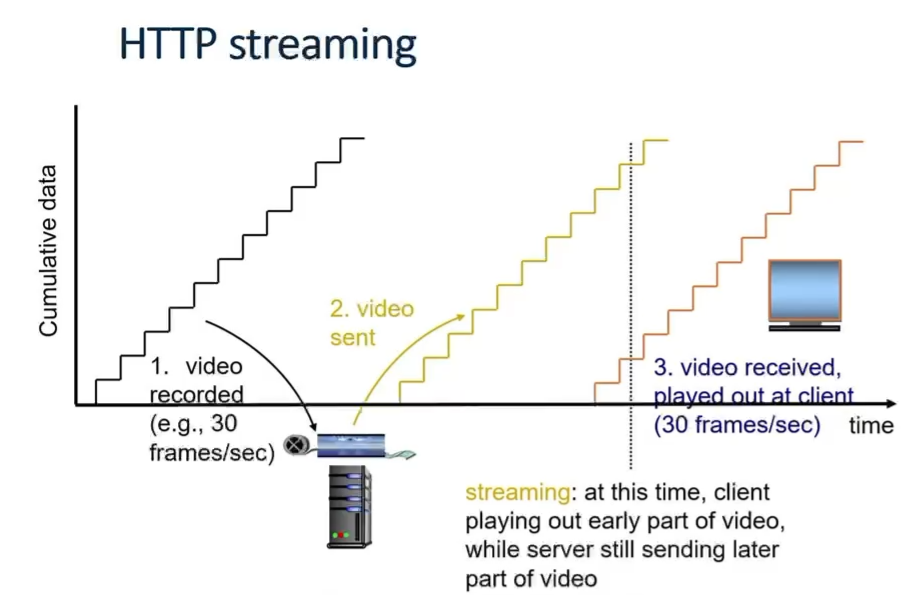

Video: 

- 一个 seq of images, 以一个固定的速率进行播放

以 1024 * 1024 来算一张 image; RGB: 一个 pixel 24 bit 

-> 那么一个 image 的大小: 3MB

24 frames/sec 来算一个 video 的速率 

-> 那么一个视频的数据: 72 MB/sec

 

常见的数据规模:

- TV 帧率: 30 frames/sec

- quality levels (resolutions): 480p, 720p, 1080p, 4k…

  1080p: 1920*1080 pixels

  压缩原分辨率 -> 更小的分辨率的做法是 compression algorithms.


Video 的特点: 

- 对于一个 GET 而言来大了
- 当退回的时候, 不应该重新加载整个视频


Http streaming:

- video 和其他资源一样, 也是存在一个 Http server with a URL

- clients 发送 GET request for 这个 URL

- server 把 video files 发送给 client, as a stream

- client 收到 video stream 后, 会 buffer 它一会儿, 减少之后的 interruptions

  当 buffer 达到 threshold 大小, video 就开始在 foreground 进行播放, 而更多的 frames 在 background 中被 download




DASH: Dynamic Adaptive Streaming over HTTP

针对和该 client 端通信的 throughtput 来定制 bitrate


非常好，这几张图展示了 **数据中心网络 (Datacenter Networks)** 的结构设计理念，以及为什么它要追求“高带宽 (High Bandwidth)” 的核心目标。我们逐层看：

------

## 🏗️ 一、数据中心网络的层次结构

### 1. **Rack 层 (机架层)**

- 每个机架 (rack) 里有几十台服务器 (Server)；
- 顶部有一个 **ToR switch (Top-of-Rack 交换机)**；
- 所有机架内的服务器都连接到这个 ToR switch。

→ **Rack = 多个 Server + 一个 ToR Switch**

------

### 2. **Aggregation 层 (聚合层)**

- 多个 ToR Switch 再连到 **Aggregation Switch**；
- 这层主要负责汇聚不同机架间的流量。

→ 类似“楼层总线”：把每层机架的流量集中起来。

------

### 3. **Core 层 (核心层)**

- 所有 Aggregation Switch 都连到 Core Switch；
- Core 是整个数据中心对外和对内通信的骨干层；
- 通常用高性能、高带宽的交换机。

→ Core 层就像数据中心的“大脑中枢”。

------

## 🔁 二、整个结构形成分层树状拓扑

图二展示的是三层结构：

```
Core
│
├── Aggregation
│   ├── Rack1 (Servers + ToR)
│   ├── Rack2
│   └── Rack3
└── ...
```

这是一种 **分层式 (hierarchical)** 网络架构，
 既方便扩展，又容易管理。

------

## 🚀 三、高带宽 (High Bandwidth) 的目标

在理想情况下：

> “每台服务器都能以满速带宽和任意其他服务器通信。”

也就是说：

- 如果每个服务器是 10 Gbps 接口，
- 那么无论通信路径经过多少交换机，中间都不会成为瓶颈。

------

## 💡 四、One Giant Switch（概念模型）

从逻辑上，我们希望：

> 整个数据中心像一个“巨大的交换机”一样工作，
>  任意两台服务器之间的通信速度，就像它们在同一个局域网里。

图四展示的 “One GIANT Switch” 就是这种**理想化视角**。

------

## ⚙️ 五、现实 vs 理想：为什么不能真的用一个巨型交换机？

图五说明了实际问题：

- 要支持 100 万台服务器、每台 10 Gbps：
  - 需要一个带宽 **10¹⁵ bps (10 Pbit/s)** 的交换机；
  - 还要 **100 万个端口**；
  - 这种设备在物理上和成本上都不现实。

------

## ✅ 六、现实可行的做法：网络织布 (Fabric)

所以，**实际方案** 是：

> 用大量普通交换机，互相连接成一个高带宽的网络结构（称为 “fabric”）。

- 通过多路径互联（如 Fat-Tree 或 Clos 架构）实现高“bisection bandwidth”；
- 确保任意两台服务器之间的通信几乎不会被瓶颈阻塞；
- 每个交换机只需承担部分端口负担，整体却像一个“巨型虚拟交换机”。

------

### 🧠 总结一句话：

> 数据中心网络由 **Rack → Aggregation → Core** 三层构成，
>  目标是实现“任意服务器之间都能以满带宽通信”。
>  实际上无法用一个超大交换机来实现，所以通过**分层互联的交换机网络 (fabric)** 达到同样效果。

------

如果你想更深入，我可以帮你画一张 “理想 vs 现实” 的对比图 (One Giant Switch vs Fabric 架构)，非常直观。是否要我画？


非常棒 👍 这一组 slides 是在讲 **数据中心网络 (Datacenter Networks)** 中一个很核心的性能指标：

### “双向带宽 (Bisection Bandwidth)”

以及如何通过拓扑设计和带宽配置来提高它。

下面我一步步帮你整理核心逻辑👇

------

## 🧠 一、什么是 Bisection Bandwidth

**定义**：
 把网络中的节点分成两半，看它们之间的**最小总带宽**是多少。

> 换句话说，它衡量的是“网络中间能同时承载多少跨区通信”。

------

### 💡 Full Bisection Bandwidth

如果一个网络有 N 个节点：

- 若每个节点都有带宽 `B`；
- 理想情况是两边 N/2 个节点能两两满速通信；
- 那么“全双向带宽 (full bisection bandwidth)” 就是
   **(N/2) × B**。

✅ 这表示任何两台机器之间都能以**满速**互相通信，没有瓶颈。

------

## 🧱 二、如何实现 Full Bisection Bandwidth

### 1️⃣ 方法一：Scale up（加粗链路）

- 把靠近核心的链路（Core 层）带宽加大；
- 比如每台服务器是 10G，聚合层和核心层之间就用 40G、100G 的线；
- 这样可以避免上层成为瓶颈。

📉 但问题是：

- 高带宽链路和大交换机太贵；
- 树状结构 (tree topology) 难以扩展。

------

## ⚠️ 三、问题：树结构会导致带宽不够用 (Oversubscription)

“Over-subscription” 意思是：

> 上层链路的总带宽 < 下层服务器的总带宽。

例如：

- 每个服务器到 ToR：10G；
- 一个机架有 10 台服务器，总共 100G；
- 但 ToR 到 Aggregation 只有 20G；
- 那么 oversubscription ratio = 100G / 20G = **5:1**。

结果：

- 不同机架之间的通信会拥堵；
- 不能实现 full bandwidth；
- 影响负载均衡与容错能力。

------

## 🧩 四、解决思路：Better Topologies

这时候引出了更好的拓扑结构，比如：

### ✅ **Clos / Fat-Tree Topology**

（最后一张图讲的就是这个）

特点：

- 多级交换机（multi-stage network）；
- 每个 pod（模块）中有两层 k/2 端口交换机；
- 一半端口向上连接，一半端口向下；
- 所有链路带宽相同；
- 网络内部存在多条等价路径 (多路径传输)。

------

### 🧮 数学特性

- 最多可容纳机器数：`k³ / 4`；
- 例如：
  - k = 4 → 16 台机器；
  - k = 48 → 27,648 台机器；
- 所有机器之间都能以**全速**互联（full bisection bandwidth）；
- 并且可以使用普通交换机（commodity switch），成本低。

------

## ✅ 总结一张表

| 概念                         | 含义                       | 典型问题       | 解决方式           |
| ---------------------------- | -------------------------- | -------------- | ------------------ |
| **Bisection Bandwidth**      | 两半网络之间的最小总带宽   | 树结构瓶颈     | 加粗链路 or 改拓扑 |
| **Oversubscription**         | 上层带宽不足以支撑下层     | 拥堵、丢包     | 提高聚合带宽       |
| **Full Bisection Bandwidth** | 任意两台服务器都能满速通信 | 成本高         | Clos / Fat-Tree    |
| **Clos Topology**            | 多层多路径结构             | 可扩展、低成本 | 各层 k/2 上下连接  |

------

💬 一句话总结：

> 数据中心网络追求的是高 **bisection bandwidth**，
>  传统树结构太贵、太“瘦”，
>  所以现代数据中心改用 **Clos/Fat-Tree 拓扑**，
>  以“多路径 + 均匀带宽”实现低成本的全速互联。

------

是否希望我帮你画一张 **对比图**（Tree vs Fat-Tree/Clos），直观展示为什么后者更能达到 full bisection bandwidth？
