## 为何需要 transport layer

回顾 layering:

- Application (应用层): FTP, HTTP, DNS 等. 
- Transport (传输层): TCP (**Reliable byte stream service**) , UDP (**Unreliable datagram delivery**).
- Network (网络层): IP 
- Link (链路层): Ethernet 以太网 / wireless 无线网.

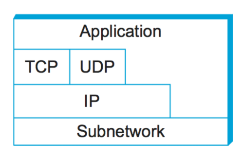

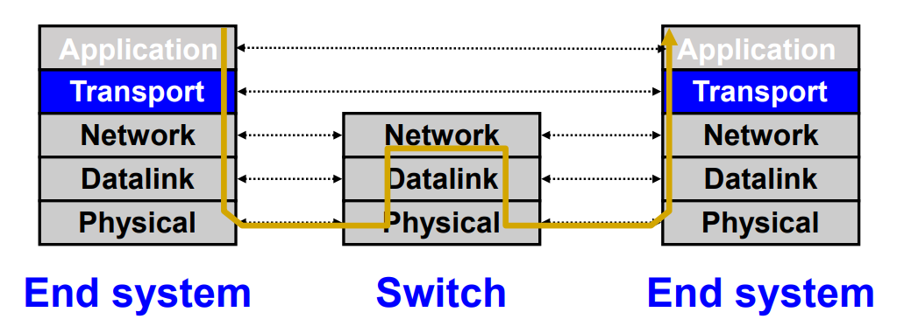

protocols 就像是一层一层 envelops 把数据封装起来. 一端封装发送, 另一端接收解封.

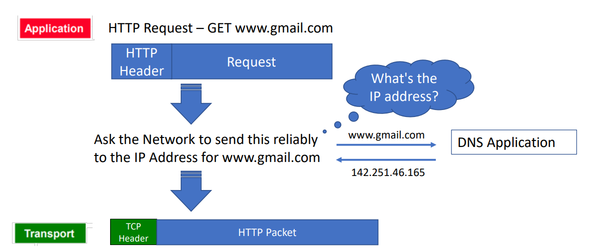

比如 TCP 这个传输协议: 在最高层的 application 层, HTTP 协议封装好了数据, 它再对这个数据进一步封装, 加上一层 TCP header.

那么我们为什么需要它?


### end-to-end communication: 即两个 processes 之间的 communication -> transport 层用 port 标识 processes

因为本质上说: application 就是 process 啊, 两个 ends 之间的通信 (比如一个 client 和一个 server) 的意思是这两个主机的各自的一个程序在通信, 也就是各自的一个 process

所以其实就是: 两个不同主机上, 两个 processes 需要沟通信息.

而我们回顾 IP: IP 只是一个 32 位的地址. 顶多代表一个主机. 

换言之, IP 地址并没有精确到 "process", 光有 IP 你并不知道你自己的哪个程序要和另一个主机的哪个程序交流. 

每台主机上可能有多个程序都在使用网络:

- 浏览器 (HTTP)
- 邮件客户端 (SMTP)
- SSH 连接 (SSH)
- 游戏进程 (UDP)


所以, 传输层 (Transport Layer, 比如 TCP 或 UDP) 引入了 **端口号 (port)** 的概念, 用来**标识主机内部的具体应用**.

从而: 

- 一个完整的通信端点由以下四个部分唯一确定:

	```
	(源 IP, 源 Port, 目的 IP, 目的 Port)
	```

- 这称为 **四元组 (4-tuple)**.

	举个例子:

	```
	客户端: 192.168.1.3:50000
	服务器: 142.250.72.68:80
	```

	其中:

	- `192.168.1.3` → 客户端主机的 IP
	- `50000` → 客户端随机选择的端口 (ephemeral port)
	- `142.250.72.68` → 服务器的 IP
	- `80` → Web 服务 (HTTP) 的端口

	这个四元组就唯一标识了这条 TCP 连接.

| 层级         | 标识对象           | 标识符     | 示例                |
| ------------ | ------------------ | ---------- | ------------------- |
| IP 层        | 主机 (Host)        | IP 地址    | 192.168.1.3         |
| Transport 层 | 应用 (Application) | Port       | 80, 443, 50000      |
| Socket       | 唯一通信端点       | (IP, Port) | (192.168.1.3:50000) |


transport layer 的存在也支撑了 multiplexing: 你可以多条数据杂乱地通过网络传输到另一 IP, 反正可以通过 port number 来确认哪一条是传输给哪一个 application 的.


#### more on port number

- port  是一个 **16-bit number**, 用于区分同一主机上的不同应用程序. 

	没错, 它最大的范围是 $[0,2^{16}-1]$. 一个 ip 可以有 65536 个 Ports.

- 每个 packet 在 transport header 中都包含:

	- 源端口号 (src port)
	- 目标端口号 (dst port)

常见端口类型:

| 类型             | 范围        | 示例                             | 用途           |
| ---------------- | ----------- | -------------------------------- | -------------- |
| Well-known ports | 0–1023      | 80 (HTTP), 443 (HTTPS), 53 (DNS) | 标准服务       |
| Ephemeral ports  | 49152–65535 | 50000, 53421                     | 客户端临时分配 |


OS 如何管理 Port ↔ Socket 的映射?

- 对于 **UDP (SOCK_DGRAM)**:

	```
	OS stores (local port, local IP address) ↔ socket
	```

	因为 UDP 是无连接的, 不关心远端是谁. source port 是一个 optional 的选项.

- 对于 **TCP (SOCK_STREAM)**:

	```
	OS stores (local port, local IP, remote port, remote IP) ↔ socket
	```

	因为 TCP 是面向连接的, 要区分每一条具体的连接.


### IP 的限制: 只是一个 Best-effort 服务, 并不精准和稳定.

如果说, 可以把 application 的标识也封装进数据, 从而省略掉 transport 层的工作, 那不完全对, 因为 transport 层还可以做别的事情 (UDP 基本就是提供 mux / demux, 但是 TCP 还封装了稳定的传输.)

因为 IP 层提供的服务非常弱:

- 它只负责把数据包从一个主机送到另一个主机, 不保证结果.
- 数据包可能:
	- 被 **损坏 (corrupted)**
	- 被 **延迟 (delayed)**
	- 被 **丢失 (dropped)**
	- 被 **乱序 (reordered)**
	- 被 **重复 (duplicated)**
- 它也不会告诉你:
	- 什么时候可以发送多少流量 (no congestion or rate control)
- 如果让应用层直接处理这些问题 (直接和 IP 即 network 层沟通, 跳过 transport 层), 虽然也可以, 但是通常开发者会非常痛苦.


所以有了 TCP 协议.

(UDP 协议非常轻量. 除了我们说的, 封装了 application to application 的通信, 就只剩下加入了 error detection. UDP header 中有一个 **checksum** 字段 (校验和), 可以检测到传输中是否出现了数据错误但不会修复它. 如果校验失败, 数据报会被直接丢弃. 它的 header 只有 8B, 但是我们之后不太会关注它. 我们更多关注的是 TCP 协议. 

一言概括: UDP = IP + Port + optional Checksum; TCP does a lot more)

UDP: 

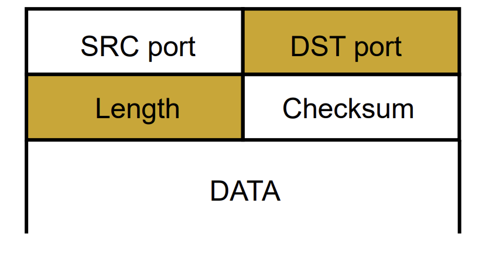

| 功能                                      | TCP  | UDP  |
| ----------------------------------------- | ---- | ---- |
| 面向连接 (connection-oriented)            | ✅    | ❌    |
| 可靠传输 (acknowledgment, retransmission) | ✅    | ❌    |
| 顺序保证 (in-order delivery)              | ✅    | ❌    |
| 拥塞控制 (congestion control)             | ✅    | ❌    |
| 流量控制 (flow control)                   | ✅    | ❌    |


## TCP for reliable transport

### IP 传输可能出现的问题

 **best-effort 网络模型 (IP 层)**不可靠的地方:
#### packet is corrupted (bit errors)

- **原因:** 在物理层或链路层传输过程中, **电磁干扰、信号衰减、噪声等可能导致某些 bit 翻转**. 

	例如, 发送方发出了：

	```
	10110010
	```

	但接收方收到的却是：

	```
	10100010
	```

- **结果:** 数据包的内容被破坏 (bit error)


#### packet is lost 

- **原因:**
	- **路由器缓存 (buffer) 满了** → 丢弃新来的包 (congestion drop). 
	- **链路层错误** → 数据在传输过程中直接丢失. 
	- **TTL (Time To Live) 到期** → 数据包在网络中绕太久被路由器丢弃. 

- **结果:** 发送方没有收到任何反馈, 数据就消失了. 


#### packet is delayed

- **原因:**
	- **排队等待 (queueing delay)**: 路由器处理繁忙, 数据包需要等前面的包发送完. 
	- **传播延迟 (propagation delay)**: 距离太远, 光速或电磁波传播时间. 
	- **处理延迟 (processing delay)**: 路由器需要查路由表或执行安全检查. 

- **结果:** 延迟时间变长, 实时应用 (如语音/视频) 体验下降. 


#### Packets are reordered

- **原因:**
	- IP 层是无连接的, 每个包可以选择不同的路径 (routing not fixed). 
	- 网络的不同路径具有不同延迟, 后发的包可能先到达. 

- **结果:** 接收方收到乱序的包, 如果上层协议不能重新排序 (如 UDP), 数据会错乱. 


#### packet is duplicated

- **原因:**
	- 网络设备发生错误重传. 
	- 路由环路 (routing loop) 导致同一包被转发多次. 
	- 某些协议层 (比如链路层) 认为包没送到而重新发送. 

- **结果:** 接收方收到重复的数据, 上层需要判断并去重. 

| 问题              | 主要原因           | 影响     |
| ----------------- | ------------------ | -------- |
| Packet corrupted  | 物理层 bit error   | 内容错误 |
| Packet lost       | 拥塞丢包, TTL 到期 | 数据丢失 |
| Packet delayed    | 队列等待, 路由延迟 | 延迟增加 |
| Packet reordered  | 路由路径不同       | 数据乱序 |
| Packet duplicated | 错误重传或路由环路 | 数据重复 |

除了第一个 packet corrupted 是 Bit error 之外, 其他都是 packet-level 的 error: 即单个 packet 本身没问题, 但是 packets 共同构成的数据流有问题.


### TCP 应对上述问题的机制

delay 是一个比较宏观的问题, 并不影响整体的正确性. 我们在之后会讨论这一问题. 当前我们先讨论其他四个问题, 其直接影响数据传输的正确性, 而 TCP 有直接的检测和检验方法:


#### **Checksums (to detect corrptions)**

- **作用**: 检测数据在传输过程中是否被破坏. 
- **原理**:
	- 发送方把数据所有字节求和 (取反等操作) → 得到一个校验值. 
	- 接收方重新计算校验和并对比. 
	- 不匹配 → 数据损坏, 丢弃. 
- 实现层级: **在 TCP header 里面**


#### Timers + Acknowledgements (positive or negative): detect loss

- **作用**: 发现数据包是否成功传输 (成功的话会受到 receiver 的 ACK)
- **原理**:
	- 每次发送一个数据段 (segment) 时, 启动一个定时器 (timer). 
	- 若在超时时间内没收到 ACK → 认为丢包, 重新发送. 
	- Acknowledgement 详细:
		- **ACK (Acknowledgement)**:
			 告诉发送方 “我收到了你的数据”. 
		- **Positive ACK**:
			 表示包收到了, 可以发送下一个. 
		- **Negative ACK (NACK)**:
			 表示 “你发的第 N 个包有问题, 请重传”. 
			 (TCP 实际不常用显式 NACK, 而是通过缺少 ACK 或重复 ACK 推断丢包. )
- **关键参数**:
	- 超时值 (timeout) = 基于 RTT (往返时间) 动态估计. 
	- RTT 波动大时, TCP 采用平滑算法 (Jacobson/Karels). 


**Timer + Acknowledgement 就是 TCP 能做到“自动重传”的根本原因**. 它不仅解决 package loss 的问题, 也是 corruption 问题解决方法的一部分. checksum 只能检测到 corruption 但是指挥丢弃 packet 不会解决这个问题, 而 Timer 通过重新传输彻底解决它.


#### Sequence Numbers: 唯一识别一个 package

- **作用**: 标识每个数据段的顺序和唯一性. 
- **功能**:
	1. 确保接收方能 **重组乱序数据**. 
	2. 检测并丢弃 **重复数据**. 
	3. 为可靠传输提供 **累积确认 (cumulative ACK)**. 
- **例子**:
	- 如果同一个包被网络复制两次 (duplicate),
		 由于有相同的 sequence number, 接收方会识别并丢弃. 


TCP 是通过这四个机制把不可靠的 IP 网络变成了一个看似可靠的字节流通道. 


### TCP 的整体方案: sliding windows

TCP 如何解决上述问题: 有一个总体的方案叫 sliding windows. 整合了 这四个机制. 

但是在此之前: 有一个相对不成熟的方案叫做 stop and wait. 

sliding windows 就是并行版的 stop and wait.

#### stop and wait

- sender 循环地 send packet -> 等待 ACK -> 如果 NACK / TIMEOUT 则重发
- receiver 循环地 wait for packet -> 收到后验证 packet, 成功则发 ACK 否则 NACK

这很好理解.

> eg:
>
> 比如 timeout:
>
> 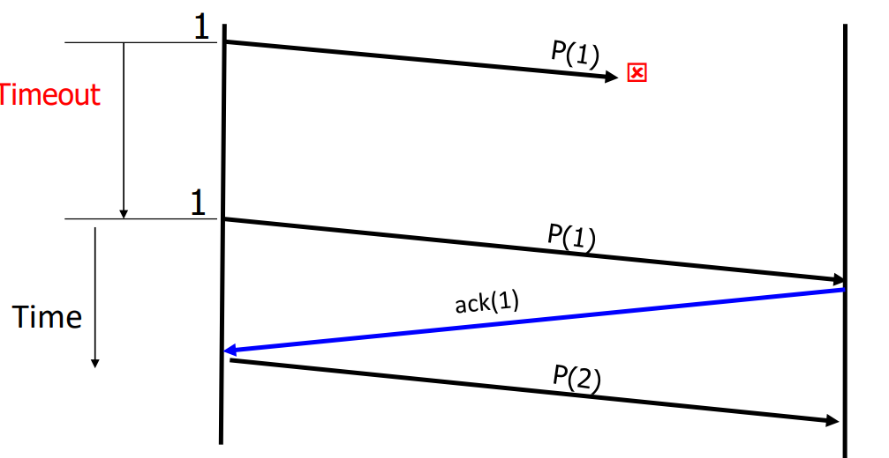
>
> 再比如 packet corruption:
>
> sender 端发现 corruption:
>
> 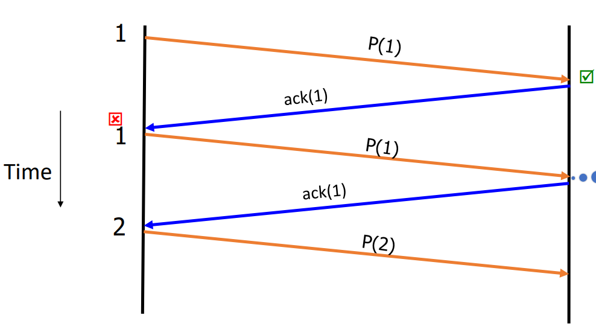
>
> receiver 端发现 corruption:
>
> 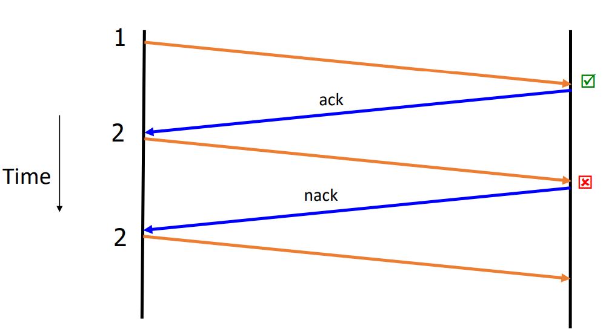

这是正确的, 但是效率太低了. 一个 packet 的问题可能会卡住其他 packets 很久, 而且完全没有并行性.

所以 TCP 有一种高效的传输算法: sliding Windows.


#### sliding windows

**Window (窗口)** 是一组连续的 **序号 (sequence numbers)**. 
 窗口大小 = **允许同时发送 (或接收)** 的最大未确认 (unacknowledged) 数据包数. 

举例：
 假设窗口大小 `n = 4`
 当前发送方的窗口覆盖的序号范围为：

```
[1, 2, 3, 4]
```

表示：

> 发送方可以在不等待 ACK 的情况下, 一次连续发送 4 个包


Sender side

- 发送方可以发送 **所有处于窗口内的包**. 
- 当收到某个包的 ACK 时, 窗口的左边界前移 (slide), 释放空间. 


Receiver side

- 接收方维护一个可接受的序号范围 (自己的窗口). 
- 收到正确的包后发送 ACK. 
- 如果包乱序或丢失, 接收方可缓存或请求重传. 


窗口滑动 (sliding)

- 每当有一个包被确认 (ACK), 窗口就往前滑动一格. 
- 滑动表示：“这个包安全到达了, 可以发下一个了”. 


窗口中所有未被确认 (ACK) 的包, **都被认为是在飞行中的数据包 (in flight)**. 
 它们可能：

- 已经到达对方但 ACK 还没回来；
- 正在网络中传输；
- 或者已经丢了. 

TCP 的拥塞控制也就是在动态调整这个 “飞行包数量”


我们可以发现:

- sender 和 receiver 的 (这个 connection 上的) sliding windows 几乎是同步的. 查了一个 RTT 的时间. 除了 packet issues 发生时. 
- 理论上 sender 会比 receiver 稍微滞后, 因为 receiver 的 ACK 是唯一让 sender 滑动的依据.
- 不论是 stop and wait 还是 sliding windows, 都解决了刚才出现的四个问题. reordering, duplication 天然地被 packet numbering 解决; corruption, loss 被 accknowledgement + timeout resend 机制解决.


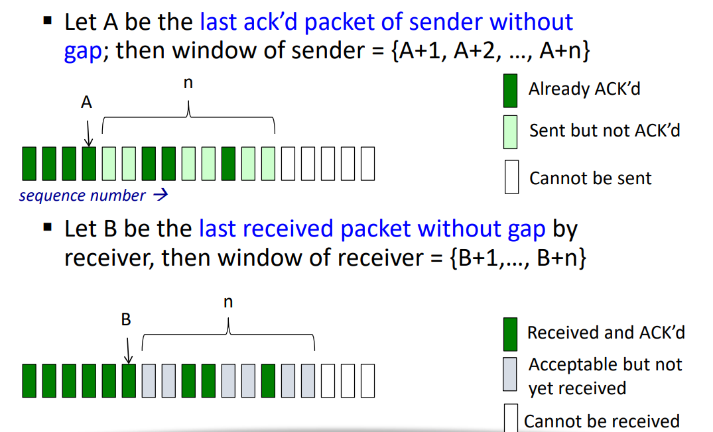


#### 根据 window size 估计 throughput

Recall: **Throughput** 表示单位时间内成功传输的数据量

设：

- `n` = window size (可同时飞行的数据包数)
- `DATA` = 每个 packet 的数据大小 (bits)
- `RTT` = 往返时间 (seconds)

则近似吞吐量为：
$$
\text{Throughput} \approx \min\left( \frac{n \times DATA}{RTT},\; \text{Link Bandwidth} \right)
$$
解释：

1. 在一个 RTT 内, 发送方最多可以发送 `n` 个数据包. 
2. 每个包有 `DATA` bits. 
3. 所以在一个 RTT 的时间窗口内, 最多传输的数据量是 $n \times DATA$. 
4. 平均速率 (throughput) ≈ (数据量 / 时间) = $n \times DATA / RTT$. 
5. 但物理链路本身也有限速, 因此最终取两者的最小值. 


我们可以对比一下效率: 假设没有 packet issues, 那么大小为 n 的 windows 的传输效率就是 stop and wait 的 n 倍: 

**Stop-and-Wait (停等协议)**：

- 一次只能发 1 个包, 等 ACK 回来后再发下一个. 

- 吞吐量：
	$$
	\text{Throughput}_{SW} = \frac{DATA}{RTT}
	$$

**Sliding Window** 提高了 n 倍的利用率：
$$
\text{Throughput}_{SW} = n \times \frac{DATA}{RTT}
$$


#### what if $n$ too large

根据这个效率计算来看: 岂不是 $n$ 越大越好吗

实则不然.

首先: throughput 受限于 bandwidth, 因而 $n$ 的提高带来的 throughput 的线性提高是有上限的; 

其次: $n$ 的提高也带来其他问题. 拥塞、延迟、丢包

- Packets in flight 太多 → 路由器缓存爆满

- 丢包 → 发送方触发重传, 于是出现恶性循环：拥塞 → 丢包 → 重传 → 更拥塞 → 更多丢包

	这就是经典的 **congestion collapse (拥塞崩溃)**. 

- 当路由器队列堆满时, 包要 **排队等待转发**. 队列积压 → RTT 激增

- Sender 自身负担加重, 内存占用增加, CPU 中断处理变多

| 限制机制               | 含义                            | 控制什么             |
| ---------------------- | ------------------------------- | -------------------- |
| **Flow Control**       | 接收方通告自己的最大窗口 (rwnd) | 防止接收方缓冲区溢出 |
| **Congestion Control** | 动态调整窗口 (cwnd)             | 防止网络链路过载w    |

TCP 的实际发送窗口是两者的最小值：
$$
\text{Effective Window} = \min(rwnd, cwnd)
$$
并通过算法 (如 AIMD, Reno, CUBIC 等) 动态调整 cwnd 来平衡吞吐与拥塞. 


### 两种 ACK 策略: Cumulative ACK (累积确认) 和 Selective ACK (SACK, 选择性确认)

#### Cumulative ACK (累积确认), with Go-Back-N (GBN) resend 机制

- **工作原理**：
	 ACK 报文携带的是 “下一个期望的 in-order 序号”. 
	 换句话说："我已经收到了所有序号小于 N 的数据, 下一个我想要的是 N"

- **举例**：

	假设发送方发出了包 1–5：

	| 包序号 | 是否收到 | Receiver 发回的 ACK |
	| ------ | -------- | ------------------- |
	| 1      | ✅        | ACK=2               |
	| 2      | ✅        | ACK=3               |
	| 3      | ❌        | (丢失)              |
	| 4      | ✅        | ACK=3               |
	| 5      | ✅        | ACK=3               |

	Receiver 收到包 4 和 5, 但因为包 3 缺失, 
	 它仍然只会 ACK=3, 等待包 3 的重传. 

- **优点**：简单、开销小. 

- **缺点**：**一旦出现丢包, 会造成“阻塞” —— 后面包都无法确认. **


正常情况:

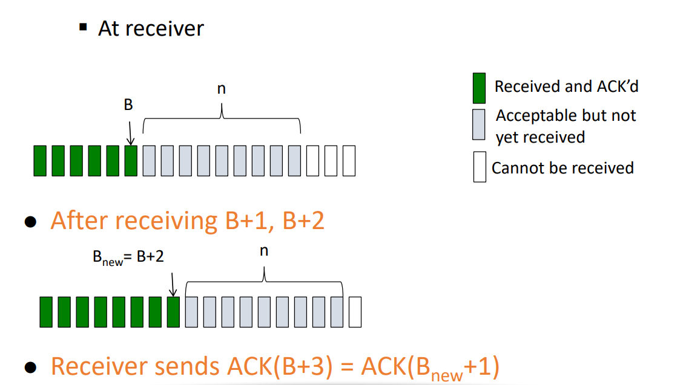

中间丢包情况 (效率较低):

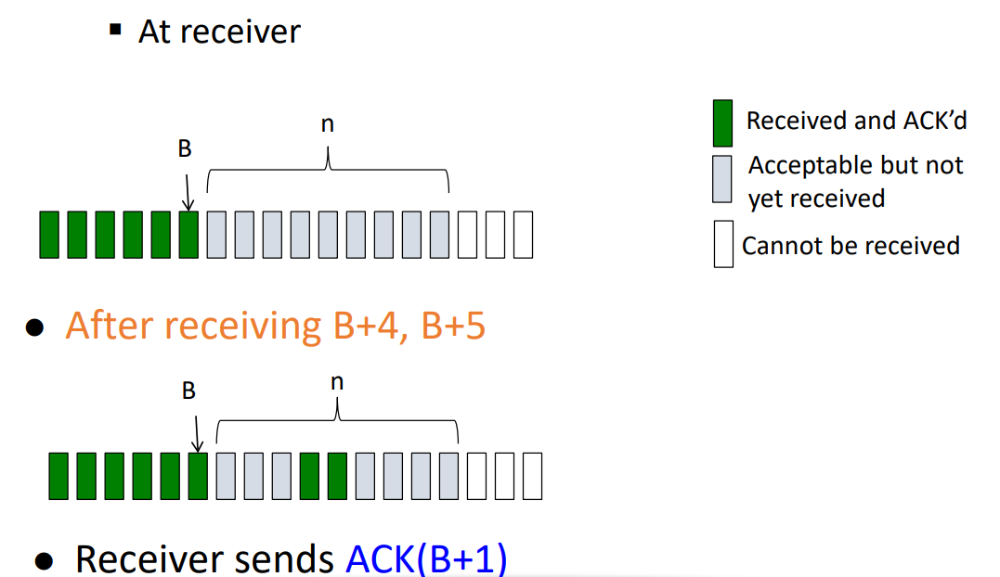


commulative ACK 对应 resend 方法: go-back-N, 

即丢包时, 重发窗口内所有的包. Cumulative ACKs 就是 GBN 的确认机制.

> eg:
>
> 发送: 1 2 3 4
>
> 收到: 1, 2, (3丢), 4
>
> Receiver: ACK=3  (还在等3)
>
> Sender: Timeout → 重发 3, 4


#### Selective ACK (SACK), with SR (Selective Repeat) resend 机制

- **工作原理**：
	 Receiver 不仅告诉“我缺什么”, 还会显式告诉“我已经收到了哪些包”. 
	 即：“我缺 3, 但我已经收到了 [4–5]. 

	> eg:
	>
	> 发送: 1 2 3 4 5
	>
	> 收到: 1, 2, (3丢), 4, 5
	>
	> Receiver: ACK=3, SACK=[4–5]
	>
	> Sender: 只重发 3, 不必重传 4, 5

- **优点**：效率高, 丢包时只重传缺失的部分. 

- **缺点**：

	- 实现复杂 (需要在 TCP option 里携带 SACK 块). 
	- 发送方需维护更多状态信息. 比如对于每个 packet 都需要一个 timer


#### Cumulative ACK with GBN 和 SACK with SR 对比

| 特性       | Cumulative ACK | Selective ACK (SACK)         |
| ---------- | -------------- | ---------------------------- |
| 确认方式   | 连续序号       | 任意已收到序号区间           |
| 丢包时行为 | 阻塞整个窗口   | 仅重传缺失部分               |
| 性能       | 简单但低效     | 高效但复杂                   |
| TCP 实现   | 所有版本支持   | TCP SACK option (RFC 2018)   |
| 状态管理   | 简单           | 复杂 (book-keeping required) |

GBN with error:

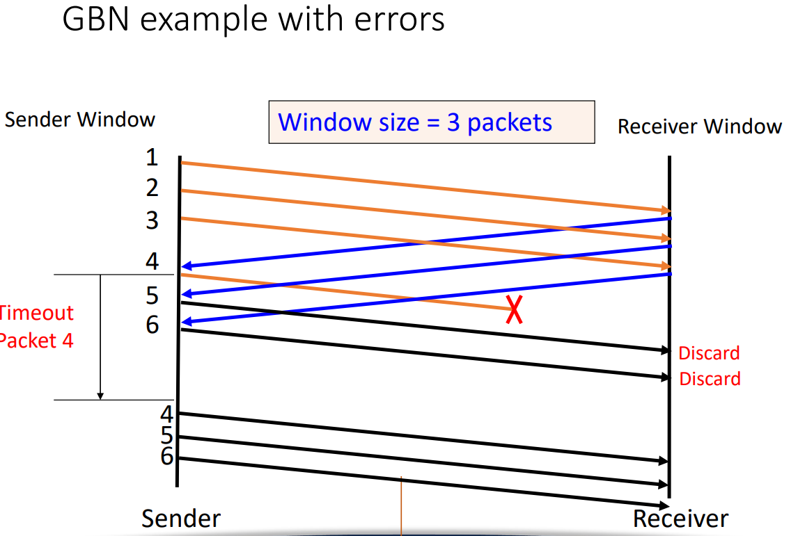

SR with error:

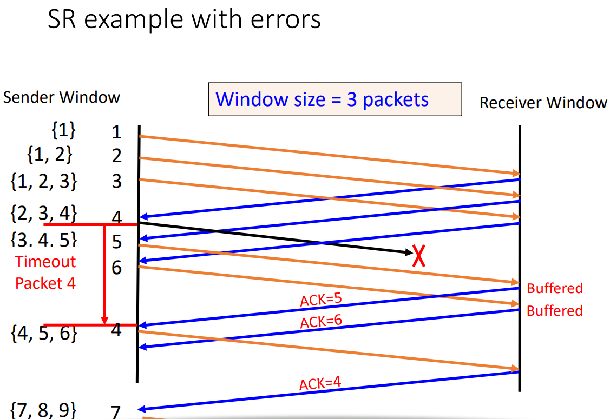


现实实现中, cumulative ACK <-> GBN, SACK <-> SR 未必完全对应. 可以 commulative ACK 添加 SACK 的成分, 让且 resend 行为接近 SR.
