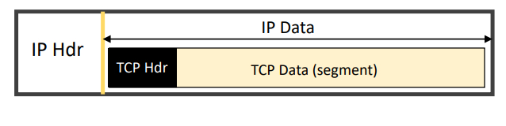
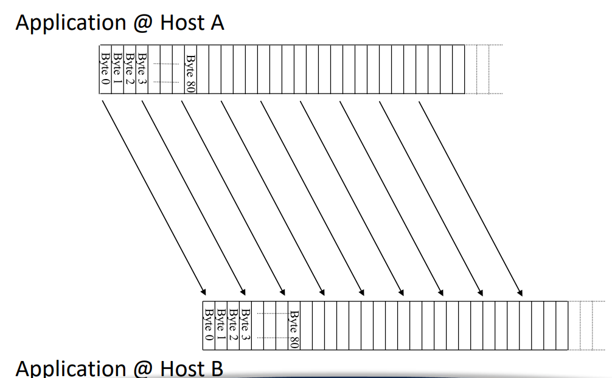
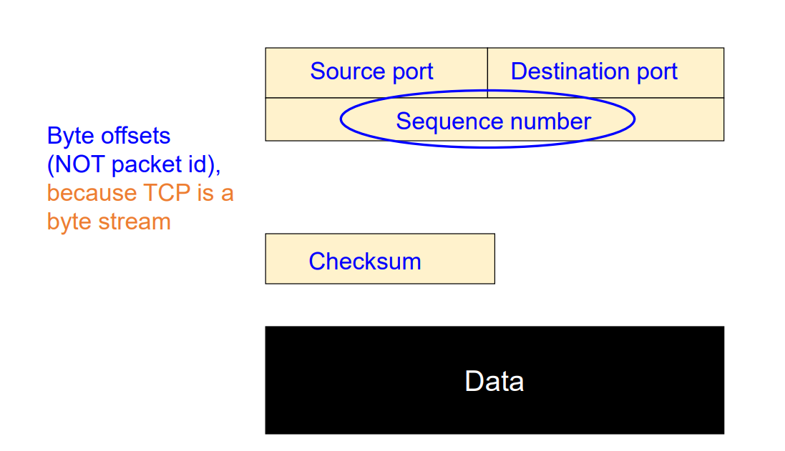
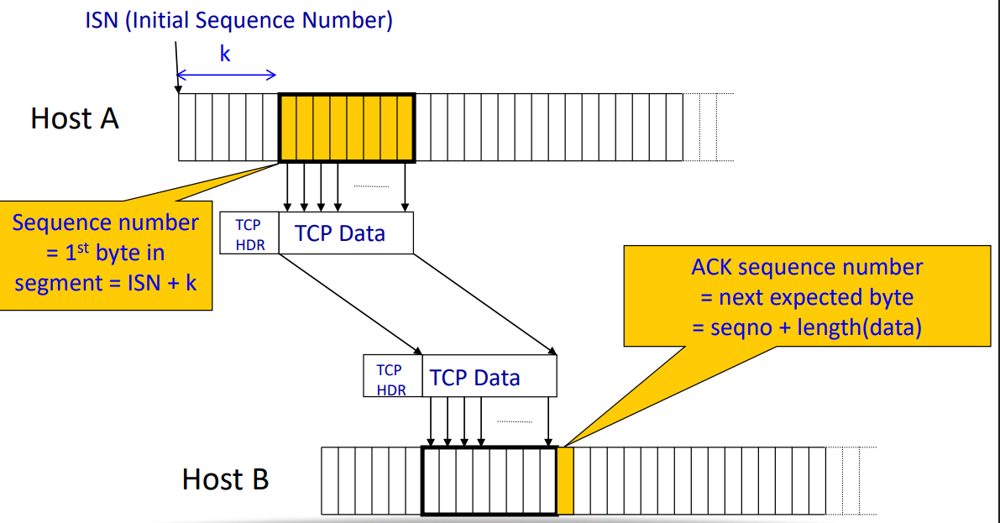

# TCP: Transmission Control Protocol

我们之前已经看了很多 TCP 的内容. 

做一个总结:TCP 使用了我们前面学习的大多数机制:

- **Checksums**
	 每个 TCP 段都有一个校验和字段 (Checksum). 它是用来检测传输过程中数据是否被破坏. 如果接收端计算出来的校验和与段中的值不匹配, 就会丢弃该段.
- **Sequence numbers are byte offsets**
	 在 TCP 中, **Sequence number** 表示字节的偏移量, 而不是包的编号.
	 例如, 若一个 TCP 段携带了 100 字节数据, 序号是 5000, 那么下一个段的序号会从 5100 开始.
	 这样 TCP 可以在字节级别进行可靠传输与重组.
- **Sender and receiver maintain a sliding window**
	 TCP 使用 **Sliding Window** (滑动窗口) 实现流量控制与可靠性控制.
	- Sender window 决定可以发送但尚未确认的字节范围.
	- Receiver window 决定接收方能暂时缓存多少数据, 从而防止发送方过快发送.
- **Receiver sends cumulative acknowledgements (like GBN)**
	 TCP 的 ACK 是**累积确认 (Cumulative ACK)**, 类似 Go-Back-N 协议.
	 它的意思是: 如果接收方发送 ACK 7000, 代表之前所有字节 (直到 6999) 都已正确收到.
	- **Sender maintains a single retransmission timer**
		 TCP 通常只维护一个定时器, 对最早未确认的包进行超时重传.
- **Receivers buffer out-of-sequence packets (like SR)**
	 TCP 接收方会缓存乱序到达的数据包 (out-of-sequence packets), 类似 Selective Repeat 协议.
	 当丢失的字节段补上后, 可以重新组装为连续的字节流.


### TCP packet 的大小限制

一个 **TCP packet** 在传输层被称为 **TCP segment**, 它由两部分组成:

- **TCP header** (通常 20 bytes, 若含选项可达 60 bytes)
- **TCP payload** (实际数据部分)

TCP packet 的大小每次可以不一样, 但是是有一个上限的. 这个上限叫做 **MSS (Maximum Segment Size)** 值.

双方在三次握手建立 connection 期间定下, 需要交换各自的 **MSS (Maximum Segment Size)** 值: 告诉对方 “我一次能接收的最大数据段大小”.

- MSS 通常 = MTU - IP header - TCP header
- 标准以太网中, MSS = **1460 bytes**

当 TCP 建立连接 (三次握手) 时, 双方会在 SYN 包中交换 MSS 值.

最终协定的 packet 大小为:
$$
MSS_{used} = \min(MSS_{client}, MSS_{server})
$$


#### 以太网下的 MSS 值

TCP segment 会被封装到 **IP packet** 中, 而 IP 层又受到 **MTU (Maximum Transmission Unit)** 的限制.

**MTU (Maximum Transmission Unit)** 指的是:

> **在某一层的网络链路上, 单个帧 (frame) 能承载的最大数据量 (单位: bytes)**

它是 **链路层 (Link Layer)** 的一个概念, 定义了 **该网络接口一次能发送的最大帧大小**.


因而:
$$
\text{MSS}= \text{MTU} - (\text{IP header size})- (\text{TCP header size})
$$
常见的情况:

- 以太网 (Ethernet) 的 MTU = **1500 bytes**
- IP header 通常为 **20 bytes**
- TCP header 通常为 **20 bytes**

因此: 在以太网的 MTU 下:
```
MTU (1500 B)
└── IP Header (20 B)
    └── TCP Header (20 B)
        └── TCP Data (MSS = 1460 B)
```

也就是说, 在最常见的以太网中, **每个 TCP segment 通常最多携带 1460 字节的数据**.

实际情况: 不同环境下 MTU 不同

| 网络类型     | MTU     | 典型 TCP payload | 说明                        |
| ------------ | ------- | ---------------- | --------------------------- |
| Ethernet     | 1500 B  | 1460 B           | 最常见                      |
| PPPoE (ADSL) | 1492 B  | 1452 B           | 减去 8 字节 PPPoE 头        |
| Wi-Fi        | ~2304 B | ~2260 B          | 更大帧, 但通常也限制为 1500 |
| Jumbo Frame  | 9000 B  | 8960 B           | 用于数据中心高速传输        |



如果超过 MTU 会怎样: 如果上层协议 (比如 TCP/IP) 生成的 packet 太大, 就会触发:

(1) **IP 分片 (IP Fragmentation)**

- 网络层会自动把大包拆成多个小包, 每个都不超过 MTU.
- 接收方再在 IP 层重新组装 (reassembly). 但这会降低性能, 因为丢一个碎片就得重传整个数据.

(2) **Path MTU Discovery (PMTUD)**

- 现代系统会主动探测路径上最小的 MTU (path 上所有链路的最小值).
- TCP 就会自动调整 MSS 来避免分片.


现在我们来 build TCP header.


### seq number of a packet

TCP 是一个 byte stream service:




因而 seq number 表示 byte offset:




(因而: 如果我的数据格式是 32 位, 那么单次的 TCP connection 中的 seq number 的范围是 $2^{32}$ 个 B, 即 0-4 GB. 超过这个数后,  seq number 不再能表示. 不过这并不代表只能传输 4GB 数据, 因为总是可以循环使用 seq number. 理论上可传输的数据量没上限.)




send 的 seq num: 是这个 segment (packet) 的第一个 B (0-based). 也就是: initial seq num + 当前已经输送的 Bytes 数量.

**Sender sends packet**: 

- **Data starts with sequence number X**
	表示这个 segment 的第一个字节序号是 X.
	 比如前一个包的最后字节是 999, 那么这个包的第一个字节可能是 1000.
- **Packet contains B bytes $ [X, X+1, X+2, ... X+B−1]$**
	说明这个 segment 共包含 B 个字节的数据, 它们在字节流中的序号从 $X$ 开始, 到 $X+B−1$ 结束.

> **举例:**
>
> - 如果 Sequence Number = 1000, B = 100 bytes,
> - 则这个包的范围是 [1000, 1099].
> - 该 segment 的 **Sequence Number = 1000**


### acknowledgement of a packet

**TCP 是全双工的**, 所以通信的双方各自都有独立的 **Sequence Number 空间**, 各自从不同的字节序号 (ISN, Initial Sequence Number) 开始计数.

假设有两个主机:

- **Host A** (客户端)
- **Host B** (服务器)

它们要建立一个 TCP 连接并互相发送数据. 那么他们首先会进行三次握手 (Three-way handshake)

在握手阶段, 双方会各自选择一个随机的 **Initial Sequence Number (ISN)**, 然后交换给对方.

| 步骤 | 方向  | SeqNum                         | 意义                                                       |
| ---- | ----- | ------------------------------ | ---------------------------------------------------------- |
| 1    | A → B | **Seq = 1000**                 | A 发 SYN, 告诉 B: “我的起始序号是 1000.”                   |
| 2    | B → A | **Seq = 5000**, **Ack = 1001** | B 发 SYN-ACK, 表示 “我的起始序号是 5000, 并确认你的 1000.” |
| 3️⃣    | A → B | **Seq = 1001**, **Ack = 5001** | A 确认 B 的起始序号 5000.                                  |

到此连接建立完毕. 现在双方都知道:

- A→B 方向的字节流从 **1000** 开始
- B→A 方向的字节流从 **5000** 开始

也就是说: **A 和 B 的序列号空间完全独立**.


而后在数据传输阶段:

**A → B 方向：**

| Segment | SeqNum | Data              | AckNum | 含义                  |
| ------- | ------ | ----------------- | ------ | --------------------- |
| A1      | 1001   | “Hello” (5 bytes) | 5001   | 从 1001 开始发 5 字节 |
| A2      | 1006   | “World” (5 bytes) | 5001   | 从 1006 开始发 5 字节 |

B 收到 A1 后会发回:

```
ACK = 1006  (期望下一个字节)
```

收到 A2 后再发:

```
ACK = 1011
```


**B → A 方向：**

| Segment | SeqNum | Data               | AckNum | 含义                  |
| ------- | ------ | ------------------ | ------ | --------------------- |
| B1      | 5001   | “Got it” (6 bytes) | 1011   | 从 5001 开始发 6 字节 |
| B2      | 5007   | “Okay” (4 bytes)   | 1011   | 从 5007 开始发 4 字节 |

A 收到 B1 后发:

```
ACK = 5007
```

收到 B2 后发:

```
ACK = 5011
```


| 方向  | 初始序号 (ISN) | 当前 SeqNum   | 对方的 AckNum          |
| ----- | -------------- | ------------- | ---------------------- |
| A → B | 1000           | 1001, 1006... | B 回 ACK=1006, 1011... |
| B → A | 5000           | 5001, 5007... | A 回 ACK=5007, 5011... |

可以看到:

- **A 和 B 各自维护独立的序列号计数**, 从各自的 ISN 开始.
- 他们之间的 ACK 是**交叉的**:
	- A 的 ACK 确认 B 的序列号进度.
	- B 的 ACK 确认 A 的序列号进度.
- sender 的 ACK 是没用的, recevier 的 seq number 是没用的


大部分 connection 中, 双方都既是 sender 也是 receiver.


#### ACK number

**Upon receipt of packet, receiver sends an ACK**

**ACK 的 number: 期望得到的下一个字节的序号.**

> 例如:
>
> - 收到了序号从 1000 到 1459 的 460 字节,
> - → **下一个期望字节是 1460, 所以 ACK Number = 1460.**
>
> 这就是所谓的 **Cumulative ACK (累计确认)** 机制:
>
> 表示“在此之前的所有字节都已正确收到”.

**(a) 如果所有 X 之前的数据都已经收到**, 也就是收到的数据是连续的, 没有缺口.

- **ACK acknowledges X + B (because that is next expected byte)**
	表示“我已经收到了从起始到 X+B−1 的所有字节,
	 下一个期望字节是 X+B”.

> **举例:**
>
> - 收到 [1000–1099],
> - ACK = 1100 (下一个要的是 1100).
>
> 这种情况代表数据**按序到达 (in-order)**.

**(b) 如果最高的连续字节是 Y, 而 (Y+1) < X**, 说明接收方还没收到中间某些数据段, 也就是出现了 **out-of-order (乱序到达)**.

- **ACK acknowledges Y+1**
	接收方不会跳过中间的缺口去确认新包, 而是重复确认“下一个我还没拿到的字节是 Y+1”.
- **Even if this has been ACKed before**
	即使之前已经发过同样的 ACK (比如三次重复 ACK), 仍然要重复发出这个 ACK. 这是 TCP 实现 **fast retransmit** 的关键信号.

> 举例: 
>
> 假设发送方依次发送:
>
> ```
> [1000–1099]
> [1100–1199]
> [1200–1299]
> ```
>
> 但接收方只收到了:
>
> ```
> [1000–1099]
> [1200–1299]  ← 中间的 1100–1199 丢了
> ```
>
> 那么接收方的行为是:
>
> - 收到第一个包 → ACK = 1100
> - 收到第三个包 (乱序) → 仍然 ACK = 1100
> 	(因为 1100–1199 还没收到)
> - 如果发送方连续收到三个相同的 ACK=1100, 就会触发 **Fast Retransmit** 重传 [1100–1199]

| 场景     | 条件                             | 接收方发送的 ACK | 说明                               |
| -------- | -------------------------------- | ---------------- | ---------------------------------- |
| 顺序到达 | 所有之前的数据已收齐             | X + B            | 下一期望字节                       |
| 乱序到达 | 前面有缺口 (最高字节 Y, Y+1 < X) | Y + 1            | 重复 ACK, 用于触发 fast retransmit |


### 总结 seq number 和 acknowledgement number

任何 TCP header 都具有这两个东西:

| 字段                      | 含义                                            |
| ------------------------- | ----------------------------------------------- |
| **Sequence Number**       | 这个报文里, “我自己” 发送的数据的第一个字节编号 |
| **Acknowledgment Number** | 我确认 “你” 的数据到哪了, 我下一个期望的字节号  |

通常它们都有意义. 

| 报文类型                          | Seq 有效性                                                  | Ack 有效性                                  | 解释                                   |
| --------------------------------- | ----------------------------------------------------------- | ------------------------------------------- | -------------------------------------- |
| **纯数据包 (Sender → Receiver)**  | ✅ 有效, 表示这个数据段的起始字节号                          | ⚙️ 一般也会带上 (确认对方数据), 但通常不重要 | 主要用 Seq 表示自己发的数据位置        |
| **纯 ACK 包 (Receiver → Sender)** | ⚙️ Seq 仍然存在, 但若没携带数据, 它不会占序号 (只是形式存在) | ✅ 非常重要, 告诉对方收到哪了                | 主要用 Ack 表示确认进度                |
| **双向都有数据 (全双工)**         | ✅ 两个都重要                                                | ✅ 两个都重要                                | 比如 Telnet 或 SSH, 双方都在持续发数据 |


**TCP 的传输机制如何结合 GBN (Go-Back-N)** 与 **SR (Selective Repeat)** 思想:

| TCP 机制                                     | 类似协议思想          | 含义                                                |
| -------------------------------------------- | --------------------- | --------------------------------------------------- |
| **Checksum**                                 | —                     | 检查数据是否在传输中被破坏.                         |
| **Sequence numbers are byte offsets**        | —                     | TCP 以“字节”为单位编号, 而不是以包为单位.           |
| **Receiver sends cumulative ACKs**           | GBN (Go-Back-N)       | ACK 表示“我已经连续收到到哪个字节为止”.             |
| **Receivers buffer out-of-sequence packets** | SR (Selective Repeat) | 收到乱序包不会立即丢弃, 而是先缓存等待缺失的包补齐. |

所以, TCP 是一个混合型设计:

- **ACK 累计** (像 GBN)
- **Buffer 支持乱序** (像 SR)


发送方一次发送若干 segment, 每个 segment 100 B 数据,

Sequence numbers 分别是:

```
100, 200, 300, 400, 500, 600, 700, 800, ...
```

每个段覆盖:

- 100 → [100 – 199]
- 200 → [200 – 299]
- 300 → [300 – 399]
- 400 → [400 – 499]
- 500 → [500 – 599] ← 丢失
- 600 → [600 – 699]
- ...


接收方按照 TCP 的 cumulative ACK 规则确认数据:

| 收到的段 | 是否按序 | 下一个期望字节 (ACK) | 原因               |
| -------- | -------- | -------------------- | ------------------ |
| 100      | ✅        | 200                  | 顺序收到, ACK 推进 |
| 200      | ✅        | 300                  | 顺序收到, ACK 推进 |
| 300      | ✅        | 400                  | 顺序收到, ACK 推进 |
| 400      | ✅        | 500                  | 顺序收到, ACK 推进 |
| 500      | ❌ (丢失) | 500                  | ACK 停止推进       |
| 600      | ❌ (乱序) | 500                  | ACK 仍然是 500     |
| 700      | ❌ (乱序) | 500                  | 继续 ACK=500       |
| 800      | ❌ (乱序) | 500                  | 继续 ACK=500       |


TCP 如何利用这些重复 ACK: 

- 发送方看到 **多个重复的 ACK=500**, 会判断 “500 段可能丢失”, 在超时之前就执行 **Fast Retransmit**, 立即重传 seq = 500 的 segment.
- 接收方随后收到补发的 500 段, 这时数据连续到 [100–599], 就立刻发 ACK = 600, 窗口顺利推进.

