### example of TCP communication

假设 windows size 是 5000B.

> 成功例:
>
> 右边 server 发了三个 packets, 左边 client 全收到了, 一一回复, 右边 server 还没收到, 在等 ack.
>
> 现在 server 会一直等待 ack, 直到收到 ack 5001 为止.
>
> 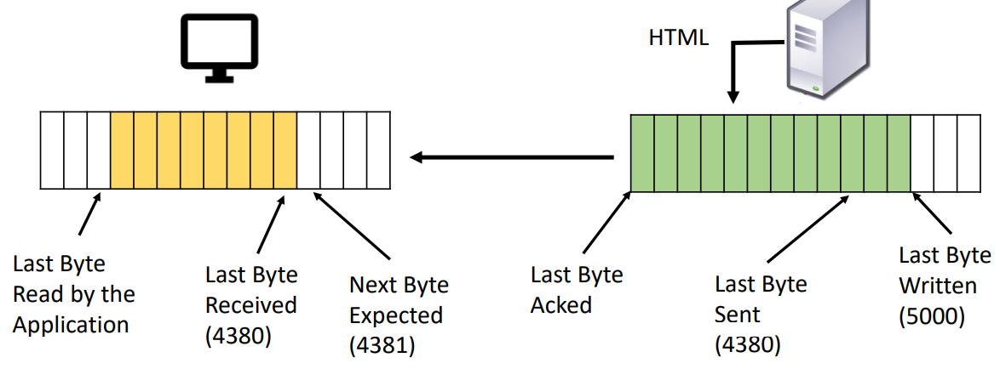
>
> 然后, server 收到了一个 ack, 遂又发了一个 packet. 由于之前 windows size 到了, 这个 packet 只有 620 B.
>
> 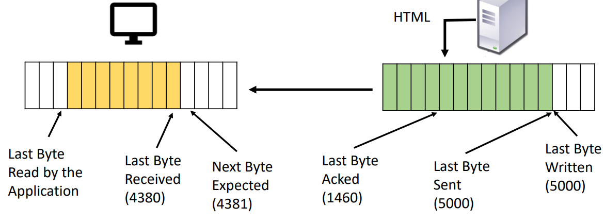
>
> 最后状态: 
>
> 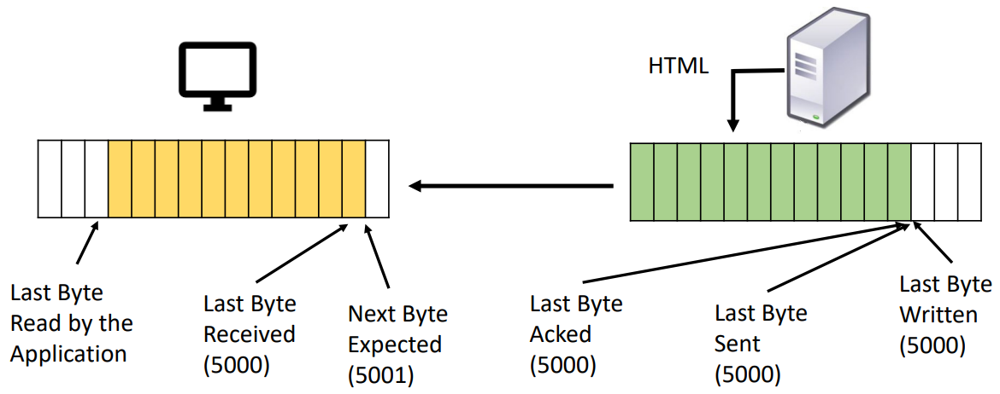
>
> 此时, server 将会继续发送. client 将会等待接收. (client 收到一个 packet 就回一个)

>顺序错乱 / missing packet 例:
>
>这里, server 仍然发了 3 个 packets, 每个 1460B.
>
>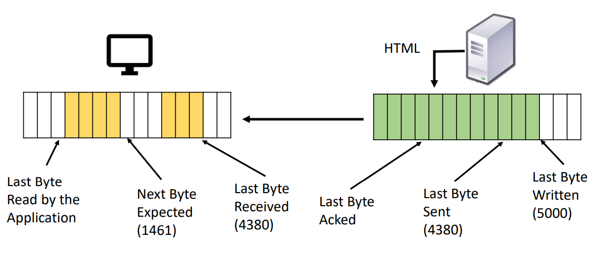
>
>但是, client 缺少了中间一个 packet. 即 1461-2920 没收到..
>
>于是, 在 client 发出第一个 ack 1461 之后, 它收到了第三个 packet, 又会再发出去一个 ack 1461. 
>
>server 遂发现不对劲: 自己当前被 ack 的是到 1460, 而 client 连续发了两次 ack 1461, 说明 client 肯定没收到 1460-2920 . 于是将再发一遍 1460-2920

这里用到了 duplicate ACKs trigger early retransmission: 不用等待 timeout, 只要收到了重复的 ack, 那就说明这个 packet client 没收到. 那么就再发一遍. (**其实通常, 两个的话会等 timeout, k =3 个才会 fast retransmit**)

而后, client 收到 1460-2920 之后, 会给 server 发 ack 2921. 

server 看自己 sent 的数据已经到了 4380, 会继续等, 等待 client 收到 4380. 而 client 确实已经收到了, 检查一遍后, 发现自己已经有后面了, 于是又紧接着发出一个 ack 4380. 然后发现自己没有更多的后面的数据了, 遂开始等待.


总结:

- 连续的 ack 1461 说明 1461 开头那个 packet 没收到
- ack n 的意思是 "client 已经收到了所有 <n 的数据, 正在准备接受 n 开头的那个 packet"


### consistency: resend 之后应该怎么做

有两个方案:

- resend missing packets 后, 根据收到的相同 ACK 的数量, 自动把 sliding windows move 那么些个 numbers

	**更快, 但是未必正确**

- resend missing packets 后, 一直等到 ACK, 等到 ACK 的位置到了自己目前已发送的所有数据的位置, 或者等待新的重复的 ACK (说明后面又缺了), 然后 resend 新缺的. 重复这个过程, 直到目前已经发的全部被 ACK 了, 遂发新数据. 

	**更慢, 但是一定正确**

正确性和效率 -> 正确性更重要. 所以当然 2.


什么时候 slide windows?

- receive windows: **并不是发送 ACK 之后 slide, 而是上层应用读取了数据之后 slide**. windows 的最左边是上次应用读取遗留下没读到的部分. 当然, 如果收到重复的数据 -> 忽略, 不会保存进 windows.

	```
	|<--- 已经被应用读取的部分 --->|<------ TCP 管理的 buffer ----->|
	             ↑
	        left edge = last byte read
	```

	应用如果继续读取:

	```
	|<--------- 新读取的部分 -------->|<------ 剩余 buffer ----->|
	                      ↑
	                left edge 向右滑动
	```

- send windows: **收到 ACK 就马上滑动**


## Retransmission timeout value 的动态选择

时间太长或太短: 

- 太长效率低
- 太短会导致 duplicate packets

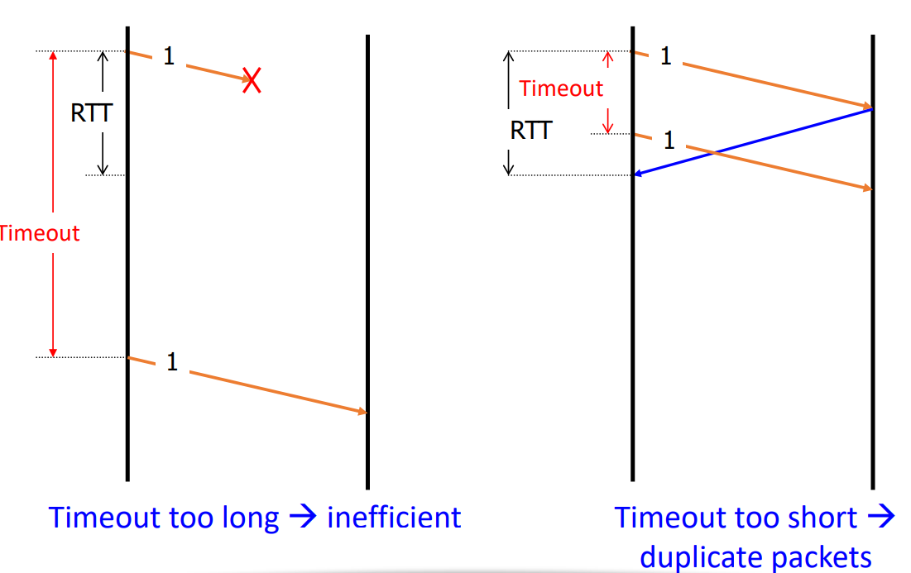

所有我们最好: **make timeout proportional to RTT** (Round trip time)

但我们怎么测量 RTT 呢?


### 基本思路: average RTT

当 sender 发送一个 segment, 并在收到它对应的 ACK 时, 可以测出一个样本 RTT: 
$$
RTT_{sample} = (ACK\ arrival\ time) - (segment\ sent\ time)
$$
然后不断更新一个“平均 RTT”指标, 用作参考:
$$
RTT_{estimate}^{(new)} = (1-\alpha) RTT_{estimate} + \alpha RTT_{sample}
$$
但问题是: retransmitted packet 怎么办呢

答案是直接忽略它. **一旦一个 packet 被 retransmit, 就忽略这个 packet.**


### Karn/Partridge algorithm

Karn/Partridge algorithm 的做法是: 直接用 $\alpha = 0.125$ 来算 avg RTT, 然后首先更新: 
$$
\text{Timeout value (RTO)} =2 \times  RTT_{estimate}
$$
并且 apply 一个 **exponential backoff**. 什么意思呢就是:

- 如果在新的 sample RTT 被测量之前, timeout 又发生了! 那么就更新 $RTO$ 为原先的两倍. 再发生就再翻倍. 最高设一个上限: 比如 60s.
- 等到新的 sample RTT 测量好了, 再重新更新为 $\text{RTO} =2 \times  RTT_{estimate}$

> eg:
> ```
> 初始 RTO = 1s
> 第一次超时 → RTO = 2s
> 第二次超时 → RTO = 4s
> 第三次超时 → RTO = 8s
> ...
> 新的测量数据到来, 重新更新 RTO = 1.5s (比如)
> ```


但问题是: 这很受 RTT 先前的测量影响. Karn 只考虑了平均值, 但如果 RTT 波动很大 (例如无线网络, 跨洲通信), 单纯平均就太慢了. **对 RTT 的 variability 不够敏感**.

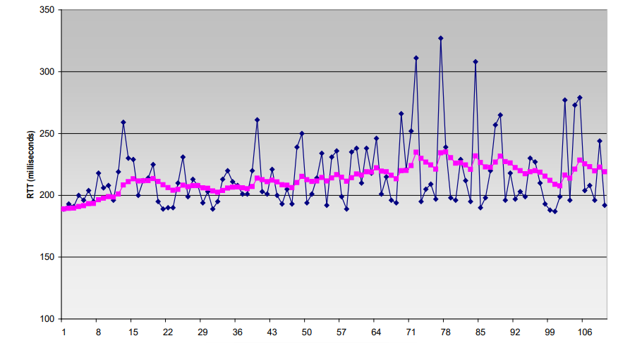

### 改进: Jacobson/Karels Algorithm (1988)

Jacobson/Karels 通过引入 **方差 (Deviation)** 来动态适配 RTT 变化.

公式如下:


1. 差值:

$$
\text{Diff} = RTT_{sample} - RTT_{estimate}
$$

2. 平滑平均:

$$
RTT_{estimate}^{new} = RTT_{estimate}+ \delta \times \text{Diff}
$$

3. 平滑偏差:

$$
\text{Deviation}^{new} = \text{Deviation} + \delta \times (| \text{Diff}| - \text{Deviation})
$$

4. 最终超时时间:

$$
RTO = \mu \times RTT_{estimate} + \phi \times \text{Deviation}
$$

通常, $\mu$ 取 1, $\phi$ 取 4. 

即:
$$
RTO = RTT_{estimate} + 4 \times \text{Deviation}
$$


其中 $4 \times \text{Deviation}$ 是安全裕量 (越不稳定, RTO 越大)

这样:

- 网络稳定时 → Deviation 小 → RTO 变短, 响应更快
- 网络不稳定时 → Deviation 大 → RTO 增长, 避免过早重传

> eg:
>
> 假设:
>
> ```
> SampleRTT = 100ms, 150ms, 110ms, 600ms, 120ms
> ```
>
> 早期算法: 
>
> ```
> EstimatedRTT ≈ 平均 216ms → 太慢, 对突发变化不敏感
> ```
>
> Jacobson/Karels 算法: 
>
> ```
> Deviation 跟踪波动, 在600ms出现时RTO临时加大,
> 600ms过后又快速收敛回来
> ```


## 最终 TCP header

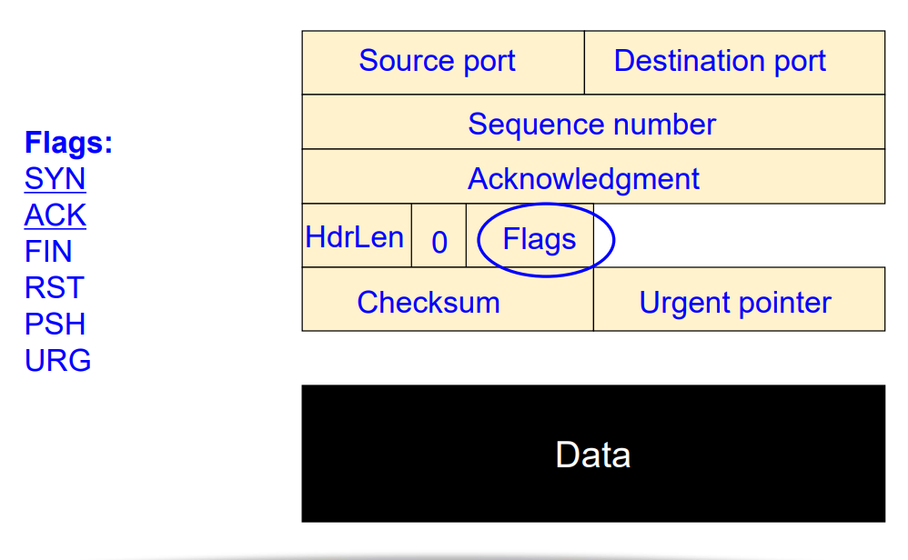

五行, 每行 32b -> 4B

即: 20B.

20B 就是 TCP header 的通常大小. 也就是我们这里建立的这个.

这里的 flags 有何用处? 标记这个 TCP packet 是一个什么东西. 比如: SYN, ACK, FIN. 可以有多个.

**空出的那部分是什么? 是 advertised window;**

**下一节再讲. 此处先忽略**


### 例: 三次握手中的三个 TCP packets

这里 A 是 client (发起 `connect`), B 是 server (发起 `listen`).

从 connect 检测到正在 listen 的 server 起, 第一次握手 (client A 向 server B 发起) 就开始了.

**第一次握手**: 首先, **A 通过给 B 发一个 SYN packet**, 告诉 B 自己向连接, 并发送了自己的初始 seq num 和 ports. 注意: ACK 不算数据, 但是 SYN 算 1B 的数据. 就是说 SYN 会占用 B 的初始 seq num 那一个 Byte, 从而 B 之后接收数据是从初始 seq num + 1 开始.

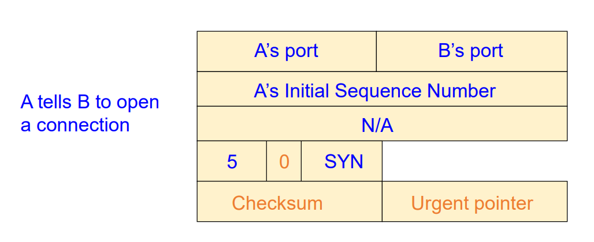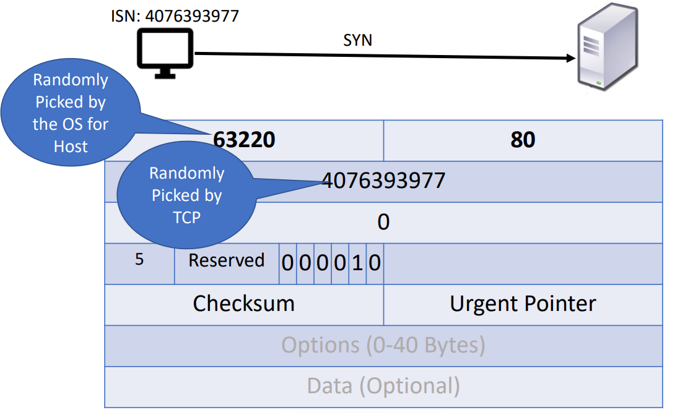

| Client            | Server |
| ----------------- | ------ |
| CLOSED → SYN_SENT | LISTEN |

**第二次握手**: 然后, B 回一个 SYN-ACK packet, 告诉 A 自己已经接受了, 并且准备好接受新的 packet. 同时也**告诉 A 自己的初始 seq num.**

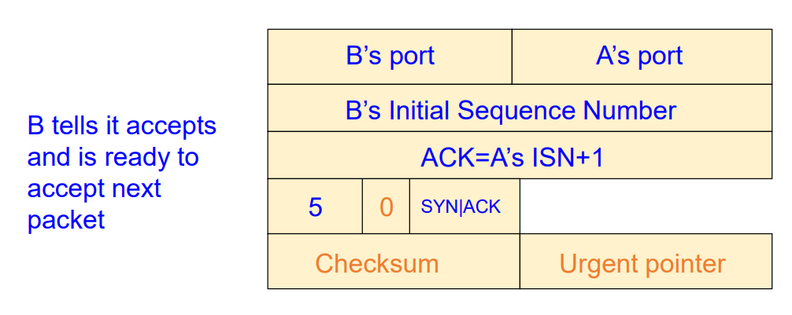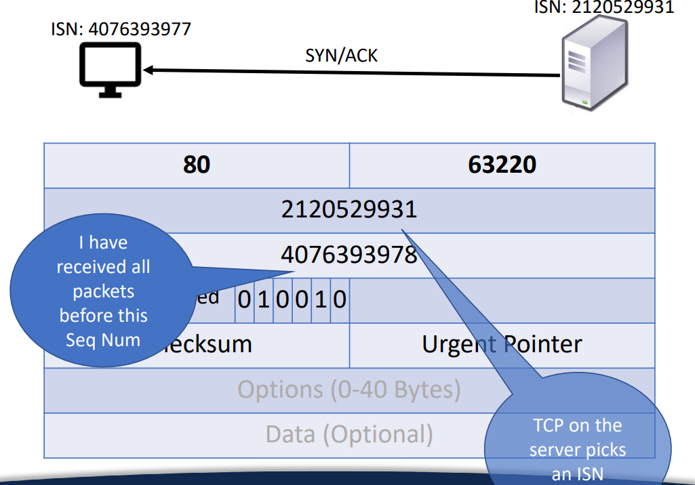

| Client   | Server            |
| -------- | ----------------- |
| SYN_SENT | LISTEN → SYN_RCVD |

最后, A 回 B 一个 ACK, 表示自己已经确认收到了 SYN 和 B 的 seq num, 于是双方序列号确认.

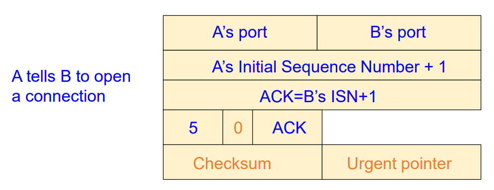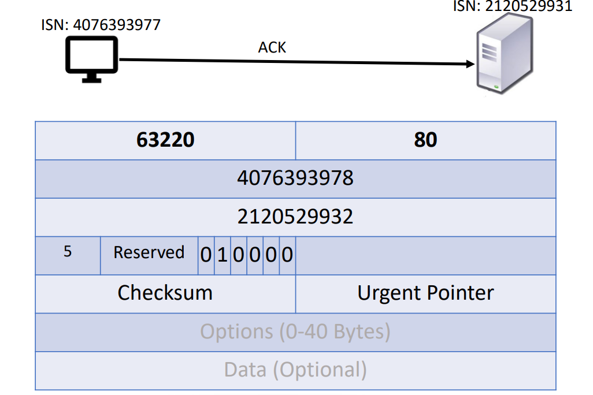

| Client                 | Server                 |
| ---------------------- | ---------------------- |
| SYN_SENT → ESTABLISHED | SYN_RCVD → ESTABLISHED |

整体:

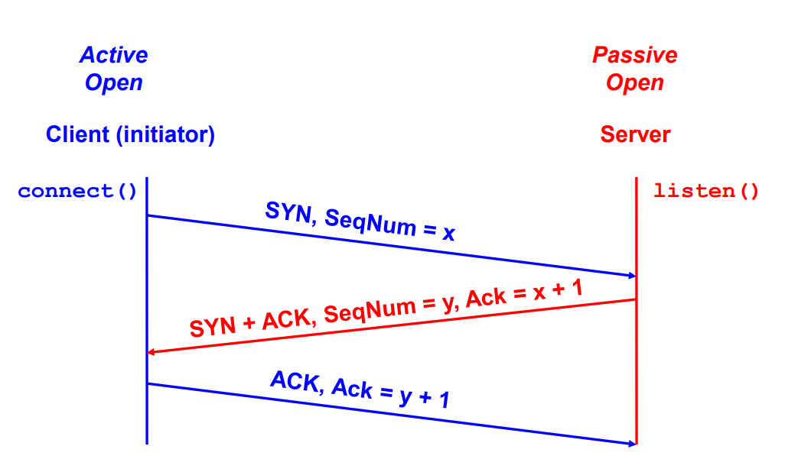

**注意, 在这个过程中, 两方都收到了对方的一个 SYN, 因而都用掉了一个 B 的 seq num (初始位置), 从而更新了 seq num 为 初始位置+1, 以及都更新了 Ack num 也为对方的初始位置+1**

> 例子:
>
> 假设: 
>
> - Client 的初始序列号为 **1000**
> - Server 的初始序列号为 **5000**
>
> Step 1: Client → Server
>
> ```
> SYN, Seq = 1000
> ```
>
> - Client 用掉 1 个序号 (SYN)
> - 下一次发数据时 Seq = 1001
>
> Step 2: Server → Client
>
> ```
> SYN+ACK, Seq = 5000, Ack = 1001
> ```
>
> - Server 用掉 1 个序号 (SYN)
> - Server 的下一个 Seq = 5001
>
> Step 3: Client → Server
>
> ```
> ACK, Seq = 1001, Ack = 5001
> ```
>
> - 纯 ACK 不占序号
> - 双方都完成序号同步
>
> | 角色   | 初始 SeqNum | 收到对方 SYN 后 | 自己下一次可用 SeqNum | AckNum |
> | ------ | ----------- | --------------- | --------------------- | ------ |
> | Client | 1000        | 收到 SYN(5000)  | 1001                  | 5001   |
> | Server | 5000        | 收到 SYN(1000)  | 5001                  | 1001   |


之后: 开始传输数据

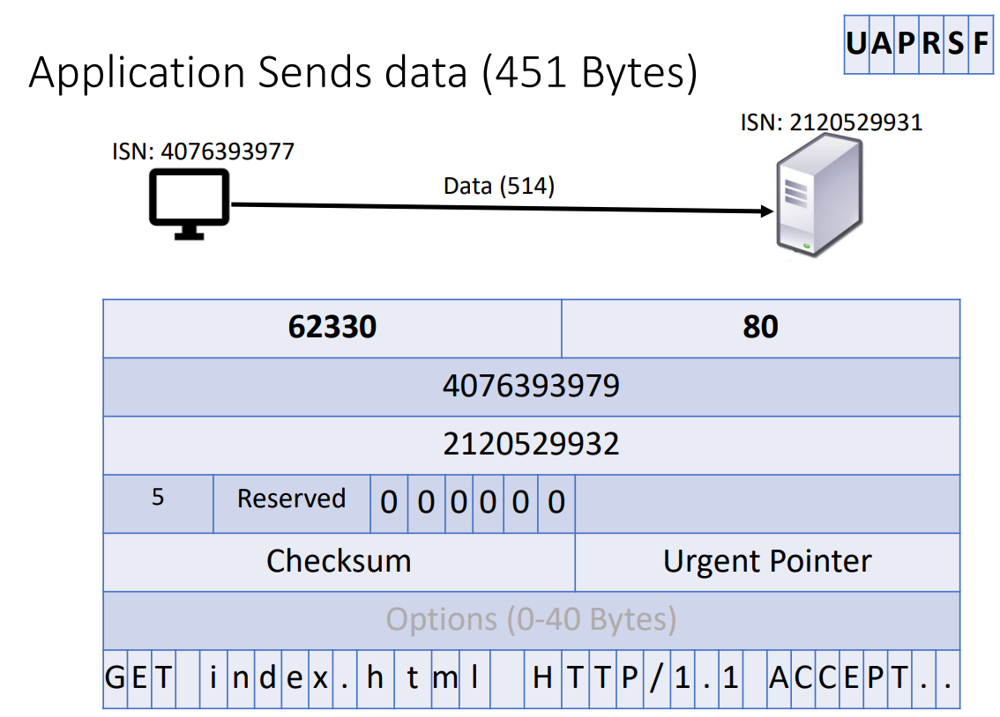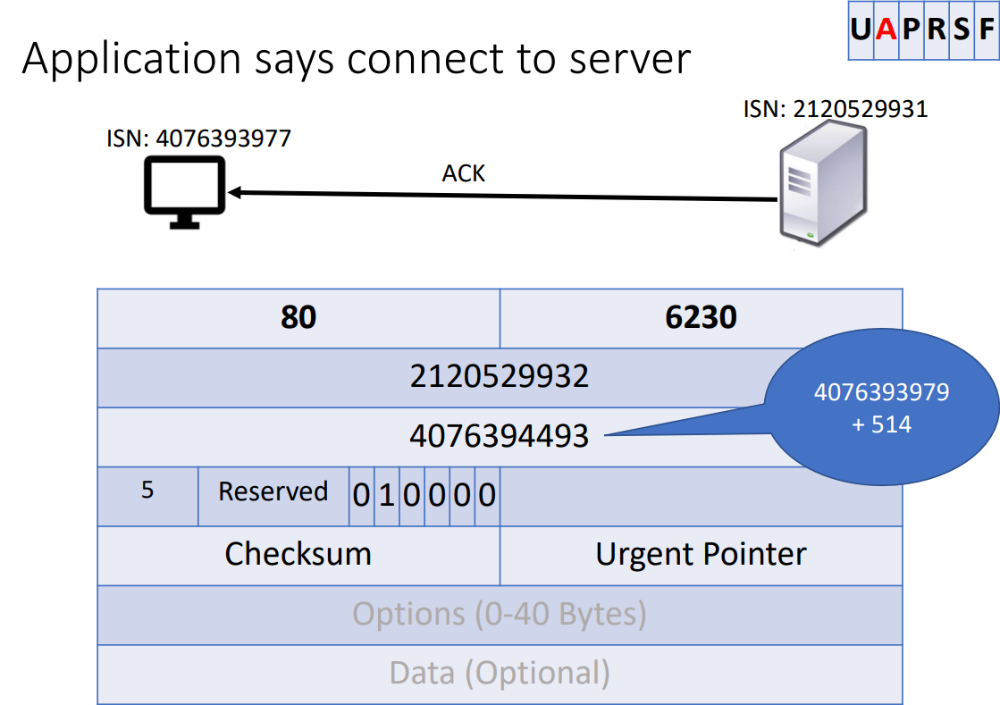


### HTTP exchange 例

request 长这样:

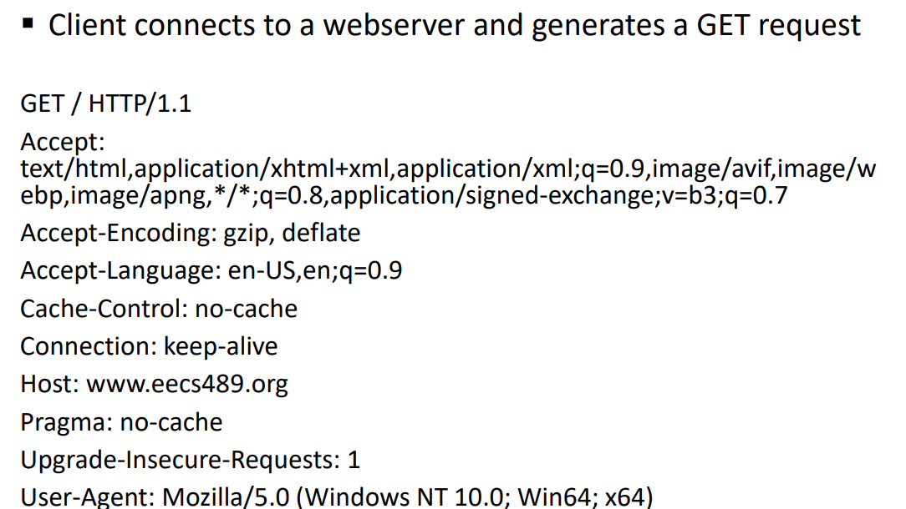

response 长这样:

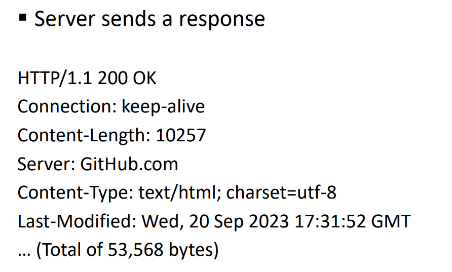


## More about TCP connection

### 三次握手中可能出现的问题

问题场景: SYN 包丢失.

假设客户端 (A) 发起连接: 

```
A → B : SYN
```

但这一个 SYN packet 被网络丢掉了 (比如路由器拥塞, 服务器忙, Wi-Fi 抖动等)

那么TCP 的行为: 超时重传 SYN. 当 A 发出 SYN 后, 它会启动一个 **重传定时器 (SYN Retransmission Timer)**

如果在超时之前没收到服务器的 **SYN-ACK**, 则说明连接请求可能丢失, 于是:

```
A → B : (timeout) Retransmit SYN
```

也就是说, A 会 **重发 SYN**.


问题: A 一开始不知道 RTT

- 在第一次握手时客户端还**完全不知道**对方的 RTT;
- 所以它无法用 Jacobson/Karn 算法去估算;
- 因此系统只能使用一个“默认的初始超时值 (Initial RTO)”.

根据 **RFC 1122** 和 **RFC 2988** 的建议: 
$$
 \text{Initial RTO} = 3 \text{ seconds}
$$
某些实现会更保守, 取 **6 秒**


如果第一次重传的 SYN 也丢了, TCP 会使用 **exponential backoff**

| 重传次数 | 超时时间 (秒) | 累计延迟 |
| -------- | ------------- | -------- |
| 第 1 次  | 3             | 3        |
| 第 2 次  | 6             | 9        |
| 第 3 次  | 12            | 21       |
| 第 4 次  | 24            | 45       |

在多次失败后, TCP 最终会放弃连接 (一般在重传 5 次后)


在网页加载中的影响:

当你在浏览器里点击一个链接时: 

- 浏览器让操作系统执行 `connect()` → 触发 TCP 发送 SYN

如果这个 SYN 丢了, 就要等 3~6 秒

- 用户看到的就是“网页加载中...卡住了几秒”

用户可能以为网断了, 重新点链接

-  浏览器实际上会创建一个新的 socket, 再次 `connect()`

	→ 重新发 SYN, 有时可以立刻成功


但实际上: 

- 3–6 秒的初始 SYN 超时非常明显
- 用户可能多次点击, 刷新页面, 甚至关闭标签页

这就是为什么现代系统和浏览器对初始 SYN 超时非常敏感. 现代操作系统和浏览器通过以下方式优化这种问题:

- **TCP Fast Open (TFO):** 在 SYN 包中携带部分数据, 减少握手延迟
- **SYN Cookies:** 避免 SYN Flood 攻击影响握手
- **Happy Eyeballs (RFC 6555):** 并行尝试 IPv4 和 IPv6 连接, 谁先成功用谁, 减少等待时间


### TCP 连接 teardown

#### normal termination by FIN, 一边接一边 (TCP 四次挥手, four-way termination)

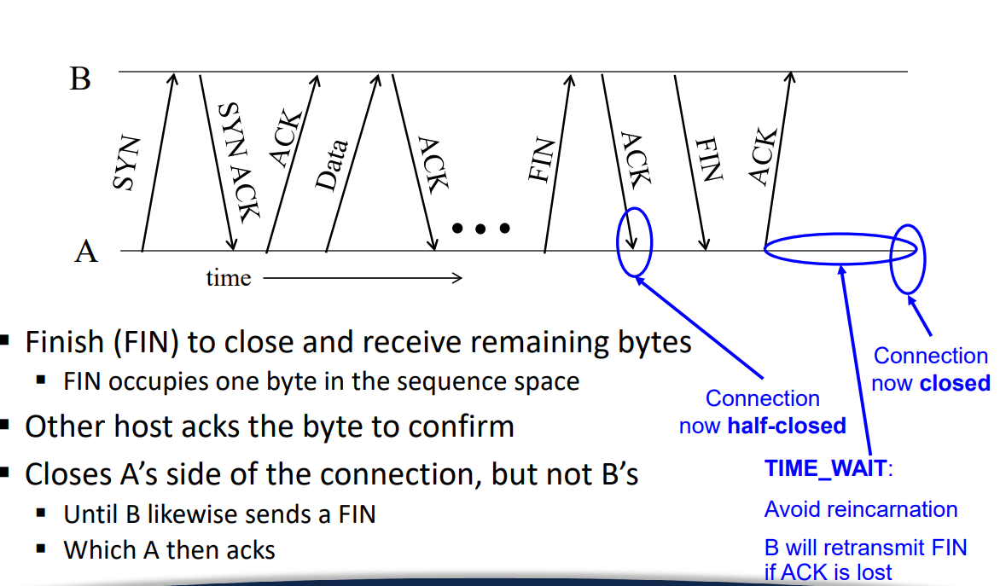

TCP 是**全双工 (full-duplex)** 的: 

> 每一方都可以单独关闭自己发送的方向. 

因此关闭时需要**双方各自发送一个 FIN**, 总共 4 个包, 形成“四次挥手”. 

这里很多问题其实很公式. 并且不太直观. 我们直接说结论, 等下再解释:

- **在 B 第一次收到 A 的 FIN 之后, 这个连接对于 B 而言就 half-closed 了**
- **随后, 当 A 在已经发出 FIN 之后收到了 B 的 ACK, 那么这个连接对于 A 而言也 half-closed 了** (因而这个连接就 half-closed 了)

**half-closed 即: 主动发起 FIN 的一方已经关闭了发送端 (A->B), 而还启用了接受端 (B->A), 等到收完全部数据之后等待被动关闭端 (B) 发送 FIN, 然后自己再回一个 ACK, 完全关闭 (B->A 也关闭).**


我不禁思考: 最后不是 A 还要再发一个 ACK 吗? 怎么能算早就关闭了发送端 (A->B) 呢?

答案是: ACK 不算数据. “连接方向关闭” 指的是 **应用层数据流的方向**. 而 TCP 仍然允许双方发送 **控制报文** (比如 ACK) 来完成关闭过程. 那个 ACK 只是确认控制用, **不代表数据还在流动**.

详细是


**第一步: A → B 发出 FIN**

```
A → B : FIN
```

- A 告诉 B: “我已经发完数据了, 不会再发新的数据. ”
- 这个 FIN 占用一个序号 (就像 SYN 一样)
- B 随机知道这件事, 于是对于 B 算是 half-closed 了

状态变化: 

| 主机 | 状态                       |
| ---- | -------------------------- |
| A    | `ESTABLISHED → FIN_WAIT_1` |
| B    | `ESTABLISHED`              |


**第二步: B → A 回 ACK**

```
B → A : ACK
```

- B 收到 A 的 FIN, 确认它: `Ack = Seq_A + 1`. 
- 这意味着: “我知道你不再发数据了, 我也不会再等你的新包. ”
- B 的**接收方向**被关闭 (因为 A 不再发). 
- 但它仍然可以继续发送数据给 A. 

状态变化: 

| 主机  | 状态         | 含义                                          |
| ----- | ------------ | --------------------------------------------- |
| **A** | `FIN_WAIT_2` | 自己不能再发, 但还能收 (**发送 half-closed**) |
| **B** | `CLOSE_WAIT` | 自己不能再收, 但还能发 (**接收 half-closed**) |

此时连接进入“半关闭 (half-close)”状态: A→B 方向已关闭, 但 B→A 方向仍可通信. 


**第三步: B → A 发出 FIN**

```
B → A : FIN
```

- 当 B 也准备关闭连接时, 发送 FIN. 
- 表示: “我也发完了, 不再发数据. ”

状态变化: 

| 主机  | 状态                    |
| ----- | ----------------------- |
| **B** | `CLOSE_WAIT → LAST_ACK` |
| **A** | `FIN_WAIT_2`            |

此时: 

- B 的发送方向关闭；
- B 仍能接收 A 对 FIN 的确认


**第四步: A → B 回 ACK**

```
A → B : ACK
```

- A 确认收到了 B 的 FIN. 
- A 进入 `TIME_WAIT` 状态: 
	- 等待 **2 × MSL (Maximum Segment Lifetime)** 的时间
	- 防止 B 没收到 ACK 而重发 FIN. 
- 最终 A 也关闭连接. 

状态变化: 

| 主机  | 状态                              |
| ----- | --------------------------------- |
| **A** | `FIN_WAIT_2 → TIME_WAIT → CLOSED` |
| **B** | `LAST_ACK → CLOSED`               |


#### normal termination, 但是双方同时.

这是个特殊情况. 就是当 B 也不再发送数据时.

那么, B 会直接回一个 FIN + ACK.

那么, 就省去了一次挥手.

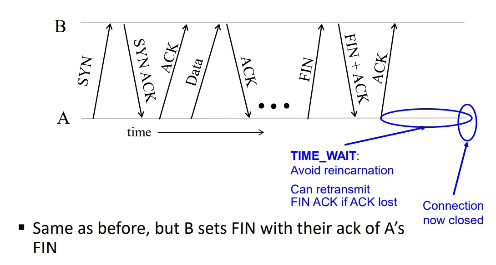


#### abrupt termination (异常中止)

在正常情况下, TCP 连接要通过 **四次挥手 (FIN/ACK)** 来保证双方数据都传完再关闭. 

但在异常情况下 (例如程序崩溃, 端口错误, 非法访问等), 一方会直接发送 **RST 报文**, 强制终止连接. 

这是因为: 这一方的 application crash 了.


比如图中: A 的 application crash 了, 因而给 B 发了个 RST.

这个时候, 所有的 data in flight 都丢失了. 所以此时如果 B 再给 A 发任何数据, A 都只会回 RST.


**RST 的特点**

1. **立即终止连接**
	- 收到 `RST` 的一方 (这里是 B) 必须立刻放弃该连接. 
	- 所有缓冲区的数据 (包括未确认的, 正在传输的) 都会被直接丢弃. 
2. **不需要 ACK**
	- `RST` 报文 **不会被确认** (`B does not ack the RST`). 
	- 也就是说, RST 不是可靠传输的, 如果丢了就丢了. 
3. **数据不再可靠**
	- 由于不经过 FIN/ACK 的四次握手, 此时**仍在传输中的数据全部失效**. 
	- 应用层可能直接收到错误 (如 `Connection reset by peer`). 
4. **原因常见于:**
	- 应用进程崩溃或异常退出. 
	- 应用调用 `close()` 之前直接 `abort()`. 
	- 收到非法 TCP 报文 (例如访问了不存在的端口). 


### TCP connection State Transition machine

这是一个有限状态机, 展示了所有 TCP connection States 之间的变化.

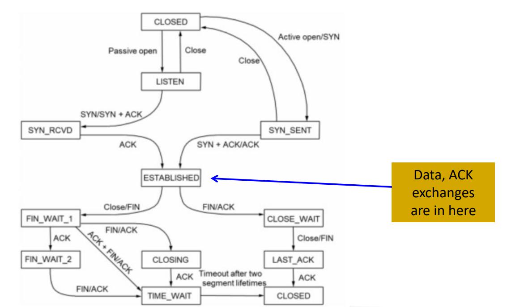