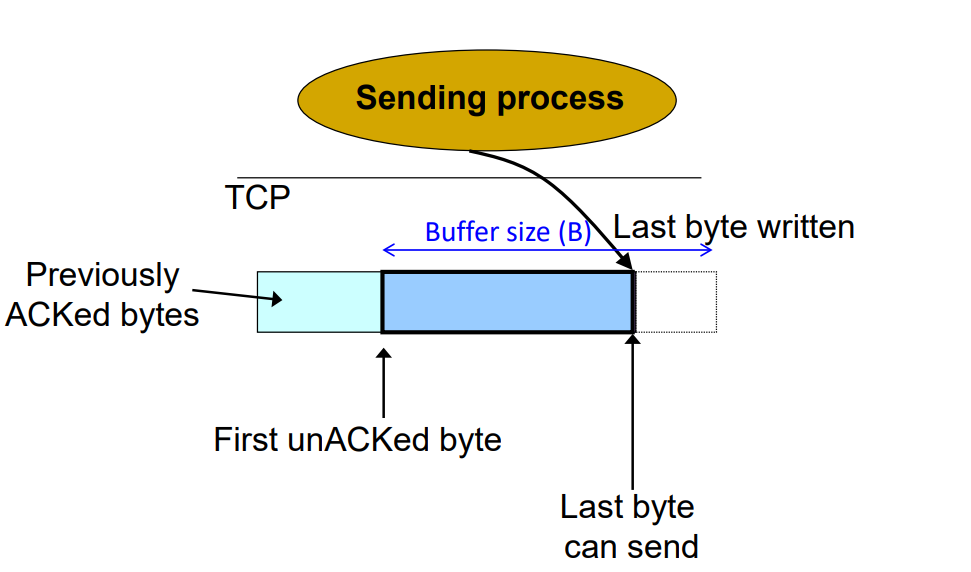
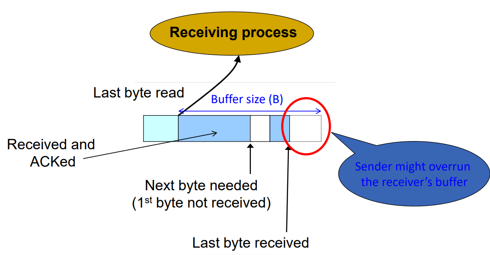
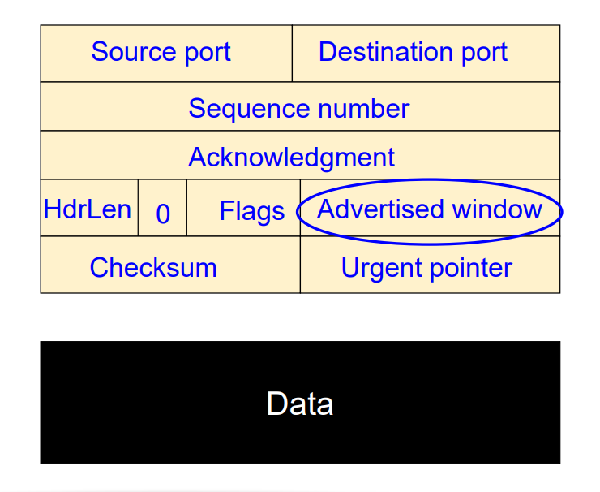
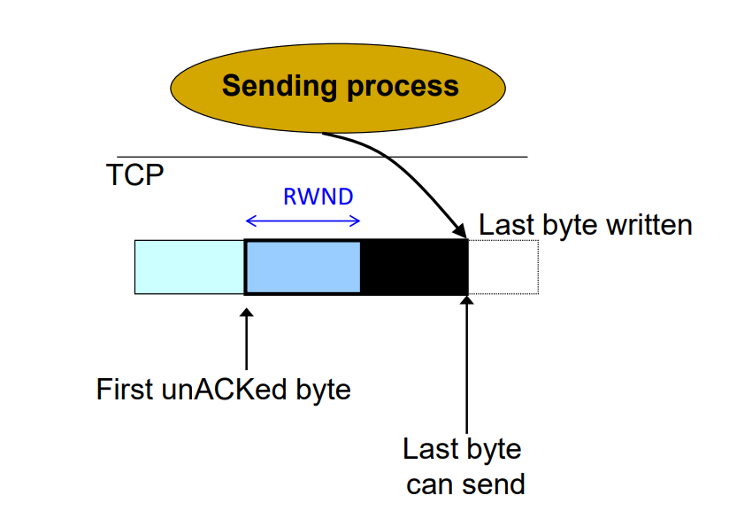
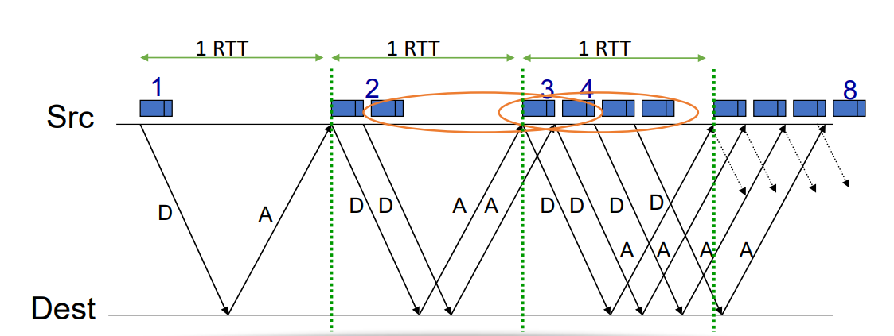
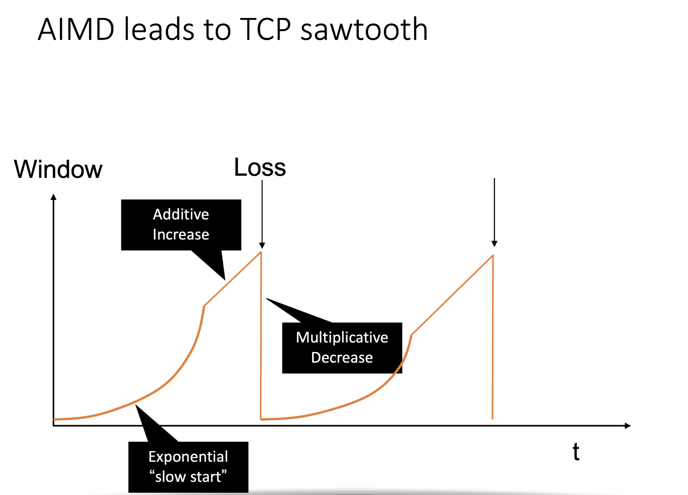

# TCP Flow and Congestion Control

## Flow Control

先回顾一下 sliding window:

TCP 是 **全双工 (full-duplex)** 的协议, 所以:

- 每个方向上 (A→B, B→A) 都维护一个独立的窗口.
- **Sender window**: 控制可以发送、但还没被 ACK 的数据范围.
- **Receiver window**: 控制可以接收、但还没被交付到应用层的数据范围.

sender window 决定“还能发多少”, receiver window 决定“还能收多少”.


**buffer windows 并不是一块固定的空间, 而是 literally "滑动向前的"**

窗口有左右两个边界. 左边界 (left edge) 表示“下一个最关键的位置”.

- **Left edge of window**

	- **对 Sender 而言**: Left edge = **最早一个还没被 ACK 的 segment**. 也就是 “unacknowledged data 的开头”.

		例如:

		```
		已 ACK: 1–99
		未 ACK: 100–200
		```

		那么 sender window 的 left edge 就在 100.

	- **对 Receiver 而言**: Left edge = **下一个期望收到的 byte**. 即 “expected data 的开始”.

		例如:

		```
		已收到: 1–499, 501–600
		缺口: 500
		```

		那么 left edge = 500.

	- **receiver 的 left edge 是上层应用程序已经从 buffer 里读取走的最后一个字节的位置, 而 sender 只有收到 ACK 时才可以可以把自己的窗口左边界往前滑动, 释放出空间给新数据.**

- **Right edge of window**: Right edge of window
	$$
	\text{Right edge} = \text{Left edge} + \text{constant}
	$$
	即: transport layer 的 buffer 限制了可发送 (或接收) 的最大窗口宽度.

	

### issue: receiver buffer can overflow

Sliding window at sender:



Sliding window at receiver:




我们发现一个问题:

- 当 sender 给 receiver 发数据的时候, 所有数据都会立刻进入 receiver bufferr, 不会经过 receiver 确认. 
- **receiver 的上层应用如果读取速度很慢**-> sender 发了 window size 的数据, 全部屯在了 receiver 的 buffer 里面, 直接 overflow 了这个 buffer.

对于 sender 而言, 这个行为是合法的, 但是造成了对 receiver 的破坏. (sender 自己的 Buffer 永远不会被破坏, 因为它的数据全是自己控制的.)

所以这件事情对于 receiver 其实不公平. **因而我们需要一个机制: receiver 在每次 ACK 的时候, 都要告诉 sender, 自己的 Buffer 还剩多大, 这样, 在 sender 收到下一次 ACK 之前, 最多发这么多数据给他, 不能再多!** 

### solution: RWND

**这个 "receiver buffer 剩余的大小" 叫做 “Advertised Window” (RWND)**. 于是, **bytes in flight (即已发送但尚未被 ACK 的数据量, sender windows 中 UnACKed 的部分) 从而不止受 windows size 限制, 还受到 RWND 限制:**
$$
\text{bytes in flight} \le \text{RWND}
$$


RWND 的计算很直白. 就是 **buffer size 中, Last byte received 之后的部分.** recall: buffer 是从 last byte read 开始的. 所以具体而言就是: buffer size - (last byte received - last byte read)

> eg: 
>
> windows size 10
>
> 上次读取的是 100
>
> 上次 received 是 106
>
> 那么 RWND -> 4

RWND 在 ACK 消息的 header 中的位置:



### 考虑 RWND 的 sender windows

那么 sender windows 就不再是:


而是:



只有 RWND 的大小可以放新数据. 后面的部分, 到 last byte written 前的部分, 是空白的. 


### flow control 带来的性能限制

只有 TCP 有 flow control. UDP 没有 flow control.

TCP 的这一 flow control 行为也带来了新的性能限制:


**Sender can send no faster than RWND / RTT bytes/sec**

- 在流量控制下, sender 每次最多只能有 **RWND** 字节的数据处于“in flight” 状态；

- 也就是说, 在一次 RTT（Round Trip Time）中, sender 最多能发送 RWND 这么多数据；

- 因此它的平均发送速率被限制为：
	$$
	 \text{Throughput} \le \frac{RWND}{RTT}
	$$
	

举个例子, 假设

- Receiver 的 buffer (RWND) = 64 KB
- RTT = 100 ms = 0.1s

那么 sender 的最大吞吐率就是：
$$
\frac{64\text{KB}}{0.1\text{s}} = 640\text{KB/s}
$$


并且, receiver 不会主动扩大窗口. 只有当上层应用读取 (consume) 一部分旧数据后，receiver 才会在下一个 ACK 中更新 RWND

- 换句话说, receiver 的窗口增长速度取决于**应用层的读取速率**

那么如果上层应用堵住了: RWND = 0

此时Sender 必须暂停发送. 

- 但它会 **周期性地发送一个 1-byte 的 “probe packet”**, 用来测试 receiver 有没有重新腾出空间；
- 这叫做 **Zero Window Probe (ZWP)** 机制。

一旦 receiver 在 ACK 中回复了一个新的 RWND > 0, sender 就可以继续正常发送


## Congestion Control

我们目前为止 build 的 TCP 协议看起来很 robust 了. 但是其实仍然有问题. 

这就是最早期的 TCP 版本 (1970s): 控制发送速率的唯一机制就是 RWND (flow control). 它只能防止 **receiver** 被淹没, 但无法防止 **网络中间路由器** 被淹没. 

出现这种事情的原因是:

- 如果两个 packets 几乎同时到达一个 router, 那么 router 会 transmit 一个, buffer / drop 另一个
- 这会导致 -> packet lost 以及 timeout 重发.
- 这具有滚雪球效应. 如果有一堆 senders, 每个都重发, 那么一起阻塞了 router. 并且 receivers 几乎一直都收不到, 也不会更新 RWND, 于是几乎所有 senders 全部 send 满 RWND, 并且一次 timeout 之后再次重发, 于是 repeatedly 一直 retransmit. 这就导致 routers 一直处于阻塞的状态. 跟交通堵塞一样.

因而此时: 这个网络中所有人的 throughput 都会大大降低. delay 都会大大提升.

> 比如: “congestion collapse” in Oct. 1986. Throughput on the NSF network dropped from 32Kbits/s to 40bits/sec


### Jacobson's fix to TCP: CWND (Congestion Window)

原始的 TCP 只考虑 receiver 的承受能力 (RWND)，而没有考虑网络的承受能力

于是 Jacobson 提出了革命性的修复方案:  继续使用 TCP 的 **window 机制**，但窗口大小不再固定，而是要**根据网络是否拥塞进行自适应调整**。

他引入了第二个窗口：**CWND (Congestion Window)**

- Sender 的实际发送窗口 = min(RWND, CWND)
- CWND 是 sender 端根据网络反馈调整的动态窗口。

于是, 不需要更改 router 或应用层, 只需要在 TCP 实现中增加几行代码, 完全向后兼容。这使得整个 Internet 能在不改动基础设施的情况下，立刻解决拥塞问题。Jacobson 的思想成为所有现代 TCP 变种的核心, TCP Tahoe, Reno, NewReno, Cubic, BBR... 都是基于这个理念。


下面, 我们尝试理解 CWND 的设计.

首先:
#### key considerations in CWND

- **如何判断 network is congested?**

  网络本身不会主动告诉你“我拥塞了”。所以 TCP 需要通过**隐式信号 (implicit signals)** 来判断：

  - **Increased RTT** (延迟变大) → 拥塞早期信号
  - **Packet loss** (丢包) → 拥塞强烈信号

  有时还会使用**显式信号 (explicit signals)**：像 ECN (Explicit Congestion Notification)，由路由器直接标记

- **谁来负责 takes care of congestion?**

  答案是 end-hosts, 也就是我们的电脑. 

  TCP 的核心理念是 **end-to-end control**. 拥塞的检测和调节由发送端完成，而不是由路由器统一管理。

  也就是说：

  - 每个 sender 都根据自己的观测决定发多少；
  - router 不用保存全局状态；
  - scalability 非常高。

  并且, 这也是 CWND 之所以有用的地方. 因为不用从硬件架构上大作更改, 而是只需要每个 host 多考虑一些事情就可以, 于是才做到轻松地 scale.

- **如何应对 congestion?**

  答案是:  TCP 必须**持续自适应** (continuous adaptation)：

  - 检测网络状况；
  - 调整 CWND；
  - 让发送速率与可用带宽保持平衡；
  - 当拥塞出现时迅速减速，当网络空闲时逐步加速。

  


#### key goals in CWND

无论是哪种拥塞控制算法，它们都必须解决这三个核心问题, 把他们解决掉:


**(1) Discovering the available (bottleneck) bandwidth**

要估计网络的瓶颈带宽 (bottleneck bandwidth)，才能知道“最多能发多快”。

→ TCP Reno 通过 ACK 速率估算，TCP BBR 通过测量 bottleneck 速率估算。


**(2) Adjusting to variations in bandwidth**

网络状况会不断变化（路由变化、其他流竞争、无线波动）

→ 算法必须根据 RTT 变化和丢包不断调整发送速率。


**(3) Sharing bandwidth between flows**

多条 TCP 流必须**公平地共享带宽**

→ Jacobson 的算法保证 “AIMD (Additive Increase, Multiplicative Decrease)”：

- 慢慢增加 (Additive Increase)
- 一旦检测到拥塞, 就成倍减少 (Multiplicative Decrease)

这就是 TCP 公平性 (TCP fairness) 的核心


#### 总结: 需要设计的点

综合我们刚才说的 key considerations 和 key goals, 我们发现处理好这几个事情, 那么就设计出了好的 CWND.

- 随时能 detect congestion, 从而知道 ”什么时候我要开始应对“
- 在限制 congestion 的前提下, Discovering the available (bottleneck) bandwidth
- 针对 variations in bandwidth, 随时调整 send rate 来防止 congestion
- 让多条 TCP 连接 **公平地共享带宽**


Detecting Congestion — 拥塞检测的三种信号

TCP 并不能直接看到网络是否“堵了”，因为路由器不会告诉你队列多长、带宽多小。
 所以 sender 只能通过一些**间接信号 (implicit signals)** 来判断网络状态。

(1) Packet delays

延迟增大 (RTT 变长) 可能表示路由器队列在变满。

- **优点:** 能较早地发现拥塞 (在丢包前就能检测到).
- **缺点:** 非常 noisy.
	- 延迟波动可能是由路径变化、跨洲通信、链路调度等引起的.
	- 因此 “delay-based” 方法（如 TCP Vegas）比 “loss-based” 方法更复杂。

(2) Routers tell end hosts when they’re congested

如果网络支持 **显式信号 (explicit signals)**, 路由器可以直接告诉 sender：

> “我快满了，别再发那么多.”

例如：

- **ECN (Explicit Congestion Notification)** 标志；
- 路由器在 IP header 里打上 ECN bit；
- Receiver 收到后在 ACK 中告诉 sender；
- sender 立刻减小 CWND。

不过，ECN 需要网络设备支持，不是所有路径都能用。

(3) Packet loss

丢包是最经典、最可靠的拥塞信号 (fail-safe signal).

TCP Reno 和 Tahoe 都是基于“丢包代表拥塞”的假设：

> 一旦丢包，就减小发送速率。

但要注意：

- 并非所有丢包都因为拥塞；
- 无线网络可能有 bit error、checksum error 等 “non-congestive loss”.


Not all losses are the same — 丢包类型不一样，反应也不一样

Jacobson 发现：
 TCP 不应该对所有丢包都同样对待。
 丢包的“严重程度”取决于 sender 收到的反馈类型。

(1) Duplicate ACKs — isolated loss

当 sender 连续收到 3 个重复 ACK (dupack) 时：

- 说明 receiver 仍在收到后续数据；
- 网络还在流动，只是某个 packet 中间丢了；
- 属于 “isolated loss”.

这种情况:

- 不需要完全进入超时重传；
- 只需触发 **Fast Retransmit**；
- CWND 减半 (进入 Fast Recovery)；
- 然后继续发送新数据。

(2) Timeout — much more serious

如果 sender **等不到足够的 duplicate ACKs**, 超时 (timeout) 触发：

- 表明网络更严重地堵塞；
- 多个包丢失或路径完全阻塞；
- sender 只能退回到 **Slow Start** 状态。

这时的 CWND 会重置为 1 MSS,
 重新指数式增长, 慢慢探测可用带宽。


(3) Adjust differently for each case

> **TCP will adjust rate differently for each case.**

这正是 **AIMD 机制 (Additive Increase / Multiplicative Decrease)** 的核心精神：

- 对小问题 (duplicate ACKs) → 温和调整；
- 对严重问题 (timeout) → 强烈减速。

| 信号类型       | 来源           | 说明               | 对应反应                        |
| -------------- | -------------- | ------------------ | ------------------------------- |
| Delay ↑        | RTT 测量       | 可能拥塞但不确定   | 暂不降速 (Vegas 会处理)         |
| ECN bit        | 路由器显式通知 | 确认拥塞           | 降低 CWND                       |
| Duplicate ACKs | Receiver 反馈  | 单个 packet 丢失   | Fast Retransmit / Fast Recovery |
| Timeout        | Timer 触发     | 多包丢失, 严重拥塞 | Slow Start (CWND=1)             |

------

一句话总结：

> ✅ TCP 通过 **RTT、ECN、loss** 等隐式或显式信号来检测拥塞；
>  其中 **丢包是最主要信号**，但不同丢包类型对应不同强度的“降速反应”


收到 ACK (新数据, 不是 retransmit): 需要 increase rate

检查到 loss: 需要降低 rate


如何根据当前的 phase of congestion control 来调整 rate? 

- 发现可用的 bottleneck bandwidth 
- 调整到 bandwidth variations


### 通过 "slow start" 来发现合适的 bandwidth

发现 bandwidth 的方法: 肯定要自己自适应.

一个做法: slow start.


一开始 start slow for safety.

然后 ramp up **exponentially** for efficiency.


具体做法: 一开始让 CWND = 1 (MSS)

从而 initial sending rate 为 MSS / RTT

之后: 对于每个 RTT, 我们都 double CWND.

- 即: 对于每个 ACK, 我们都让 CWND +1. 

- linear increase per ACK -> exponential increase in CWND per RTT 

	


- 于是发送速率成指数增长。

$$
\text{CWND after } n \text{ RTTs} \approx 2^n \times \text{MSS}
$$


slow start 何时 stop?

Slow Start gives an estimate of available bandwidth, 但是既然是速率单调递增的, 那么一定到了某个点就会出 loss. 并且很快就可以检测到.

到这个点 -> 我们就要开始停止增加, 并做一次降低速率.


**作用：**
 在连接刚开始时，TCP 不知道网络容量是多少，
 所以它“试探性地”从小到大增加发送窗口。

**规则：**

- 初始时：`CWND = 1` MSS；
- 每收到一个 ACK：`CWND += 1`；
- 所以每个 RTT 内，CWND **指数级增长** (2×, 4×, 8×...)；
- 一直到出现丢包或超过阈值 `ssthresh`。

📈 举例：

```
RTT 1: CWND = 1
RTT 2: CWND = 2
RTT 3: CWND = 4
RTT 4: CWND = 8
...
```

**停止条件：**

- 如果 `CWND > ssthresh` → 进入 Congestion Avoidance；
- 如果出现 packet loss → ssthresh = CWND / 2，然后重新从 1 开始。


### AIMD（加性增大、乘性减小）

当 TCP 进入**拥塞避免阶段 (Congestion Avoidance)** 后，它假设：

> 网络大致稳定，可以逐步加速。


Additive Increase (AI)

- 每收到一个 ACK：
  $$
  CWND = CWND + \frac{1}{CWND}
  $$

- 也就是每个 RTT 增加约 1 个 MSS。
   → **线性增长**


Multiplicative Decrease (MD)

- 一旦检测到丢包（代表网络拥塞）：
  $$
  ssthresh = \frac{CWND}{2}
  $$

  $$
   CWND = 1
  $$

   然后重新进入慢启动 → **指数下降**


| 阶段                          | 增长方式   | 数学公式                  | 特点             |
| ----------------------------- | ---------- | ------------------------- | ---------------- |
| **Slow Start**                | 指数增长   | CWND += 1 per ACK         | 快速找到带宽上限 |
| **Congestion Avoidance (AI)** | 线性增长   | CWND += 1/CWND per ACK    | 稳定增加速率     |
| **On Loss (MD)**              | 减半并重启 | ssthresh = CWND/2, CWND=1 | 防止过载         |


- **ssthresh (slow start threshold)**：决定何时从慢启动切换到拥塞避免；
- **dupACK fix**（图里说暂时忽略）：实际实现中 TCP Reno 会在收到多个重复 ACK 时提前减半，而不是等到超时；
- 这个机制就是经典的 **AIMD 算法**，保证：
  - 网络稳定（不会爆炸式拥塞）；
  - 带宽能被公平共享。


主流算法（Reno, Tahoe）里，`ssthresh` **不会自动上升**, 除非重新建立连接（新的 TCP flow 会重新初始化一个大阈值）。

它只会在丢包的时候减半, 但不会提升.

| 情况                | ssthresh 变化          | 原因         |
| ------------------- | ---------------------- | ------------ |
| 第一次连接          | 初始化为大值 (如 64KB) | 不知道带宽   |
| 慢启动期间丢包      | ssthresh = CWND / 2    | 拥塞，减少   |
| 拥塞避免阶段丢包    | ssthresh = CWND / 2    | 拥塞，减少   |
| 长期无丢包          | 不变                   | 网络稳定     |
| 极少数实现 (BBR 等) | 可增大                 | 重新评估带宽 |





### 为什么选择 AIMD over MIMD

为什么 TCP 选择 **AIMD (Additive Increase, Multiplicative Decrease)** 来做拥塞控制？

TCP 拥塞控制的目标是 **高效 (efficiency)** + **公平 (fairness)**：

每个 RTT，TCP 都可以选择几种方式来调整速率（或 CWND）：

| 模式               | 公式            | 说明               |
| ------------------ | --------------- | ------------------ |
| **Additive**       | CWND → CWND + b | 线性变化（温和）   |
| **Multiplicative** | CWND → a × CWND | 按比例变化（剧烈） |

于是可能有四种组合：

| 策略     | 增长方式 | 减小方式 | 效果             |
| -------- | -------- | -------- | ---------------- |
| **AIAD** | 温和增加 | 温和减少 | 收敛太慢         |
| **AIMD** | 温和增加 | 剧烈减少 | ✅ 平衡最好       |
| **MIAD** | 剧烈增加 | 温和减少 | 太激进，容易拥塞 |
| **MIMD** | 剧烈增加 | 剧烈减少 | 振荡太大，不稳定 |

**AIMD 被选中**，因为它：

- 逐步探测带宽（additive increase），不会太冒进；
- 一旦拥塞立刻退半（multiplicative decrease），能迅速稳定；
- 最终各个流都会在相同带宽下稳定共存。


每个用户的变化都是乘法比例，因此：
$$
\frac{x_1}{x_2}
$$
在整个过程中保持**不变**。

换句话说：

- 如果一开始 user1 比 user2 快两倍；
- 那不管增加或减少多少次，它们**永远保持 2:1** 的比例；
- 因此永远不会靠近公平线。


- 每次丢包后，所有用户都乘性减半；
- 之后每个 RTT，大家都**以相同的速率 a_I 线性增加**；
- 这会让速度较慢的流追上速度较快的流；因为加的是相同的 “绝对值”，而不是同样的“比例”。

- 随着多次增加/减少循环，用户速率的差距不断缩小；
- 最终所有流都会在 “红线 × 绿线” 交点附近震荡；
   → **既公平又高效。**
