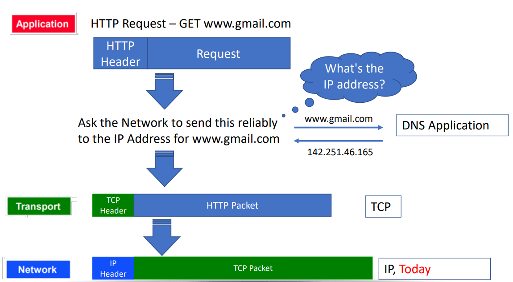
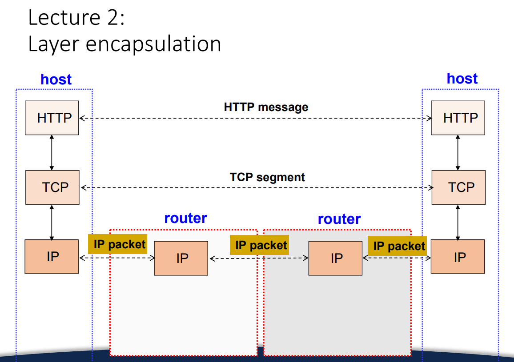

router 要做的事情: 收到了自己网络里的 packet, 要把它 send 给另一个网络.


问题: 我们电脑上不可能存到所有 ip 的具体路径. 首先数据量巨大, 其次我们的 ip 会变. 变了以前存的都炸了.


所以说:

 router 不可能依靠一种中心化的路径导向.

现实的方法: 让 router 存一个 "转发指令表". 

- 对于这个目标 IP, 我要把信息转交给谁, 让他来帮我转发给下一个人, 从而一路转发到那个目标 ip?

从而, 当一个路由器收到一个 IP 数据包时, 它只关心两件事：

1. **目标 IP 地址 (Destination IP) 是谁？**
2. **我该把它交给谁 (Next Hop)？**


路由表 be like:

| 目标网络 (Destination) | 下一跳 (Next Hop) | 出口接口 (Interface) |
| ---------------------- | ----------------- | -------------------- |
| 192.168.1.0/24         | — (直连)          | eth0                 |
| 10.0.0.0/8             | 192.168.1.1       | eth0                 |
| 0.0.0.0/0 (default)    | 47.88.0.1         | eth1                 |


具体而言:

```
你的电脑 → 家用路由器 → ISP路由器 → 中间骨干路由器 → 对方ISP → 对方路由器 → 对方电脑
```

这些中转站

- **不会偷看你的消息内容**（如果你用 HTTPS/TLS）；
- **不会修改 IP Header** 的目标地址；
- **只负责转发** 到下一跳；
- 每个只知道“下一步往哪送”，不需要知道最终目的地的具体位置。


于是, 任何 router 都会建立一个这样的 forward table. router 只会做两件事: routing 和 forwarding.

- routing 就是建表
- forwarding 就是查表 -> 把消息 (不管是哪里来的) 转发给 dest ip 在你这里对应的下个人.


recall:




# IP protocol

## Designing IP header

首先是这个 ip segment 的基本信息字段:

| 字段              | 位数    | 作用                                 |
| ----------------- | ------- | ------------------------------------ |
| **Version**       | 4 bits  | 指示 IP 协议版本 (IPv4 或 IPv6)。    |
| **Header Length** | 4 bits  | 指明首部长度 (通常为 20 bytes)。     |
| **Total Length**  | 16 bits | 指整个 IP 包的长度 (header + data)。 |

然后是: source address 和 dest address. 这肯定是必要的:

| 字段                    | 位数    | 作用                     |
| ----------------------- | ------- | ------------------------ |
| **Destination Address** | 32 bits | 目标主机的 IPv4 地址。   |
| **Source Address**      | 32 bits | 发送方主机的 IPv4 地址。 |

然后: 如何处理一些传输问题.

| 问题类型             | 对应字段             | 位数    | 作用                                                         |
| -------------------- | -------------------- | ------- | ------------------------------------------------------------ |
| **Loops**            | TTL (Time To Live)   | 8 bits  | 每过一个 router 减 1, 为 0 时丢弃, 防止无限循环。            |
| **Corruption**       | Header Checksum      | 16 bits | 检查头部是否被破坏 (错误时丢弃包)。                          |
| **Too Large Packet** | Fragmentation fields | 32 bits | 用于分片和重组过大的包。包括 Identification, Flags, Fragment Offset。 |


### 4️⃣ 为什么要重新计算 checksum

- TTL 每经过一个 router 就会减 1 → header 内容变化。
- 因此每个 router 都要重新计算 IPv4 header checksum。
- 这个 checksum 只保护 header, 不保护 data (data 由上层协议如 TCP 校验)。

------

### 5️⃣ IPv6 的不同点

IPv6 删除了 header checksum 和 fragmentation fields，原因是：

- 链路层和上层协议（如 TCP/UDP）已经有校验；
- 减少中间路由器的负担，提高转发速度；
- 分片由发送方负责，不再由中间路由器分片。