# Computer Vision overview

cv 的常见用处:

- object detection
- 3D reconstruction (from RGB images) and modeling
- robot vision

学习路径:

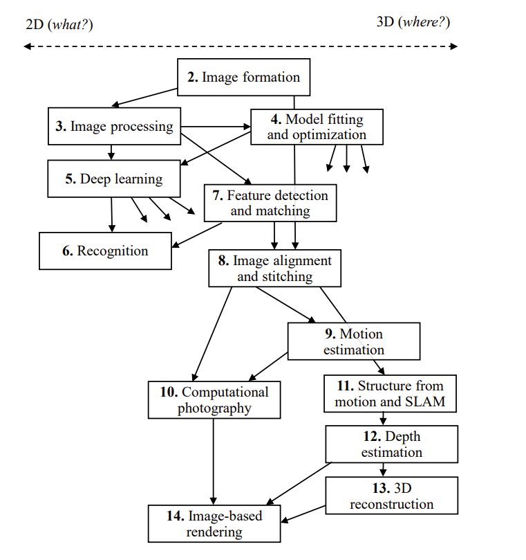

[^1]: picture credit: https://szeliski.org/Book/, page 23.

# Image processing

## image as a signal

图像是信号的一种. 

- **一维离散信号**：

  - 音频、时间序列

    是 $y : \mathbb{Z} \to \mathbb{R}$ 的函数

    更 compact 的形式是 
    $$
    y:\mathbb{Z}_{\text{length}} \to \mathbb{R}
    $$
    等同于一个 $\mathbb{R}^{\text{length}}$ 的 vector.

- **二维离散信号**：

  - 图像（灰度）

    是 $I : \mathbb{Z}^2 \to \mathbb{R}$ 的函数

    更准确而言是 
    $$
    I: \mathbb{Z}_{\text{pixels(hori)}}\times  \mathbb{Z}_{\text{pixels(verti)}} \to [0,255]
    $$
    等同于一个 $\mathbb{R}^{\text{pixels}(\text{hori})} \times \mathbb{R}^{\text{pixels}(\text{verti})}$ 的矩阵, 其元素值取自 $[0,255]$

  - 图像（RGB）

    是 $I : \mathbb{Z}^2 \to \mathbb{R}^3$ 的函数

    更准确而言是
    $$
    I: \mathbb{Z}_{\text{pixels(hori)}}\times  \mathbb{Z}_{\text{pixels(verti)}}   \to [0,255]^3 \\
    I(m,n)=(R(m,n),G(m,n),B(m,n))
    $$

    也等同于一个 $(\mathbb{R}^3)^{\text{pixels}(\text{hori})} \times (\mathbb{R}^3)^{\text{pixels}(\text{verti})}$ 的矩阵, 其元素值取自  $[0,255]^3$

- **三维离散信号**：

  - 视频（空间 + 时间, 灰度）

  - 3D 模型（灰度）

    都是 $V : \mathbb{Z}^3 \to \mathbb{R}$ 或者 $V : \mathbb{Z}^3 \to \mathbb{R}^3$ 的函数

所以图像是信号处理里的一个特殊例子. 

## convolution and neighborhood filtering

**linear filter 就是一个线性算子** $H$, 作用在输入信号 $g$ 上.
$$
f = H(g)
$$
假设输入信号 $g\in \mathbb{R}^N$, 而输出信号 $f \in \mathbb{R}^M$, 那么
$$
H = (H[n,k]) = 
\begin{bmatrix}
H[0,0] & H[0,1] & \cdots & H[0,N-1] \\
H[1,0] & H[1,1] & \cdots & H[1,N-1] \\
\vdots & \vdots & \ddots & \vdots \\
H[M-1,0] & H[M-1,1] & \cdots & H[M-1,N-1]
\end{bmatrix} \in \mathbb{R}^{M \times N}
$$
这里每个 $h[n,k]$ 就是矩阵第 $n$ 行、第 $k$ 列的元素. 

对 **一维信号**, linear filter 即：
$$
f[n] = \sum_{k=-\infty}^{\infty} H[n, k] \, g[k]
$$

- $g[k]$ 是输入
- $f[n]$ 是输出

对 **二维图像**, linear filter 即：
$$
f[m,n] = \sum_{i}\sum_{j} H[m,n; i,j] \, g[i,j]
$$

- $g[i,j]$ 是输入矩阵
- $f[m,n]$ 是输出矩阵

### convolution

对于一个 linear filter $H$, 如果 diagonal 上的所有元素都是相同的(未必是 block matrix)：
$$
H =
\begin{bmatrix}
h[0] & 0     & 0     & \cdots & 0 \\
h[1] & h[0]  & 0     & \cdots & 0 \\
h[2] & h[1]  & h[0]  & \cdots & 0 \\
\vdots & \vdots & \vdots & \ddots & \vdots \\
h[K-1] & h[K-2] & h[K-3] & \cdots & h[0] \\
0 & h[K-1] & h[K-2] & \cdots & h[1] \\
0 & 0 & h[K-1] & \cdots & h[2] \\
\vdots & \vdots & \vdots & \ddots & \vdots
\end{bmatrix}.
$$
我们知道这个叫做 Toeplitz 结构. 一言概括即:
$$
H[n,k] = h[n-k]
$$
那么则称之为一个 convolution. 

> ex:  1D 和 2D 图像的 convolution 
>
> - $$
>   f[n] = \sum_{k} H[n, k] \, g[k] = \sum_{k} h[k] \, g[n-k] =  \sum_{k} h[n-k] \, g[n]
>   $$
>
> - $$
>   \begin{align}
>   f[m,n] &= \sum_{i}\sum_{j} h[m,n; i,j] \, g[i,j] \\
>   &=\sum_{i}\sum_{j} h[i,j] \, g[m-i, n-j]\\
>   &= \sum_{i}\sum_{j} h[m-i,n-j] \, g[m, n]
>   \end{align}
>   $$

我们学过 analysis 就知道它的连续形式是: 

> $$
> f(t) = \int h(\tau)\, g(t-\tau)\, d\tau = \int h(t-\tau)\, g(\tau)\, d\tau
> $$

我们可以 denote 这个操作为: 
\[
f = (h * g)
\]

### convolution (与 cross-correlation) 的几何理解

convolution 的几何理解:  **Toeplitz 结构**的每条对角线上的元素相同, 即

- 每一行就是在上一行的基础上整体平移一格. 
- 所以当 $H$ 作用在信号 $g$ 上时, 输出 $f$ 的模式和 $g$ 的平移保持一致. 

因而几何意义就是: 当把输入图像整体往右 / 往下挪一个像素, 输出结果也会整体挪相同的像素.

因而它相当于：有一个 “convolution kernel”, 在整张图像上是**以同样的方式滑动**, 不会因为位置不同而改变规则. 称之为 **translation-invariance**.

容易发现, 对于 convolution matrix $H$, 它对于 input $g$ 的作用
$$
f =Hg
$$
就等同于用一个小 matrix (即 “convolution kernel” 倒过来) 扫过整个 g, 在扫过 input 每个元素时都用这个 matrix 与 input 中这个元素为中心的区域来和倒过来的 kernel 做加权和运算.

- 更简洁而言: **每个输出像素 = kernel 和对应输入邻域 patch 的 dot product**; 

这个运算如果去掉 “kernel 倒过来” 这一部分, 称为 cross-correlation (**互相关**)
$$
(f \star g)(t) = \int_{-\infty}^{\infty} f^*(\tau)\, g(t+\tau)\, d\tau
$$
而如果加上  “kernel 倒过来” 这一步则变成了我们现在所说的卷积:
$$
(f * g)(t) = \int_{-\infty}^{\infty} f(\tau)\, g(t-\tau)\, d\tau.
$$

linear filtering with filter kernel: 即 convolution.

我们可以使用不同的 convolution kernel 来进行不同形式 linear filtering.  

**定义: 使用 convolution kernel 进行 filter 的 linear filtering 就叫做 neighborhood filtering.**

### neighboring filters (i.e. convolution with a kernel)

#### ex1:  average filter (denoising)

**形式**：所有权重相等的均值核, 比如 $3\times 3$ 的 $\tfrac{1}{9}\mathbf{1}$. 

> 我们用 convolution kernel  来扫过下面的 input $g$ 的第一第二个元素 (附近的 kernel 形状), 得到 output 的第一第二个元素:
>
> 
>
> 这里, 输入和输出 (左列和上行是 padding) 都是 6*6 matrix, 即 $f,g\in\mathbb{R}^{6\times6}$, 而把它们 flatten 后则得到 
>
> 这个 $3\times3$ convolution kernel 的完整 convolution matrix 是: $H \in \mathbb{R}^{36} \times \mathbb{R}^{36}$, 每一行在对应的 $3 \times 3$ 邻域位置放上 $1/9$, 其余位置是 0, 即每行只有 9 个非零元素 (1/9).
>
> 画出来就是: 
>
> 

**用途**：图像去噪 (denoising)、模糊 (blur), 通过邻域平均来抑制噪声, 但也会模糊边缘

我们可以用 average filter 来从 noisy image 复原 original image. 

#### ex2: impulse filter

- **形式**：一个像素为 1, 其余为 0. 
- **用途**：保持图像不变, 进行平移.

#### ex3: **sharpening filter**

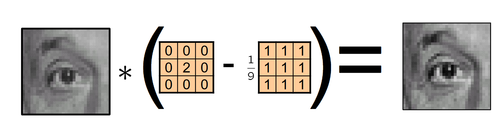

ex:
$$
\begin{bmatrix}
0 & 0 & 0 \\
0 & 2 & 0 \\
0 & 0 & 0
\end{bmatrix}
\;-\;
\frac{1}{9}\begin{bmatrix}
1 & 1 & 1 \\
1 & 1 & 1 \\
1 & 1 & 1
\end{bmatrix}
$$
强调像素和邻域平均值之间的差异, 从而增强边缘、增加清晰度

#### ex4: derivative filters (edge detection)

remember, 一个 image 其实是一个函数:

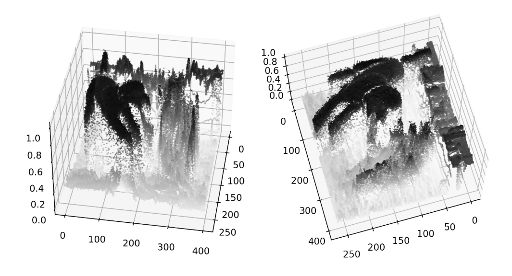

因而它梯度大的地方就是它的边缘.

这个函数在分析的定义上来看是一个 piecewise const 函数, 在网格内 const, 在网格线上 jump discontinuous, 如果把它看作 $\mathbb{R}^2 \to \mathbb{R}$ 的话, 

但是我们可以用两个网格之间的 intensity 变化来数值近似梯度（即有限差分）

- 水平梯度
  $$
  \frac{\partial \mathbf{I}}{\partial x} \approx \mathbf{I}(x, y)-\mathbf{I}(x-1, y)
  $$
  数值近似: 
  $$
  d_x = \begin{bmatrix}
  0 & 0 & 0 \\
  -1 & 1 & 0 \\
  0 & 0 & 0
  \end{bmatrix}
  $$
  
- 垂直梯度
  
  类似. 数值近似是:
  $$
  d_y = \begin{bmatrix}
  0 & 0 & 0 \\
  0 & 1 & 0 \\
  0 & -1 & 0
  \end{bmatrix}
  $$

这里是向后差分, 当然也可以中心差分：
$$
\frac{\partial \mathbf{I}}{\partial x}(x, y) \approx \frac{\mathbf{I}(x+1, y)-\mathbf{I}(x-1, y)}{2}
$$
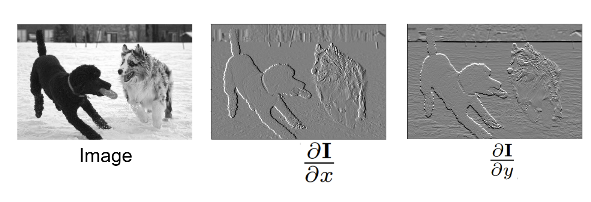
$$
\text { Total edge strength: } S=I_x^2+I_y^2
$$
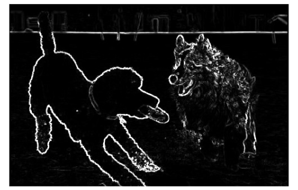

#### ex5: Gaussian filters (blurring, smoothing)

box 形状的 blurring 会让整个图都有一层方形的拉伸. 每个像素受到方形周边区域的影响. 

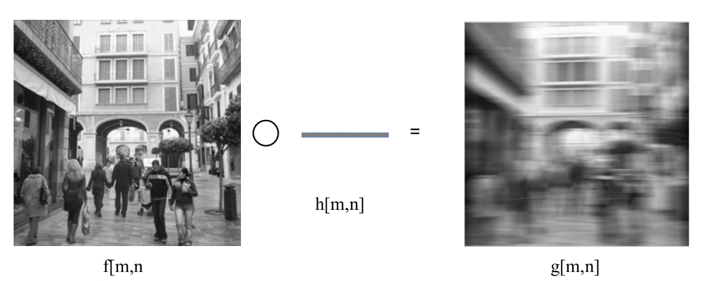

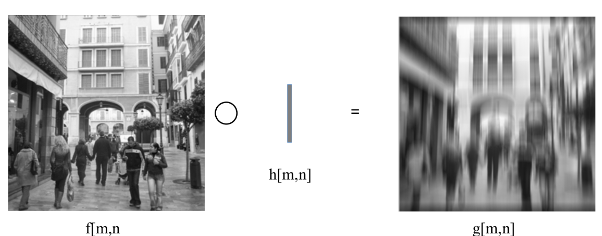

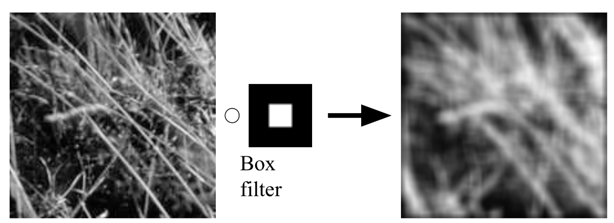

[^]: Image source: D. Forsyth

我们更希望有一个这样的 kernel:

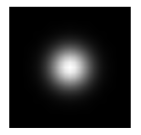

于是我们自然想到使用高斯分布:
$$
G_\sigma=\frac{1}{2 \pi \sigma^2} e^{-\frac{\left(x^2+y^2\right)}{2 \sigma^2}}
$$

- Constant factor in front makes kernel sum to 1
- Can estimate it by simply summing the values in the kernel

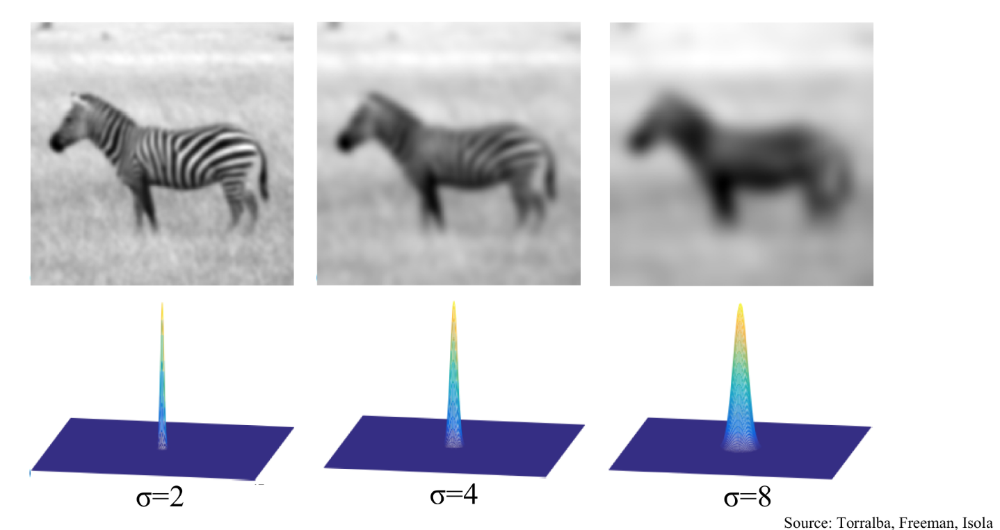

### more about Gaussian and gradient filters

#### properties of Gaussian filters

- 性质 1: 一个 Gaussian filter 和另一个 Gaussian filter 的 convolution 仍然是一个 Gaussian filter.

  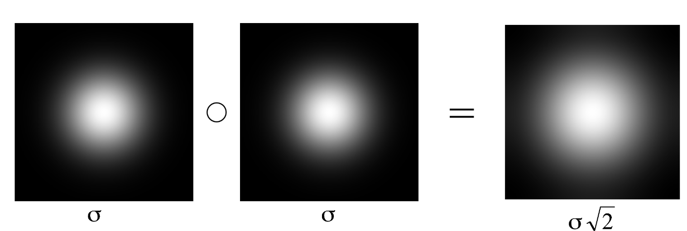

- 性质 2: Gaussian filter 是 separable 的:

  - convolution with 2D Gaussian filter ($n\times n$) 等于先后 convolution with 两个 1D Gaussian filters  ($n\times 1, 1\times n$)
  - 因而不论是多少维的 Gaussian filtering, 都可以直接可以把复杂度降低到 $O(n)$.

  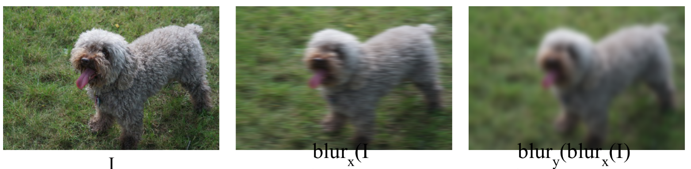

  

#### combining Gaussian and derivative filters

derivative filter 的问题是: 它对于很小的边缘也很敏感.

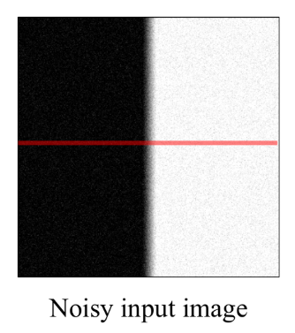

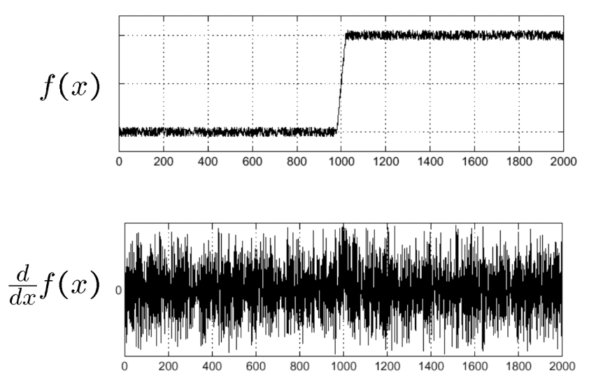

因而我们的解决方法是: 在差分求数值导前, 先 apply 一个 Gaussian filter 来 smoothing

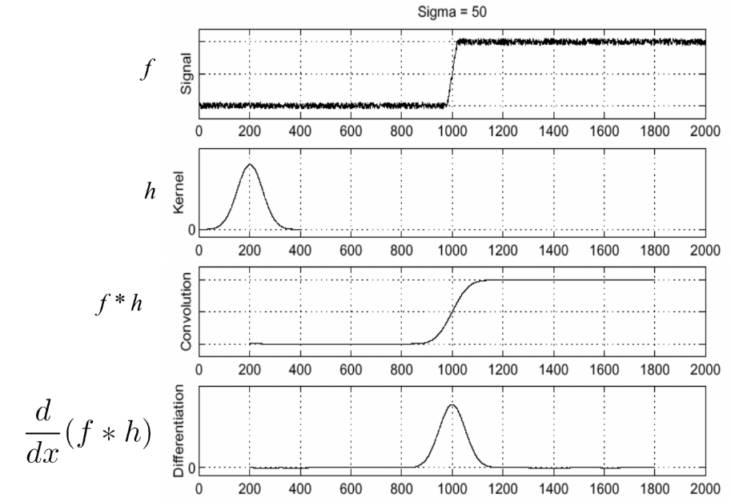

[^2 ]: image source: S. Seitz

#### 任意方向上的 gradient filters

我们如果想要特定方向上的 gradient filter:

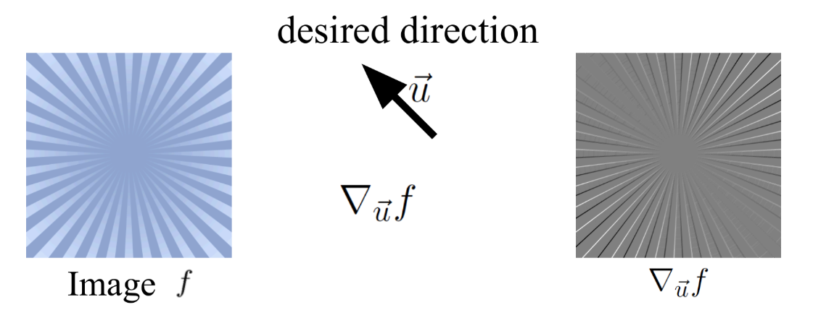

我们可以使用 multivariable calculus fact:
$$
\nabla_{\vec{u}} f(\vec{x})=\nabla f(\vec{x}) \cdot \vec{u}
$$
更具体:
$$
\frac{\partial f}{\partial x} \cdot u_x + \frac{\partial f}{\partial y} \cdot u_y = \nabla_{\vec{u}} f
$$
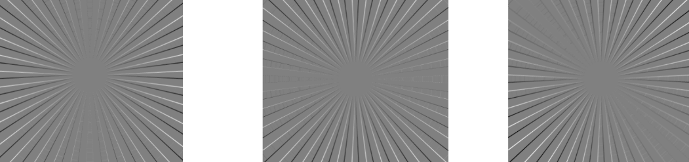

> 以 Gaussian filter 的 derivative (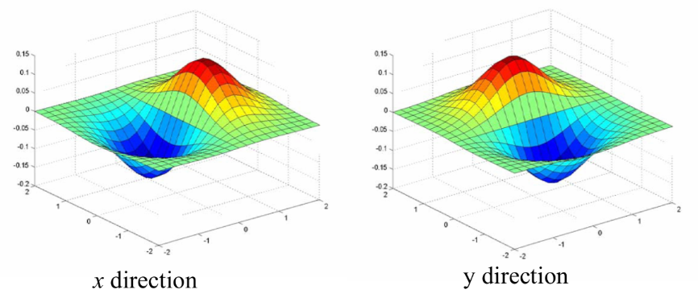)为例:
>
> 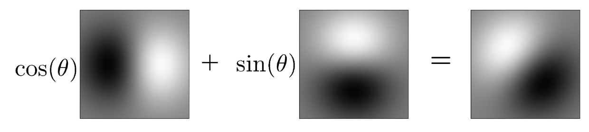

[^ 3]: Source: N.Snavely

#### higher-order derivative filters, 以及 Laplacian filter

首先, 我们来看一个方向上的二阶导的差分近似:

导两次, 那么 numerically 就是 apply 两次 derivative filter:
$$
[1,-1] *[1,-1]=[1,-2,1]
$$
和数值二阶导的经典近似 agree:
$$
\frac{\partial^2 f}{\partial x^2}(x) \approx f(x-1)-2 f(x)+f(x+1)
$$

recall Laplacian 算子:
$$
\nabla^2 I=\frac{\partial^2 I}{\partial x^2}+\frac{\partial^2 I}{\partial y^2}
$$
我们要做出它的 filter (numerical 近似算子), 首先用一维二阶差分近似
$$
\frac{\partial^2 I}{\partial x^2} \approx I *[1,-2,1], \quad \frac{\partial^2 I}{\partial y^2} \approx I *[1,-2,1]^T
$$

所以二维 Laplacian 算子的差分近似即:

$$
\nabla^2 I \approx I *\left[\begin{array}{ccc}
0 & 1 & 0 \\
1 & -4 & 1 \\
0 & 1 & 0
\end{array}\right]
$$
所以 Laplacian filter 即:
$$
\left[\begin{array}{ccc}
0 & 1 & 0 \\
1 & -4 & 1 \\
0 & 1 & 0
\end{array}\right]
$$

> Laplacian filter 的效果: 度量“局部强度变化的变化率”, 也是用来检测 edges 和 blobs. 不过, 从算式中就可以看出: 它不受到方向的 bias (不过对于 noise 很敏感.)

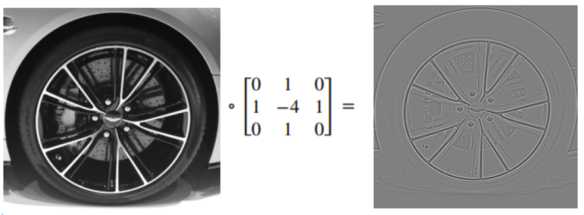

[^4]: Source: Torralba, Freeman, Isola

#### decomposing 一个 image, by Gaussian and Laplacian filtering

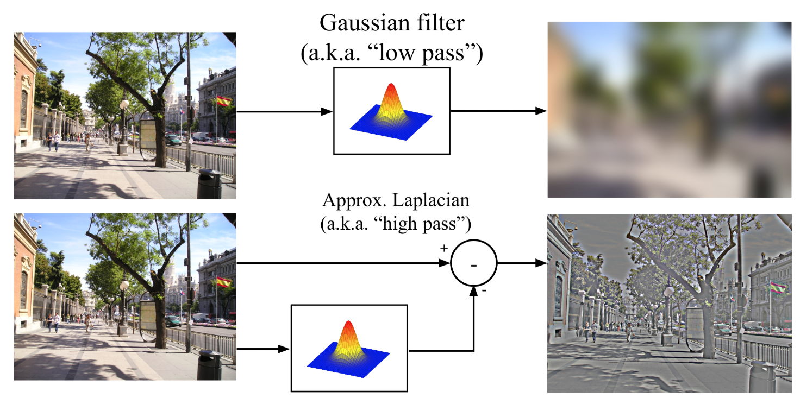

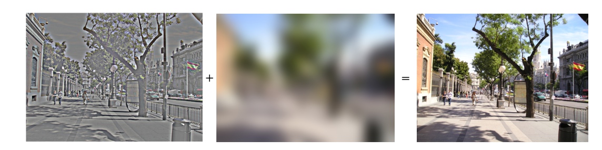
