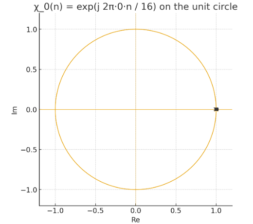
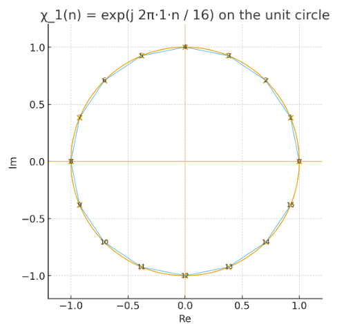
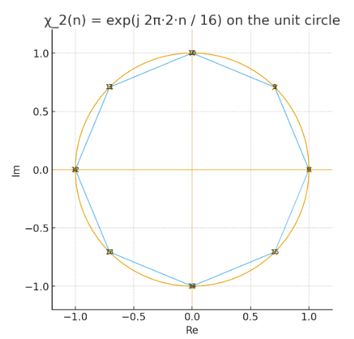
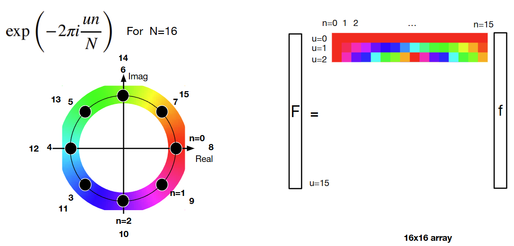
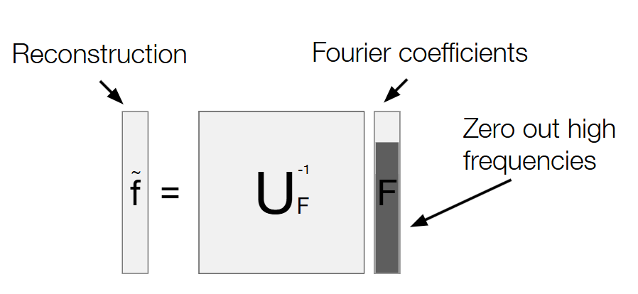

# Frequency and Fourier transform

我们已经 state: 图像可以被看作一个离散信号.

这里我们先简略讲解一下傅里叶变换. 着重将我们用得到的部分 (DFT)

## Fourier transform

### Fourier transform in general (代过, 详见 Fourier Analysis 笔记)

我们可能经常会看到各种形式的傅里叶变换, 尤其是对于 $f\in L^1(\mathbb{R})$ 的傅里叶变换, 以及 $f\in L^1( \mathbb{Z}_m^n)$ 的傅里叶变换 (即这里的图像作为一个函数 $f$); 但是很少看到解释: 为什么取频率函数的集合是不同的, 为什么累加 / 积分等等. 所以笔者这里先 state 一下 general 的理论.

最 general 的 def 与 properties 是: 

> Set Up:
>
> - 设 $G$ 是局部紧阿贝尔群 (Locally Compact Abelian group), together with 一个唯一的 Haar measure $\mu$.
>
> - 我们定义对偶群 $\widehat G$ 为所有连续的群同态 $\chi: G\to S^1$ (其中每个称为特征 (character)). 
>
>   注意: $\widehat G$ 本身亦是 LCA 群.
>
> - 对任意的 $f\in L^1(G,\mu)$ 定义 Fourier transform $\hat f: \hat{G} \to \mathbb{C}$
>   $$
>   \hat f(\chi) \;=\; \int_G f(x)\,\overline{\chi(x)}\, d\mu(x), \qquad \chi \in \widehat G
>   $$
>
> 则有以下定理:
>
> - **反演定理 (Fourier Inversion)**: 若 $f\in L^1(G)$ 且 $\widehat f\in L^1(\widehat G)$, 则几乎处处
>   $$
>   f(x)=\int_{\widehat{G}} \hat{f}(\chi) \chi(x) d \mu_{\widehat{G}}(\chi)
>   $$
>   其中 $d\mu_{\widehat G}$ 是 $\widehat G$ 上的 Haar 测度 (normalized).
>
>   这个定理即: **Fourier 逆变换**.
>
> - **Plancherel 定理**: 如果 $f \in L^2(G)$ , 则傅里叶变换扩展为一个 $L^2$ isometry:
>   $$
>   \int_G|f(x)|^2 d \mu(x)=\int_{\widehat{G}}|\hat{f}(\chi)|^2 d \mu_{\widehat{G}}(\chi)
>   $$
>   即任意的 $\|f\|_{L^2(G)}=\|\hat{f}\|_{L^2(\widehat{G})}$. 
>
>   在 $\mathbb{R}^n$ 上就是 Parseval 恒等式. 这个定理的现实意义是时域与频域的等距同构.

### Fourier transform on $G= \mathbb{R}$

$G= \mathbb{R}$ 时, 时最标准的傅里叶变换. 这个时候的对偶群  $\widehat G$  的每个元素是一个函数:
$$
\chi_{\xi}(x)=e^{2 \pi i   \xi x} = \cos (2 \pi \xi x)+i \sin (2 \pi \xi x)
$$
这个特征函数的性质:

- **对于所有的 $\xi$, 它的这个特征函数对于任意 $x$ 的取值的模都是 1,** 并且在有限区间上 (如 $[0,1]$ ) 存在正交性:
  $$
  \int_0^1 \chi_{\xi}(x) \overline{\chi_\eta(x)} d x=\int_0^1 e^{2 \pi i(\xi-\eta) x} d x= \begin{cases}1, & \xi=\eta, \\ 0, & \xi \neq \eta(\text { 若 } \xi, \eta \in \mathbb{Z}) .\end{cases}
  $$

- 具有乘法群结构:
  $$
  \chi_{\xi}(x) \cdot \chi_\eta(x)=\chi_{\xi+\eta}(x)
  $$

  $$
  \overline{\chi_{\xi}(x)}=\chi_{-\xi}(x)
  $$

在 Fourier 正变换里, 
$$
\hat{f}(\xi)=\int_{\mathbb{R}} f(x) e^{-2 \pi i \xi x} d x
$$

$\hat{f}(\xi)$ 的这个值, 这个积分运算即: 信号函数 $f$ 与频率模式 $\chi_{\xi}$ 的内积.

更加形象地说: 是函数 **$f$ 在频率模式 $\chi_{\xi}(x)=e^{2 \pi i \xi x}$ 上的投影**.

**对于每个频率模式 $\chi_{\xi}$, $f$ 在其上的投影系数 $\hat{f}(\xi)$ 都是一个 constant, 其模值表示这个频率模式在整个信号 $f$ 中的强度, 而其值包含了这个频率模式的相位 (辐角).**

而在傅里叶逆变换里, 
$$
f(x)=\int_{\mathbb{R}} \hat{f}(\xi) e^{2 \pi i \xi x} d \xi
$$

就是把所有频率成分加权叠加回来. 

就是说, 原函数是对偶群中的所有频率模式的加权积分, 每个频率模式的权重就是 $f$ 的 Fourier 变换 $\hat f$ 中, 这个频率模式 $\chi_\xi$ 的得分 $\hat f(\xi)$.

因而, 整个傅里叶变换其实就是**把一个函数 $f$ 给分解成一族振动模式 $\{\chi_\xi\}$ 关于 $\xi$ 的加权积分.** 

### What we are interested: DFT, 即 Fourier transform on $G = \mathbb{Z}_N$

对于 $G = \mathbb{Z}_N$, 即有限长度的时间 / 位置上, 对偶群 $\widehat G$ 的元素是所有群同态:
$$
\chi_k: n \mapsto e^{j 2 \pi k n / N}, \quad k=0,1, \ldots, N-1
$$

我们画出 $\chi_0, \chi_1, \chi_2$ 的图来演示:

我们已经从群论的角度解释: 它们是 $\mathbb{Z}_N$ 的 characters.

而

1. **线性代数解释**: 它们构成 $\mathbb{C}^N$ 的一组正交基
2. **信号处理解释**: 它是从连续傅里叶基 $e^{j\omega t}$ 离散化 (时间采样+有限窗口) 自然得到的

> 几何意义:
>
> $e^{j 2\pi kn/N}$ 表示的是单位圆上, 从角度 0 开始, 沿逆时针旋转了 $\tfrac{2\pi}{N}$ 的 $kn$ 倍；
>
> 对于每个 $k$, $\chi_k$ 都表示一个频率函数: 一个复正弦函数
> $$
> \chi_k: n \mapsto e^{j 2 \pi k n / N} =\cos\!\Big(\tfrac{2\pi k}{N}n\Big) + j \sin\!\Big(\tfrac{2\pi k}{N}n\Big)
> $$
>
>
> 在位置 $n=0, \cdots, N-1$ 的这几个采样点上, $e^{j 2\pi k n/N}$ 表示的是这个频率函数在位置 $n$ 上的值.
>
> 从欧拉公式来看：
>
> 所以它确实就是一个正弦/余弦波（复正弦波）。
>
> 对于每个 $n$, 取 $k=1$, 这个 $e^{j 2\pi n/N}$ 表示了单位圆上的一个旋转点 (所有点合起来是一个周期), 就是给这个时刻 $n$ 的 encodingc, 代表时刻 $n$ 代表的基本相位.
>
> 注意: 这个 encoding 不止是一个标签, 而是带有自然的顺序意义(阿贝尔群).  容易发现, 因为指数只依赖乘积 $kn \bmod N$, 时刻 $2$ 的旋转点以频率 $3$ 的速度旋转, 与时刻 $3$ 的旋转点以频率 $2$ 的速度旋转, 会落到单位圆上的同一点. 这是 DFT 的 **时间–频率对偶性**, 即时域和频域在有限维情形下是完全平等的.
>
> 所以说, 必须要依次映射. 如果打乱 (比如时间 $n=3$ 映射到 $e^{j 2\pi 2/N}$, 时间 $n=2$ 映射到 $e^{j 2\pi 3/N}$), 相当于对 DFT 矩阵的行进行了置换, 虽然频谱依然正确, 但是失去了其天然的几何意义. 
>
> 而固定 $n$, 在指数上乘上频率索引 $k$, 表示的就是这个旋转点在旋转速度为 $k$ 的时候, 旋转到的位置.  代表在这个频率上, 这个旋转点的相位. 
>
> - 时刻 $n$ 的信号 $x[n]$ 就是“对于旋转点 $n$, 所有频率分量上它在单位圆上的相位, 乘以这个频率分量的强度 $X[k]$, 再加权合成”的结果. 

从而 general 的傅里叶变换在这个情景可以简化得到**离散傅里叶变换 (DFT) **为: 
$$
X[k]= X(e^{-j2\pi k / N}) = \sum_{n=0}^{N-1} x[n]\,e^{-j2\pi kn/N},\quad x[n]=\frac{1}{N}\sum_{k=0}^{N-1} X[k]\,e^{j2\pi kn/N}
$$
这是在有限维空间 $\mathbb{C}^N$ 上用基 $\{e^{j2\pi kn/N}\}_{k=0}^{N-1}$ 做系数投影, 即一个可以用矩阵来表达的简单线性映射. 

对于一维离散信号而言, 傅里叶变换的现实意义非常好理解: 

- $x(n)$ 是 intensity (overtime), 表示在时间/位置 $t$ 上信号的强度多大
- $X[k]$ 是 frequency, 表示信号在 “第 $k$ 个频率分量” 上的强度有多大. 

如果写成向量: 

- 信号 $\mathbf{x} = (x[0], x[1], \dots, x[N-1])^\top \in \mathbb{C}^N$
- 频谱 $\mathbf{X} = (X[0], X[1], \dots, X[N-1])^\top \in \mathbb{C}^N$
- DFT 矩阵 $F = \big( e^{-j2\pi kn/N}\big)_{k,n=0}^{N-1}$

那么: 
$$
\mathbf{X} = F \mathbf{x}, \qquad  \mathbf{x} = \frac{1}{N} F^H \mathbf{X}
$$
即, 得到了一个用频率基函数的线性组合来表达强度函数的方法. 任意时间/位置上的信号强度 $x(n)$ 都可以通过: 

- 所有频率分量上的信号强度的大小 $\mathbf{X}$ 

和

- 此时刻 $n$ 所有频率基函数的取值 $\phi_n = \big( e^{j2\pi 0\cdot n/N},\; e^{j2\pi 1\cdot n/N},\; \dots,\; e^{j2\pi (N-1)\cdot n/N} \big)^\top$

的内积 $x[n] = \frac{1}{N}\langle \mathbf{X}, \, \phi_n\rangle$ 来表达.

这个 $e^{j2\pi kn/N}$ 看着很烦, 它有另一个形式: 
$$
e^{j2\pi kn/N} = \cos\!\Big(\tfrac{2\pi kn}{N}\Big) + j \sin\!\Big(\tfrac{2\pi kn}{N}\Big)
$$
这就是 Fourier transform 的核心思想: **把任何函数 (实际上限制于 $f \in L^1(G,\mu)$, 不过离散的肯定是) 转化成一堆正弦波和余弦波的线性组合.**

### Fourier transform on $G=\mathbb{Z}_M\times\mathbb{Z}_N$

这里就是我们的情况! 

图像是一个离散二维信号, 也就是一个矩阵, 也就是一个函数 (之前说过):
$$
I: \mathbb{Z}_M \times \mathbb{Z}_N \rightarrow \mathbb{R}^3
$$

我们先具体地看一维离散信号的傅里叶变换: 

### Applications in image 

而我们现在看回 “image” 这个信号: 

二维信号 $I(x,y)$ 的傅里叶变换 $X(f_x,f_y)$ 中, 频率是向量 $(f_x,f_y)$. $|X|$ 的位置给出方向 (纹理方向) 与尺度 (条纹密度) . 

[^]: Source: Torralba, Freeman, Isola

